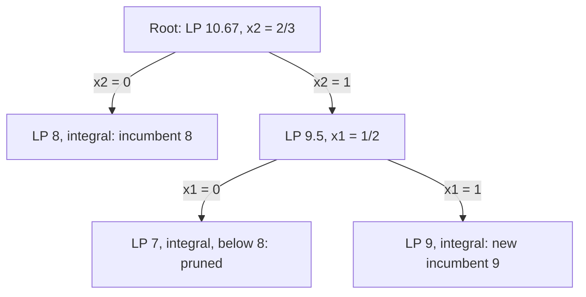
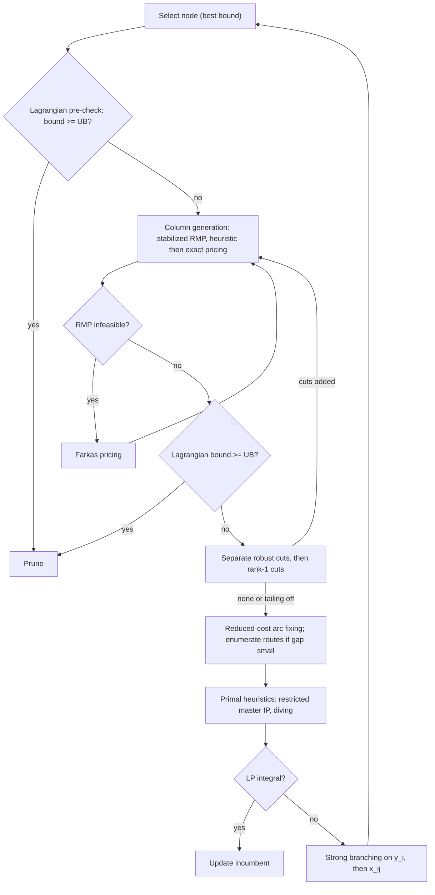

# Branch-Price-and-Cut: Consolidated Report

Theory, history, components, parameters, the WSmart-Route implementation, and a research agenda for a BPC for the capacitated profitable tour problem with time windows and time constraints (CPTP-TW-TC / CPTPTW-TC / CPTP-RCTW).

Consolidated on 1 November 2026 from four reports that were previously separate files in this directory. Nothing was summarized away: every paragraph, table, equation, code block, diagram, citation and link of the sources appears below, moved under the topic it belongs to and tagged with its source. Where the sources disagree, both statements are kept and the disagreement is recorded in the “Cross-source notes” at the end of the section.

## Contents

- [About this report](#about-this-report)
  - [Sources](#sources)
  - [How to read this report](#how-to-read-this-report)
  - [Clean-ups applied during the merge](#clean-ups-applied-during-the-merge)
- [Overview and terminology](#overview-and-terminology)
  - [[WR] Branch-and-price-and-cut in WSmart-Route](#wr-branch-and-price-and-cut-in-wsmart-route)
  - [[FG] §0 Map of the territory](#fg-0-map-of-the-territory)
  - [[DR] Executive synthesis and terminology](#dr-executive-synthesis-and-terminology)
- [History and lineage](#history-and-lineage)
  - [[FG] §1 History, 1954–2026](#fg-1-history-19542026)
  - [[DR] Historical lineage from branch-and-bound to branch-price-and-cut](#dr-historical-lineage-from-branch-and-bound-to-branch-price-and-cut)
  - [[AA] 5. Comprehensive Synthesis of BPC: History, Problem Applications, and Parameter Tuning](#aa-5-comprehensive-synthesis-of-bpc-history-problem-applications-and-parameter-tuning)
  - [Cross-source notes: History and lineage](#cross-source-notes-history-and-lineage)
- [The parent algorithms: branch-and-bound, branch-and-cut, branch-and-price](#the-parent-algorithms-branch-and-bound-branch-and-cut-branch-and-price)
  - [[AA] 1. Genealogical Origins: From Branch-and-Bound to Polyhedral and Decomposition Hybrids](#aa-1-genealogical-origins-from-branch-and-bound-to-polyhedral-and-decomposition-hybrids)
  - [[FG] §2 Branch-and-bound: what it does and how](#fg-2-branch-and-bound-what-it-does-and-how)
  - [[AA] 1.1 The Branch-and-Bound Paradigm: Land and Doig's Geometric Hyperplane Shifting](#aa-11-the-branch-and-bound-paradigm-land-and-doigs-geometric-hyperplane-shifting)
  - [[DR] Branch-and-bound, bounds and pruning (from “Historical lineage”)](#dr-branch-and-bound-bounds-and-pruning-from-historical-lineage)
  - [[WR] Where branch-and-bound sits](#wr-where-branch-and-bound-sits)
  - [[FG] §4 Branch-and-cut](#fg-4-branch-and-cut)
  - [[AA] 1.2 The Branch-and-Cut Paradigm: Polyhedral Outer Approximation and Separation Hierarchies](#aa-12-the-branch-and-cut-paradigm-polyhedral-outer-approximation-and-separation-hierarchies)
  - [[DR] Cutting planes and branch-and-cut (from “Historical lineage”)](#dr-cutting-planes-and-branch-and-cut-from-historical-lineage)
  - [[AA] 1.3 The Branch-and-Price Paradigm: Dantzig-Wolfe Convexification and Dual Pricing](#aa-13-the-branch-and-price-paradigm-dantzig-wolfe-convexification-and-dual-pricing)
  - [[DR] Dantzig–Wolfe decomposition, column generation and branch-and-price (from “Historical lineage”)](#dr-dantzigwolfe-decomposition-column-generation-and-branch-and-price-from-historical-lineage)
  - [[DR] From branch-and-price to branch-price-and-cut (from “Historical lineage”)](#dr-from-branch-and-price-to-branch-price-and-cut-from-historical-lineage)
- [Master problem, column generation and pricing](#master-problem-column-generation-and-pricing)
  - [[FG] §5 Branch-and-price and column generation](#fg-5-branch-and-price-and-column-generation)
  - [[DR] Mathematical anatomy of a BPC solver](#dr-mathematical-anatomy-of-a-bpc-solver)
  - [[AA] 2. The Mechanics of Column Generation and Pricing Oracles](#aa-2-the-mechanics-of-column-generation-and-pricing-oracles)
  - [[WR] From branch-and-bound to branch-and-price-and-cut](#wr-from-branch-and-bound-to-branch-and-price-and-cut)
  - [[FG] §6 Pricing in depth: labeling and its alternatives](#fg-6-pricing-in-depth-labeling-and-its-alternatives)
  - [[AA] 4.3 Advanced Labeling Architectures: Bidirectional Search, Bucket Graphs, and Dynamic Discretization](#aa-43-advanced-labeling-architectures-bidirectional-search-bucket-graphs-and-dynamic-discretization)
  - [[WR] Pricing, including Farkas pricing](#wr-pricing-including-farkas-pricing)
  - [Cross-source notes: Master problem, column generation and pricing](#cross-source-notes-master-problem-column-generation-and-pricing)
- [Relaxations and bounds](#relaxations-and-bounds)
  - [[FG] §3 Relaxations and bounds](#fg-3-relaxations-and-bounds)
  - [[AA] 4. Relaxation Schemes and State-Space Reduction in Pricing](#aa-4-relaxation-schemes-and-state-space-reduction-in-pricing)
  - [[DR] Elementary versus relaxed route pricing (from “Pricing, route relaxations, cutting planes, and branching in depth”)](#dr-elementary-versus-relaxed-route-pricing-from-pricing-route-relaxations-cutting-planes-and-branching-in-depth)
  - [[DR] Lagrangian relaxation (from “Pricing, route relaxations, cutting planes, and branching in depth”)](#dr-lagrangian-relaxation-from-pricing-route-relaxations-cutting-planes-and-branching-in-depth)
  - [[DR] Reduced-cost resource-window reduction (from “Pricing, route relaxations, cutting planes, and branching in depth”)](#dr-reduced-cost-resource-window-reduction-from-pricing-route-relaxations-cutting-planes-and-branching-in-depth)
  - [[WR] Relaxations](#wr-relaxations)
  - [Cross-source notes: Relaxations and bounds](#cross-source-notes-relaxations-and-bounds)
- [Cutting planes and valid inequalities](#cutting-planes-and-valid-inequalities)
  - [[FG] §7 Cut families and inequalities](#fg-7-cut-families-and-inequalities)
  - [[AA] 3. Polyhedral Cutting Planes in B&C and BPC: Robust vs. Non-Robust Inequalities](#aa-3-polyhedral-cutting-planes-in-bc-and-bpc-robust-vs-non-robust-inequalities)
  - [[DR] Robust and non-robust cuts, capacity, multistar, subset-row, k-path and lifted cover inequalities (from “Pricing, route relaxations, cutting planes, and branching in depth”)](#dr-robust-and-non-robust-cuts-capacity-multistar-subset-row-k-path-and-lifted-cover-inequalities-from-pricing-route-relaxations-cutting-planes-and-branching-in-depth)
  - [[WR] Cuts](#wr-cuts)
  - [Cross-source notes: Cutting planes and valid inequalities](#cross-source-notes-cutting-planes-and-valid-inequalities)
- [Branching, node assembly, stabilization and acceleration](#branching-node-assembly-stabilization-and-acceleration)
  - [[DR] Pricing, route relaxations, cutting planes, and branching in depth](#dr-pricing-route-relaxations-cutting-planes-and-branching-in-depth)
  - [[FG] §8 Assembling branch-price-and-cut](#fg-8-assembling-branch-price-and-cut)
  - [[DR] Exactness conditions (from “Mathematical anatomy of a BPC solver”)](#dr-exactness-conditions-from-mathematical-anatomy-of-a-bpc-solver)
  - [[DR] Branching (from “Pricing, route relaxations, cutting planes, and branching in depth”)](#dr-branching-from-pricing-route-relaxations-cutting-planes-and-branching-in-depth)
  - [[FG] §9 Acceleration toolkit](#fg-9-acceleration-toolkit)
  - [[AA] 2.3 Dual Stabilization: In-Out Separation, Wentges Smoothing, and Dual-Optimal Inequalities](#aa-23-dual-stabilization-in-out-separation-wentges-smoothing-and-dual-optimal-inequalities)
  - [[WR] What the two engines return](#wr-what-the-two-engines-return)
  - [Cross-source notes: Branching, node assembly, stabilization and acceleration](#cross-source-notes-branching-node-assembly-stabilization-and-acceleration)
- [Parameters](#parameters)
  - [[FG] §10 Parameters: typical values and your BPC](#fg-10-parameters-typical-values-and-your-bpc)
  - [[AA] 5.3 Algorithmic Components and Hyperparameter Engineering](#aa-53-algorithmic-components-and-hyperparameter-engineering)
  - [[DR] Interacting implementation parameters (from “A practical BPC architecture”)](#dr-interacting-implementation-parameters-from-a-practical-bpc-architecture)
  - [[WR] Parameters](#wr-parameters)
  - [Cross-source notes: Parameters](#cross-source-notes-parameters)
- [Applications and lessons from the literature](#applications-and-lessons-from-the-literature)
  - [[FG] §11 How BPC applies across problems](#fg-11-how-bpc-applies-across-problems)
  - [[AA] 5.2 Cross-Domain Applications and Structural Adaptations](#aa-52-cross-domain-applications-and-structural-adaptations)
  - [[DR] What the literature says about successful BPC design](#dr-what-the-literature-says-about-successful-bpc-design)
  - [[WR] How the same machine specializes](#wr-how-the-same-machine-specializes)
  - [Cross-source notes: Applications and lessons from the literature](#cross-source-notes-applications-and-lessons-from-the-literature)
- [A BPC for the CPTP with time windows and time constraints](#a-bpc-for-the-cptp-with-time-windows-and-time-constraints)
  - [[WR] Three problems that share a name](#wr-three-problems-that-share-a-name)
  - [[FG] §12 A BPC for the CPTP with time windows and time constraints](#fg-12-a-bpc-for-the-cptp-with-time-windows-and-time-constraints)
  - [[AA] 6. Frontier Research Blueprint: Designing a Next-Generation BPC for the Capacitated Profitable Tour Problem with Time Windows and Time Constraints (CPTP-TW-TC)](#aa-6-frontier-research-blueprint-designing-a-next-generation-bpc-for-the-capacitated-profitable-tour-problem-with-time-windows-and-time-constraints-cptp-tw-tc)
  - [[DR] A practical BPC architecture for a CPTP with time windows and time constraints](#dr-a-practical-bpc-architecture-for-a-cptp-with-time-windows-and-time-constraints)
  - [[DR] Implementation frameworks (from “A practical BPC architecture”)](#dr-implementation-frameworks-from-a-practical-bpc-architecture)
- [Research agenda](#research-agenda)
  - [[DR] A research-grade BPC design specifically for the CPTP-TW-TC](#dr-a-research-grade-bpc-design-specifically-for-the-cptp-tw-tc)
  - [[FG] §13 Research agenda: new components](#fg-13-research-agenda-new-components)
  - [[AA] 6.2 Five Promising Frontier Research Ideas and Novel BPC Components](#aa-62-five-promising-frontier-research-ideas-and-novel-bpc-components)
  - [[DR] Promising future research agenda and an experimental roadmap](#dr-promising-future-research-agenda-and-an-experimental-roadmap)
  - [[WR] A research program for a BPC on the capacitated PTP with time windows and time constraints](#wr-a-research-program-for-a-bpc-on-the-capacitated-ptp-with-time-windows-and-time-constraints)
  - [Cross-source notes: Research agenda](#cross-source-notes-research-agenda)
- [Experimental protocol and roadmap](#experimental-protocol-and-roadmap)
  - [[FG] §14 Experimental protocol for the new BPC](#fg-14-experimental-protocol-for-the-new-bpc)
  - [[DR] Staged development and experimental matrix (from “Promising future research agenda and an experimental roadmap”)](#dr-staged-development-and-experimental-matrix-from-promising-future-research-agenda-and-an-experimental-roadmap)
- [Conclusions](#conclusions)
  - [[AA] 7. Conclusions](#aa-7-conclusions)
  - [[DR] The end-state algorithm (from “Promising future research agenda and an experimental roadmap”)](#dr-the-end-state-algorithm-from-promising-future-research-agenda-and-an-experimental-roadmap)
- [References and reading list](#references-and-reading-list)
  - [[FG] §15 Reading list](#fg-15-reading-list)
  - [[AA] Works cited](#aa-works-cited)
  - [Cross-source notes: References and reading list](#cross-source-notes-references-and-reading-list)

## About this report

### Sources

| Tag | Former file | Title as written in the source | Date / framing |
| --- | --- | --- | --- |
| [FG] | `Branch-Price-and-Cut Field Guide.md` | Branch-Price-and-Cut Field Guide — From branch-and-bound to modern branch-cut-and-price (BPC): bounds, relaxations, pricing, cuts, branching, acceleration and parameters, with a research agenda for a BPC for the capacitated profitable tour problem with time windows and time constraints (CPTPTW-TC). | Exact methods for routing with profits · October 2026; Written for WSmart Route+ · Notation: minimization unless stated · Problem: CPTPTW-TC |
| [AA] | `Branch-and-Price-and-Cut Algorithm Analysis.md` | Theoretical Foundations, Algorithmic Architecture, and Frontier Extensions of Branch-Price-and-Cut | Undated long-form analysis |
| [WR] | `bpc-report.md` | Branch-and-price-and-cut in WSmart-Route | Dated 2026-10-27 (see its first block) |
| [DR] | `deep-research-report.md` | Branch-Price-and-Cut: Theory, Origins, Components, and a Research Blueprint for Capacitated Profitable Tour Problems with Time Windows | Undated; mentions an October 14, 2026 preprint, so written after that date |

A fifth BPC file in this directory, [`bpc_guide.pdf`](bpc_guide.pdf), is a typeset 27-page guide. It was kept as a separate companion document because its figures and typesetting cannot be carried into Markdown without loss.

### How to read this report

- Each topical section opens with a short orientation, then holds the source passages on that topic, each under a heading tagged **[FG]**, **[AA]**, **[DR]** or **[WR]** and followed by an italic line giving the former file and line range.
- Section numbers inside passages refer to the numbering of that passage’s own source: “§3” is Field Guide §3, “4.2” is Algorithm Analysis 4.2.
- Sign conventions differ. [FG] uses minimization unless stated; [WR] writes the objective as a maximization of prize minus cost; [DR] states maximization in some passages and minimization in others, and says so locally. Bounds and dual signs therefore flip between passages; the Cross-source notes flag the places where this matters.
- [WR] is an audit of the code on `main` and of the BPC manuscript; [FG] references to “your BPC” and to Table 8/Appendix D of the simulator paper describe the same solver from the paper side.
- Math is kept in the notation each source used. [FG] and [AA] passages contain escaped LaTeX from their original export and may not render as math on every viewer.

### Clean-ups applied during the merge

- Removed 56 export artifacts of the form `[span_N](start_span)` / `[span_N](end_span)` from [AA]; they carried no content.
- Removed the bold markup and backslash escapes from [AA] headings, and inserted the missing space after section numbers in [FG] headings (“§0Map” → “§0 Map”, “R1Regime” → “R1 Regime”).
- Rendered 65 [FG] call-out titles (for example “Mechanism”, “Why”, “Test”, “Risk”, “Practice”) in bold, since the original boxes were lost in export.
- Replaced the [FG] contents list (16 anchor links to the old file) by the contents of this report; restored separators in the [FG] framing line.
- Demoted source headings so that each source passage sits under one topical section. No sentence was reworded.
- Some [AA] table rows were already broken in the source (cell text cut at a `|` inside math). They are kept as they were; the Cross-source notes point them out.

## Overview and terminology

What BPC is, which three algorithmic lines it inherits, and how the repository uses the term. Each source defines BPC in its own words; the definitions agree, and all are kept.

### [WR] Branch-and-price-and-cut in WSmart-Route

*Source: WSmart-Route audit (`bpc-report.md`), lines 1–5.*

Date: 2026-10-27. Read-only account of the solver on `main` and of the manuscript `assets/papers/BPC-for-the-Capacitated-PTP-with-Resource-Constraints-and-Time-Windows/paper.tex`. No production files were changed to produce this note.

Branch-and-price-and-cut, as this repository and its manuscript define it, is a branch-and-bound tree whose node bound is a column-generation linear program, tightened by cuts whose duals are pushed back into the pricing problem. The manuscript designs that machine for the capacitated profitable tour problem with resource constraints and time windows (CPTP-RCTW). The code that runs today is the same skeleton on a smaller problem: a capacitated profitable tour with no clock.

### [FG] §0 Map of the territory

*Source: Field Guide (`Branch-Price-and-Cut Field Guide.md`), lines 28–42.*

Branch-price-and-cut (BPC), also called branch-cut-and-price (BCP), is LP-based branch-and-bound in which the LP at every node is solved by *column generation* (pricing) and strengthened by *cutting planes* (separation). It inherits three lines of work:

- **Branch-and-bound** (Land & Doig, 1960) supplies the enumeration tree, pruning by bounds and the incumbent.
- **Branch-and-cut** (Padberg & Rinaldi, 1987–1991) supplies dynamic separation of valid inequalities to tighten the relaxation at each node.
- **Branch-and-price** (Desrochers, Desrosiers & Solomon, 1992; Barnhart et al., 1998) supplies Dantzig–Wolfe reformulations with exponentially many columns, generated on demand by a pricing subproblem.

Lagrangian relaxation, state-space relaxation (q-routes, ng-routes) and dual stabilization sit underneath all three. They decide how strong and how cheap each bound is.

**The one-line idea**

Every node of the tree computes a bound \\(z\_{\\text{LB}}\\). Pricing makes the LP *bigger* (more columns), which can only lower the LP value in a minimization. Cutting makes the LP *smaller* (more rows), which can only raise it. A node is closed when its bound proves it cannot beat the incumbent, \\(z\_{\\text{LB}} \\ge z\_{\\text{UB}}\\). Everything else in this guide is about getting a strong \\(z\_{\\text{LB}}\\) quickly.

The rest of the guide follows the inheritance order: history (§1), the three parent algorithms (§2, §4, §5), the relaxations they rely on (§3), then pricing and cuts in detail (§6–§7), how they fit together (§8), acceleration techniques and parameters (§9–§10), other problems (§11), and finally a design and research agenda for the CPTPTW-TC (§12–§14).

### [DR] Executive synthesis and terminology

*Source: Deep-research report (`deep-research-report.md`), lines 3–58.*

**Branch-Price-and-Cut (BPC)**—also written **Branch-and-Price-and-Cut**, **Branch-Cut-and-Price**, or **Branch-Cut-and-Price (BCP)**—is best understood not as one algorithm but as an exact optimization architecture combining three ideas:

\[
\boxed{\text{Branch-and-Bound}+\text{Column Generation}+\text{Cutting Planes}}
\]

The names “branch-price-and-cut” and “branch-cut-and-price” normally describe the same fundamental machinery; different papers emphasize a different ordering of operations. Fukasawa et al.'s influential CVRP algorithm uses the term *robust branch-and-cut-and-price*, whereas Jepsen et al. describe a *branch-and-cut-and-price* algorithm for the VRPTW, and more recent routing papers commonly use BPC or BCP interchangeably. citeturn15search0turn15search2turn22search23

At a high level:

\[
\text{BPC}
=
\underbrace{\text{tree search}}_{\text{branch}}
+
\underbrace{\text{dynamic variables}}_{\text{price}}
+
\underbrace{\text{dynamic constraints}}_{\text{cut}}.
\]

That compact definition hides most of the difficulty. A serious BPC solver also needs a strong Dantzig–Wolfe reformulation, an efficient resource-constrained shortest-path engine, dual stabilization, feasibility/Farkas pricing, specialized dominance rules, route relaxations such as \(ng\)-routes, a separation engine for robust and nonrobust inequalities, pricing-compatible branching rules, primal heuristics, variable fixing, preprocessing, numerical safeguards, and careful coordination of all these components. The success of generic frameworks such as VRPSolver demonstrates how mature this architecture has become for vehicle-routing problems, while also showing that the difficult part is no longer merely “doing column generation”: it is orchestrating all of these ingredients efficiently. citeturn19search0turn22search4

For your intended problem, there is one **very important modeling distinction**.

The classical **Profitable Tour Problem (PTP)** chooses a subset of vertices and a tour so that collected profit is traded against routing cost. Dell'Amico, Maffioli, and Värbrand introduced the name in 1995 in a prize-collecting-tour context. citeturn16search1 The **Capacitated Profitable Tour Problem (CPTP)** adds capacity restrictions; Archetti et al. studied the CPTP together with the capacitated team-orienteering problem. citeturn16search2 There is also a direct branch-and-cut treatment of the CPTP by Jepsen et al. citeturn16search3 Sun et al. later considered a particularly close relative of your proposed target: a **time-dependent capacitated profitable tour problem with time windows and precedence constraints**. citeturn22search0

A classical single-vehicle CPTP is therefore conceptually different from a classical VRP:

\[
\text{VRP: choose a collection of routes serving all required customers}
\]

versus

\[
\text{PTP: choose which customers are worth serving and how to connect them in a tour}.
\]

This matters because **route-based BPC is most naturally powerful when many complete routes must be chosen from an exponentially large set**. If your problem literally contains one vehicle and exactly one tour, a direct branch-and-cut or a specialized elementary resource-constrained path/tour algorithm may be simpler. If instead you have several vehicles, several tours, multi-trip operation, shifts, route-duration limits, heterogeneous resources, or assignment decisions, then BPC becomes exceptionally natural. The route-based decomposition can simultaneously decide **which profitable customers to serve** and **which feasible routes should serve them**. Exact BPC has been successful precisely on rich routing models in which the compact arc formulation becomes weak or unwieldy. citeturn17search11turn19search0turn21search19

For the remainder of this report I therefore treat your proposed target as a generalized **CPTP-TW-TC**:

\[
\text{Capacitated Profitable Tour/Routing Problem with Time Windows and Time Constraints},
\]

where customers may be optional, each carries a profit, vehicles have finite capacity, service must satisfy time windows, and routes may additionally face a maximum duration, working-time limit, time-dependent travel, precedence requirements, or related temporal constraints. I distinguish throughout between the **single-tour** and **multi-route** cases.

The central conclusion of the literature is:

> A promising CPTP-TW BPC should not simply copy a VRPTW BPC and add customer profits. Its most interesting research opportunity is to make **customer selection, route pricing, temporal feasibility, cuts, and branching interact explicitly**.

In particular, I would build the new method around five ideas: a **selection-aware set-packing/set-partitioning master**, **profit-aware ESPPRC pricing with adaptive \(ng\)-route/DSSR relaxations**, a **two-tier robust/nonrobust cut system**, **selection-first followed by cluster/arc branching**, and a **pricing-for-integrality/primal-search mechanism** designed for optional customers. Recent developments in cluster branching, learning-to-branch, pricing for integrality, resource-window reduction, and learned column prefilling make this a particularly promising direction in 2026. citeturn17search1turn22search7turn17search3turn15search23turn22academia26

## History and lineage

Milestones from 1954 to 2026. The Field Guide gives a dated list, the deep-research report a period table, and the Algorithm Analysis a four-era narrative with recent software.

### [FG] §1 History, 1954–2026

*Source: Field Guide (`Branch-Price-and-Cut Field Guide.md`), lines 44–104.*

The milestones below are the ones that changed what a BPC looks like in practice. The TSP and the VRP drove most of them.

- 1954

  **Dantzig, Fulkerson & Johnson** solve a 49-city TSP with LP plus hand-added subtour-elimination cuts: the first cutting-plane proof of optimality.
- 1958

  **Ford & Fulkerson** propose generating path variables on demand for multicommodity flow, the first column generation. **Gomory** publishes fractional cuts for pure integer programs.
- 1960

  **Land & Doig** introduce LP-based branch-and-bound. **Dantzig & Wolfe** publish their decomposition principle.
- 1961–63

  **Gilmore & Gomory** apply column generation to cutting stock, with a knapsack as pricing problem. **Little, Murty, Sweeney & Karel** coin "branch and bound" for the TSP (1963). **Dakin** (1965) gives the variable-dichotomy branching used today.
- 1970–71

  **Held & Karp** bound the TSP with Lagrangian 1-trees and subgradient optimization.
- 1974–81

  **Geoffrion** (1974) characterizes the Lagrangian dual bound. **Fisher** (1981) popularizes Lagrangian relaxation. **Christofides, Mingozzi & Toth** (1981) introduce q-routes and state-space relaxation for the VRP.
- 1983–91

  **Crowder, Johnson & Padberg** (1983) show lifted cover inequalities make large 0-1 programs solvable. **Padberg & Rinaldi** solve a 532-city TSP (1987) and name the method branch-and-cut (1991).
- 1992

  **Desrochers, Desrosiers & Solomon** solve the VRPTW by column generation with a shortest path problem with resource constraints (SPPRC) as pricing problem, inside branch-and-bound.
- 1996–98

  **Vanderbeck & Wolsey** (1996) and **Barnhart, Johnson, Nemhauser, Savelsbergh & Vance** (1998) formalize branch-and-price and branching rules compatible with pricing.
- 1999

  **Kohl, Desrosiers, Madsen, Solomon & Soumis** add 2-path cuts to VRPTW column generation, an early branch-price-and-cut.
- 2004

  **Feillet, Dejax, Gendreau & Gueguen** give an exact labeling algorithm for the elementary SPPRC (ESPPRC). **Baldacci, Hadjiconstantinou & Mingozzi** publish the two-commodity flow formulation.
- 2006

  **Fukasawa et al.** combine q-route pricing with capacity cuts in a robust BCP for the CVRP. They define robust cuts, whose duals project onto arc costs and leave the pricing problem unchanged. **Righini & Salani** introduce bidirectional labeling.
- 2007–08

  **Boussier, Feillet & Gendreau** (2007): first exact B&P for the team orienteering problem (TOP), a routing-with-profits problem. **Jepsen, Petersen, Spoorendonk & Pisinger** (2008): subset-row cuts, the first widely used non-robust cuts. **Righini & Salani** (2008): decremental state-space relaxation (DSSR). **Baldacci, Christofides & Mingozzi** (2008): route enumeration once the gap is small.
- 2011

  **Baldacci, Mingozzi & Roberti** introduce ng-routes, which became the standard partially elementary pricing.
- 2013–14

  **Archetti, Bianchessi & Speranza** (2013): B&P for the CPTP and capacitated TOP. **Jepsen, Petersen, Spoorendonk & Pisinger** (2014): branch-and-cut for the CPTP with rounded multistar inequalities, solving 800-node instances where dynamic programming stalled near 200.
- 2017

  **Pecin, Pessoa, Poggi & Uchoa** introduce limited-memory rank-1 cuts, which made a CVRP BCP solve every classic instance up to 199 customers. **Pecin, Contardo, Desaulniers & Uchoa** bring the same machinery to the VRPTW.
- 2018–21

  Automatic dual-smoothing stabilization (Pessoa et al., 2018). Diving primal heuristics (Sadykov et al., 2019). **VRPSolver**, a generic BCP for VRP variants (Pessoa, Sadykov, Uchoa & Vanderbeck, 2020). Bucket-graph labeling (Sadykov, Uchoa & Pessoa, 2021). Survey of exact BPC for routing (Costa, Contardo & Desaulniers, 2019).
- 2021–23

  Machine-learning column selection (Morabit, Desaulniers & Lodi, 2021) and arc selection for pricing networks (2023, up to 40% less time on VRPTW).
- 2024–26

  Textbooks: *Optimizing with Column Generation*, Part I (Uchoa, Pessoa & Moreno, 2024) and *Branch-and-Price* (Desrosiers, Lübbecke, Desaulniers & Gauthier; GERAD report 2024, open-access Springer book 2026). BPC with ng-paths, subset-row cuts and a Lagrangian bound for a time-dependent TOPTW (Peng et al., EJOR 2025). Bidirectional labeling for a VRPTW with flexible departures and route-duration limits (Lichau, 2025 talk). An open, reproducible CPTP branch-and-cut in which capacity-class cuts give almost all the benefit, while combs, rounded generalized large multistars and reduced-cost fixing show no measurable gain (Spoorendonk, arXiv 2607.04497, 2026). A bucket-graph meta-solver refactoring of VRPSolver's pricer (2026 preprint).

### [DR] Historical lineage from branch-and-bound to branch-price-and-cut

*Source: Deep-research report (`deep-research-report.md`), lines 60–72.*

BPC is easiest to understand chronologically because virtually every one of its modern components arose as a response to a specific weakness of an earlier exact method.

| Period | Development | Why it matters for BPC |
|---|---|---|
| 1958–1960 | Gomory cutting planes; Land–Doig branch-and-bound; Dantzig–Wolfe decomposition | Established the three intellectual roots: dynamic constraints, tree search, and decomposition |
| 1961–1963 | Gilmore–Gomory cutting stock; Little et al. TSP B&B | Demonstrated practical generation of missing columns and combinatorial branching |
| 1980s–1990s | Polyhedral routing, Lagrangian routing methods, route-based formulations | Developed stronger bounds and resource-constrained path subproblems |
| late 1990s | Modern branch-and-price and VRPTW cuts | Column generation became integrated with integer search |
| 2000s | Robust BCP, ESPPRC algorithms, subset-row cuts | BPC became a state-of-the-art exact routing paradigm |
| 2010s | \(ng\)-routes, limited-memory cuts, stronger pricing, generic solvers | Large improvement in pricing/cutting efficiency |
| 2020s | Bucket graphs, reduced-cost resource windows, enumeration, learning, cluster branching | Focus shifted toward component interaction, integer solutions, and adaptive algorithms |

### [AA] 5. Comprehensive Synthesis of BPC: History, Problem Applications, and Parameter Tuning

*Source: Algorithm Analysis (`Branch-and-Price-and-Cut Algorithm Analysis.md`), lines 189–196.*

#### 5.1 Historical Evolution of Exact Decomposition Solvers (1960–2026)

The trajectory of exact integer programming decomposition spans four distinct methodological eras. In the first era of foundational decomposition and polyhedral theory (1960–1989), Dantzig and Wolfe (1960) introduced LP column generation concurrently with Land and Doig's (1960) B\&B algorithm and Gomory's (1958) cutting planes. Gilmore and Gomory (1961–1963) solved LP relaxations of cutting stock via knapsack pricing, Appelgren (1969) first attempted column generation for integer ship scheduling, Geoffrion (1974) established the theoretical equivalence between Lagrangian duality and Dantzig-Wolfe bounds, Ryan and Foster (1981) introduced set-partitioning pair branching, and Desrosiers, Soumis, and Desrochers (1984) developed the first B\&P for the VRPTW.  
During the second era of formalized Branch-and-Price and early BPC (1990–2005), Nemhauser and Park (1991) published the first combined row-and-column generation algorithm for edge coloring, while Desrochers, Desrosiers, and Solomon (1992) established the classic 2-cycle-free B\&P for VRPTW. Vanderbeck and Wolsey (1994, 1996, 2000\) and Barnhart, Johnson, Nemhauser, Savelsbergh, and Vance (1998) unified the mathematical theory of B\&P, and Barnhart, Hane, and Vance (2000) demonstrated the power of robust BPC using LCI cuts and divergence-node branching on ODIMCF. Concurrently, Wentges (1997) and du Merle et al. (1999) introduced dual stabilization.  
In the third era of robust BPC, non-robust SRIs, and ng-routes (2006–2016), Fukasawa et al. (2006) coined **Robust BPC** for the CVRP, combining edge-space capacity, comb, and multistar cuts (from Lysgaard et al. 2004\) with q-route pricing to solve all literature instances up to 134 customers. Jepsen et al. (2008) introduced non-robust **Subset-Row Inequalities (SRIs)**, and Baldacci, Mingozzi, and Roberti (2008, 2011\) introduced **ng-route relaxation**, dual ascent heuristics, and elementary route pool enumeration when the dual gap becomes small.  
In the fourth and current era of limited-memory cuts, bucket graphs, and generic solvers (2017–2026), Pecin, Pessoa, Poggi, and Uchoa (2017) introduced **Limited-Memory Rank-1 Cuts (lm-SRCs / lm-R1Cs)**, expanding the frontier of solvable CVRP and VRPTW instances from 150 to over 360 customers. Sadykov, Uchoa, and Pessoa (2021) introduced **Bucket-Graph Labeling**, and Pessoa, Sadykov, Uchoa, and Vanderbeck (2020) synthesized all these advances into **VRPSolver** (alongside the Python interface VRPSolverEasy in 2024 and the open-source modular solver **RouteOpt** in 2025–2026) via the unified abstractions of Packing Sets and Elementarity Sets. Between 2024 and 2026, open-source SPPRC libraries (PathWyse and bucket-graph-spprc / bgspprc, which outperforms PathWyse by 1.3\\times–2.35\\times in shifted geometric mean), reproducible CPTP B\&C benchmarks (cptp on HiGHS), functional labeling for bivariate time-varying profits, and machine-learning-guided Deep DOIs have defined the contemporary state of the art.

### Cross-source notes: History and lineage

- Irnich & Villeneuve, k-cycle elimination in the ESPPRC: [FG] dates it 2006, [AA] 2005.
- First branch-and-price for the VRPTW: [AA] credits Desrosiers et al. (1984); [FG] credits Desrochers, Desrosiers & Solomon (1992). The 1984 work is column generation for routing with time windows; the 1992 paper is the VRPTW algorithm usually cited as the first B&P for that problem. Both attributions are kept.
- The state of the art for exact VRPTW/CVRP: [FG] cites Pecin et al. solving instances with up to 199 customers; [AA] describes the frontier moving from about 150 to 360+ customers. The figures refer to different instance classes and years and are not necessarily in conflict.

## The parent algorithms: branch-and-bound, branch-and-cut, branch-and-price

Branch-and-bound first (the Field Guide worked example, Land and Doig, the deep-research definitions, and how `search_bpc_tree` implements the tree), then branch-and-cut, then Dantzig–Wolfe/column generation and branch-and-price, and finally the step to BPC.

### [AA] 1. Genealogical Origins: From Branch-and-Bound to Polyhedral and Decomposition Hybrids

*Source: Algorithm Analysis (`Branch-and-Price-and-Cut Algorithm Analysis.md`), lines 3–5.*

The exact resolution of NP-hard combinatorial and mixed-integer linear programming (MILP) problems rests on a seventy-year evolutionary synthesis of tree enumeration, polyhedral outer approximation, and convexification via decomposition. The modern **Branch-Price-and-Cut (BPC)** algorithm—frequently termed **Branch-Cut-and-Price (BCP)** when cutting planes precede pricing in the node evaluation loop—represents the culmination of three foundational methodologies: **Branch-and-Bound (B\&B)**, **Branch-and-Cut (B\&C)**, and **Branch-and-Price (B\&P)**. Understanding how BPC operates requires dissecting the exact mathematical mechanics and structural failure modes of each predecessor.

### [FG] §2 Branch-and-bound: what it does and how

*Source: Field Guide (`Branch-Price-and-Cut Field Guide.md`), lines 106–157.*

Consider \\(z^\* = \\min\\{c^\\top x : x \\in X\\}\\) with \\(X = \\{x \\in \\mathbb{Z}^n\_+ : Ax \\ge b\\}\\). Branch-and-bound (B&B) partitions \\(X\\) recursively into subproblems \\(X_k\\) and keeps two numbers:

- **Incumbent (primal bound)**: \\(z\_{\\text{UB}}\\) is the cost of the best feasible solution found so far.
- **Node bound (dual bound)**: \\(z\_{\\text{LB}}(X_k) \\le \\min\\{c^\\top x : x \\in X_k\\}\\) comes from a relaxation, usually the LP.

A node is **pruned** (fathomed) when its relaxation is infeasible, when \\(z\_{\\text{LB}}(X_k) \\ge z\_{\\text{UB}}\\) (pruning by bound), or when the relaxation's optimum is feasible for \\(X_k\\) (pruning by optimality, which may also update the incumbent). The global lower bound is the minimum node bound over open nodes, and the optimality gap is \\((z\_{\\text{UB}} - z\_{\\text{LB}})/|z\_{\\text{UB}}|\\).

```
procedure BranchAndBound(root)
  open ← {root};  z_UB ← +∞  (or a heuristic value)
  while open ≠ ∅ and gap > ε:
    k ← select(open)                   // best-bound, DFS, best-estimate, hybrid
    (z_k, x_k) ← solve relaxation of X_k
    if infeasible or z_k ≥ z_UB: continue   // prune
    if x_k ∈ X_k: z_UB ← z_k; incumbent ← x_k; continue
    run primal heuristics on x_k       // may lower z_UB
    choose a disjunction X_k = X_k' ∪ X_k''   // e.g. x_j ≤ ⌊x̂_j⌋ or x_j ≥ ⌈x̂_j⌉
    open ← open ∪ {X_k', X_k''}
```

#### A worked example

Maximize \\(5x_1 + 4x_2 + 3x_3\\) subject to \\(2x_1 + 3x_2 + x_3 \\le 5\\), \\(x \\in \\{0,1\\}^3\\). For a maximization, the relaxation gives an *upper* bound and pruning compares it against the incumbent from below. The LP takes items by value/weight ratio: \\(x_3 = 1\\) (ratio 3), \\(x_1 = 1\\) (2.5), then \\(x_2 = 2/3\\), so \\(z\_{\\text{LP}} = 10.67\\).



After node D, no open node has a bound above 9, so \\(x = (1,1,0)\\) with value 9 is optimal. Three design choices control the size of every B&B tree, and they reappear in BPC with more at stake because each node's LP is expensive.

##### 1. Bounding: how strong is the relaxation?

A stronger relaxation prunes more nodes. This is why BPC accepts expensive column generation at each node: the Dantzig–Wolfe bound can be much stronger than a compact LP (§3).

##### 2. Branching: which disjunction?

- **Most fractional** is simple and, on general MIPs, about as good as random.
- **Pseudocost branching** estimates the bound gain per unit of change from earlier branchings on the same variable.
- **Strong branching** tentatively solves both children for a few candidates and picks the best by a score such as \\(\\max(\\Delta^-,\\epsilon)\\cdot\\max(\\Delta^+,\\epsilon)\\) (the product rule). **Reliability branching** (Achterberg, Koch & Martin, 2005) uses strong branching until pseudocosts are reliable.
- In BPC, strong branching is usually done in phases: a cheap estimate on many candidates, then a few CG iterations on the best ones, then full CG on two or three (Røpke, 2012; Pecin et al., 2017). It typically cuts tree size by an order of magnitude on hard instances.

##### 3. Node selection: which open node next?

- **Best-bound** minimizes the number of nodes needed to prove optimality.
- **Depth-first** finds incumbents quickly, uses little memory and allows warm starts, but can wander in poor subtrees.
- **Hybrids** dive depth-first and periodically jump to the best bound. BPC codes almost always use best-bound, because each node is costly and the goal is proof.

### [AA] 1.1 The Branch-and-Bound Paradigm: Land and Doig's Geometric Hyperplane Shifting

*Source: Algorithm Analysis (`Branch-and-Price-and-Cut Algorithm Analysis.md`), lines 7–16.*

Introduced in the seminal work of Land and Doig (1960), the Branch-and-Bound algorithm was conceived to solve general mixed-integer linear programs in which indivisibilities prevent the continuous rounding of fractional linear programming (LP) solutions. Land and Doig formulated the discrete programming problem as the maximization of a linear functional over a mixed-integer polyhedral domain:  
\\max \\gamma \= c^\\top x \+ \\bar{c}^\\top y \\quad \\text{s.t.} \\quad Ax \+ \\bar{A}y \\le b, \\quad x \\in \\mathbb{Z}\_+^{n\_1}, \\quad y \\in \\mathbb{R}\_+^{n \- n\_1}  
Because the feasible set of discrete points is non-convex, local neighborhood search can only certify local optimality. Land and Doig framed the global optimization problem geometrically: starting from the continuous LP relaxation optimum \\gamma^0, the objective hyperplane c^\\top x \+ \\bar{c}^\\top y \- \\gamma \= 0 is systematically shifted parallel to itself in the direction of decreasing \\gamma until it intersects a point within the continuous polyhedron whose x-coordinates are entirely integral.  
Because an n-dimensional hyperplane cannot be inspected visually for integer lattice points, Land and Doig embedded the problem in (n+1)-dimensional space (x, y, \\gamma) and projected the polyhedron onto the two-dimensional (x\_k, \\gamma) plane for a chosen fractional basic variable x\_k. Because the projection of a convex polyhedron is convex, this two-dimensional projection forms a convex polygon bounded laterally by two monotonic or piecewise-linear functions of the falling objective value \\gamma: the minimum envelope \\min x\_k(\\gamma) and the maximum envelope \\max x\_k(\\gamma), which meet at the continuous apex (x\_k^0, \\gamma^0).  
If x\_r^0 is fractional at \\gamma^0, the open interval (\\lfloor x\_r^0 \\rfloor, \\lfloor x\_r^0 \\rfloor \+ 1\) contains no integer values, proving that no integer-feasible solution exists with an objective value strictly greater than the point where the falling hyperplane first touches \\lfloor x\_r^0 \\rfloor on the \\min x\_r(\\gamma) curve or \\lfloor x\_r^0 \\rfloor \+ 1 on the \\max x\_r(\\gamma) curve. Land and Doig organized this search as a directed tree of subsidiary problems P(j), where j of the x variables are constrained to specific non-negative integers, partitioning tree vertices into feasible sets S\_j and the infeasible set \\bar{S}.  
In the initialization step (Step 0), the algorithm solves the continuous relaxation P(0) to obtain the root vertex \\gamma^0 \\in S\_0; if x^0 \\in \\mathbb{Z}\_+^{n\_1}, the procedure terminates immediately. Otherwise, in the envelope tracing phase (Step 1), the algorithm selects a fractional basic variable x\_r \= x\_r^0—typically governed by the "furthest from an integer" rule—and traces \\min x\_r down to \\lfloor x\_r^0 \\rfloor (yielding objective \\gamma\_{rm}) and \\max x\_r down to \\lfloor x\_r^0 \\rfloor \+ 1 (yielding \\gamma\_{rM}). Land and Doig proposed two computational routines for this step: Method 1 solves separate standard LPs with x\_r fixed to \\lfloor x\_r^0 \\rfloor and \\lfloor x\_r^0 \\rfloor \+ 1, whereas Method 2 augments the simplex basis inverse with the functional row \\gamma as a parametric constraint (I\_m augmented to order (m+1) \\times (m+1)) and applies parametric linear programming to trace the boundary rays in a single pivot sequence.  
In the subsequent labeling and expansion phases (Steps 2 through 4), the algorithm labels the highest unlabelled vertex across the tree as the new global upper bound \\gamma^k, say at x\_r \= v. Because the upper boundary of the (x\_r, \\gamma) polygon is concave, fixing x\_r \= v is only valid down to the next adjacent integer values v-1 or v+1. Therefore, whenever a vertex \\gamma^k \\in S\_j with x\_r \= v is expanded into S\_{j+1} by branching on a new fractional variable (Step 4), the algorithm simultaneously draws a lateral arc from the parent of \\gamma^k to create the next-best integer sibling x\_r \= v-1 or x\_r \= v+1 in S\_j (Step 3). Modern B\&B implementations replace Land and Doig's equality fixing (x\_r \= v) and lateral sibling expansion with a binary inequality disjunction (x\_r \\le \\lfloor x\_r^0 \\rfloor versus x\_r \\ge \\lfloor x\_r^0 \\rfloor \+ 1), which partitions the domain into two convex halves without requiring Step 3 sibling generation.  
A critical structural phenomenon emerged in Land and Doig's Appendix 2 experiments on the 21-variable Markowitz and Manne (1957) production problem. While the general integer variant (\\gamma^0 \= 643.99, optimal \\gamma \= 594\) required only 37 steps and 74 bases, the binary "0 or 1" variant (\\gamma^0 \= 594.40, optimal \\gamma \= 540\) required 53 steps and 165 bases. In the binary variant solved via Dantzig's bounded-variables simplex method, five variables sat at x\_i \= 1 in the continuous solution due to the upper bound x\_i \\le 1 rather than an explicit branching constraint x\_i \= 1\. Consequently, these variables could not be projected out of the right-hand-side vector b, and when approaching a suboptimal integer solution at \\gamma \= 538, every unused variable had to be branched to zero before the upper bound dropped below 540\. This demonstrated that weak LP relaxations and implicit bound degeneracies cause pure B\&B trees to stall, necessitating either stronger polyhedral constraints (Branch-and-Cut) or reformulations into tighter variable spaces (Branch-and-Price).

### [DR] Branch-and-bound, bounds and pruning (from “Historical lineage”)

*Source: Deep-research report (`deep-research-report.md`), lines 74–110.*

**Branch-and-Bound.** The historical starting point is the observation that an integer optimization problem can be recursively partitioned into smaller subproblems while using relaxations to avoid enumerating everything. Land and Doig's 1960 work is generally credited with the first LP-based branch-and-bound procedure for general mixed-integer programming; Little, Murty, Sweeney, and Karel's 1963 traveling-salesman algorithm was an early and highly influential combinatorial branch-and-bound method. citeturn20search1turn20search8

Suppose we solve a maximization problem. At a node \(N\), let

\[
UB(N)=\text{optimal value of a relaxation of }N
\]

and let

\[
LB=\text{value of the best known feasible integer solution}.
\]

Then:

* if the relaxation is infeasible, \(N\) can be discarded;
* if \(UB(N)\le LB\), \(N\) cannot improve the incumbent and can be discarded;
* if the relaxed optimum is feasible for the original integer problem, it becomes an incumbent candidate;
* otherwise a fractional/disjunctive decision is selected and the node is partitioned into children.

For minimization, the interpretation of the bounds is reversed: LP relaxation values are lower bounds and incumbents provide upper bounds.

This simple mechanism is the exactness skeleton of every BPC algorithm. Pricing and cutting do **not replace** branch-and-bound; they make its node bounds much stronger or much cheaper to obtain.

One can view classical B&B as:

\[
\boxed{
\text{relax} \rightarrow
\text{bound} \rightarrow
\text{prune or branch} \rightarrow
\text{repeat}
}
\]

The fundamental danger is a weak relaxation. If the LP solution is far from the integer optimum, the tree becomes enormous.

### [WR] Where branch-and-bound sits

*Source: WSmart-Route audit (`bpc-report.md`), lines 23–41.*

Branch-and-bound searches a tree of restrictions of one integer program. Each node stores a partial decision and a bound on the best completion. A node is discarded when its bound cannot beat the incumbent, when the restriction is infeasible, or when the bound is itself an integer solution. The order of the nodes and the choice of the split decide whether the search reuses the parent linear program or chases the best bound.

In this code the live walk is `search_bpc_tree` in `logic/src/policies/helpers/solvers_and_matheuristics/search/bpc_tree.py`. Both `run_bpc` and `run_ms_bpc_sp` call it. A `BranchNode` stores only the constraints added at that node, the parent pointer, the LP value, the \(\lambda\) map, and a basis snapshot. Columns live in one shared master. Selecting a node resets every column upper bound to 1 and then sets the upper bound to 0 on routes that violate the path from the root. The tree is a maximization tree. The incumbent is a global lower bound. There is no stored global upper bound. The gap uses the best LP value among open nodes.

Default node selection is a stack, so the search is depth-first. The classes `BestFirstSearch` and `HybridSearchStrategy` exist and are not called. `"best_first"` is the one alternative that does run: a heap on the LP value. Depth-first search is there so a child can start from the parent’s simplex basis.

The split, in the order the loop actually uses, is:

1. Optional-customer visit, on by default. The most fractional visit \(y_v\) is forced to 1 in one child and to 0 in the other. Strong branching, off by default, scores a few candidates by the product of the two restricted LP drops and does not re-price.
2. Fleet size, if \(\sum\lambda\) is fractional: \(\sum\lambda\le\lfloor\sum\lambda\rfloor\) against \(\sum\lambda\ge\lceil\sum\lambda\rceil\).
3. Divergence. The two most fractional routes are walked from the depot. At the first vertex where they separate, outgoing arcs are split by cumulative flow into a high-flow set and its complement. Both children forbid one of those sets. The manuscript asks for a polar-angle split in the spirit of Barnhart, Hane, and Vance (2000). The code splits by flow and can add arcs whose direction is close to the heaviest successor.
4. Ryan–Foster (1981). A customer pair whose co-occurrence is most fractional is either forced together or forced apart by deleting columns. The master does not add the equality \(\sum_{k\ni r,s}\lambda_k=1\). The filter is the whole mechanism.
5. A single arc whose flow is nearest one half. The must-use side keeps only routes that contain that arc.

An integer node is one whose \(\lambda\) values sit within \(10^{-6}\) of integers. The plain BPC engine accepts that, including a cyclic column at value 1. The multi-stage engine also rejects a selected route that repeats a customer and a customer that appears in two selected routes. The incumbent updates only when the new value beats the old one by more than \(10^{-6}\). Open nodes whose LP value cannot beat the incumbent are dropped.

Budgets are hard-coded around the config. The root node receives at most 40 percent of the time limit. Each Farkas pricing call is capped at 5 seconds. Three pricing timeouts abort the node. Plain BPC then stops the tree. The multi-stage engine tries a restricted integer solve and then stops.

### [FG] §4 Branch-and-cut

*Source: Field Guide (`Branch-Price-and-Cut Field Guide.md`), lines 217–244.*

Branch-and-cut (B&C) adds valid inequalities \\(\\pi^\\top x \\le \\pi_0\\) at B&B nodes to cut off the current fractional LP optimum \\(\\hat x\\). The core subroutine is **separation**: given \\(\\hat x\\), find an inequality from a family \\(\\mathcal{F}\\) that \\(\\hat x\\) violates, or prove there is none. By the equivalence of separation and optimization (Grötschel, Lovász & Schrijver, 1981), a polynomial-time separator over \\(\\mathcal{F}\\) makes optimizing over \\(\\mathcal{F}\\) polynomial too.

##### The cut loop at one node

```
repeat
  solve LP → x̂
  for each family F (cheapest first):
    find violated inequalities in F       // exact or heuristic separation
  add the most violated / most orthogonal ones, at most K per round
until no violated cut, or bound gain over the last r rounds < τ (tailing off)
branch
```

Key engineering choices:

- **Global versus local cuts.** Global cuts are valid everywhere and stored in a pool; local cuts are valid only in a subtree.
- **Cut selection** by efficacy (violation divided by norm), parallelism to cuts already added, and density.
- **Aging** removes cuts that have been slack for several rounds.
- **Exact versus heuristic separation.** Exact is often polynomial (min-cut for subtour elimination) or NP-hard (rounded capacity cuts, combs), so heuristics such as CVRPSEP (Lysgaard, Letchford & Eglese, 2004) dominate.

The classical routing example is the subtour elimination constraint \\(x(\\delta(S)) \\ge 2\\), separated exactly by min-cut on the support graph. For profit problems the generalized version \\(x(\\delta(S)) \\ge 2y_i\\) for \\(i \\in S\\), \\(0 \\notin S\\), is separated by \\(|B|\\) max-flow computations (or Gomory–Hu trees on undirected graphs). Section 7 lists the families relevant to the CPTP.

**Practice**

Spoorendonk's 2026 component study of CPTP branch-and-cut on HiGHS is a useful cautionary example. Capacity-class cuts lifted solved instances from 52 to 64 of 76 and shrank trees more than tenfold. Comb cuts, rounded generalized large multistars, reduced-cost fixing and bound propagation showed no measurable gain. Before adding a cut family to a BPC, run the same kind of one-at-a-time ablation.

### [AA] 1.2 The Branch-and-Cut Paradigm: Polyhedral Outer Approximation and Separation Hierarchies

*Source: Algorithm Analysis (`Branch-and-Price-and-Cut Algorithm Analysis.md`), lines 18–25.*

While Gomory (1958) introduced algebraic cutting planes concurrently with Land and Doig, pure cutting-plane algorithms suffered from numerical instability and slow convergence. In the 1980s and 1990s—pioneered by Padberg, Grötschel, Hoffman, and Rinaldi—the field unified polyhedral theory with Land and Doig's tree search to create **Branch-and-Cut (B\&C)**. Given an integer program \\min \\{c^\\top x : x \\in X\\}, Weyl's theorem guarantees that the convex hull \\mathcal{P} \= \\text{conv}(X) is a polyhedron, so the IP is theoretically equivalent to the linear program \\min \\{c^\\top x : x \\in \\mathcal{P}\\}. Because \\mathcal{P} possesses an exponential number of facet-defining inequalities \\mathcal{F}, B\&C begins with a tractable outer relaxation P\_0 \\supset \\mathcal{P} and dynamically solves the **separation problem** at each node of the B\&B tree: given a fractional LP optimum x^\* \\in P\_k, the algorithm identifies one or more valid inequalities \\alpha^\\top x \\ge \\gamma from \\mathcal{F} such that \\alpha^\\top x^\* \< \\gamma, appends them to form P\_{k+1}, and reoptimizes.  
The canonical architecture of a high-performance B\&C solver is exemplified by Fischetti, Salazar González, and Toth (1997) for the Symmetric Generalized Traveling Salesman Problem (GTSP) and its equality variant (E-GTSP). Given a graph G=(N,E) partitioned into m clusters C\_1, \\dots, C\_m, the problem seeks a minimum-cost simple cycle visiting at least one node (GTSP) or exactly one node (E-GTSP) per cluster, modeled with edge variables x\_e \\in \\{0,1\\} and node variables y\_v \\in \\{0,1\\}:  
\\min \\sum\_{e \\in E} c\_e x\_e \\quad \\text{s.t.} \\quad \\sum\_{e \\in \\delta(v)} x\_e \= 2y\_v \\; (\\forall v \\in N), \\quad \\sum\_{v \\in C\_h} y\_v \= 1 \\; (\\forall h=1,\\dots,m), \\quad \\sum\_{e \\in \\delta(S)} x\_e \\ge 2(y\_i \+ y\_j \- 1\) \\; (\\forall S \\subset N, i \\in S, j \\notin S)  
Fischetti et al. established that the GTSP polytope P has dimension \|E\| \- \|W\| (where W is the set of singleton clusters) and the E-GTSP polytope P^= has dimension \|E\| \- m. Because the compact LP relaxation admits disconnected fractional cycles where y\_v \= 1/2 and x\_e \= 1, they derived facet-defining strengthenings of the connectivity constraints—**Generalized Subtour Elimination Constraints (GSECs)**—whose right-hand sides adapt to \\mu(S) \= \|\\{h : C\_h \\subseteq S\\}\| (whether S or N \\setminus S contains an entire cluster: \\ge 2 if both do, \\ge 2y\_i if one does, and \\ge 2(y\_i+y\_j-1) if neither does), alongside **Basic GSECs** (\\sum\_{e \\in E(S)} x\_e \\le r \- 1 for S \= \\bigcup\_{i=1}^r C\_{l\_i}), **Fan inequalities** (\\sum\_{e \\in \\delta(C\_l) \\cap \\delta(w)} x\_e \\le y\_w), and **Generalized Comb inequalities**.  
Crucially, Fischetti et al. demonstrated that an effective B\&C algorithm cannot rely solely on exact polynomial-time separation (O(mn^4) max-flow calls for GSECs, or O(n^4) when \\max\_v y\_v^\* \= 1 using n+m-2 max-flows and flow-reversal lower bounds \\lambda\_v \= f\_v \+ \\min\\{f\_v, f\_j \- f\_v\\}). Instead, separation is structured as a multi-tier computational funnel that progresses from the cheapest routines to the most expensive. At the first tier, the separator scans a compact four-byte hash-indexed global cut pool and evaluates all Fan inequalities in O(mn \+ \|E^\*\|) time; if cuts with violation exceeding 0.1 are found, the routine returns immediately. If no pool or fan cuts are violated, the second tier invokes a matroid-guided nested heuristic (GSEC\_H2): rather than finding a single most-violated cut via max-flow, GSEC\_H2 sorts active edges x\_{e\_1}^\* \\ge x\_{e\_2}^\* \\ge \\dots \> 0 and executes Kruskal's maximum-weight spanning forest algorithm in O(n^2 \\log n) time, checking the connected components V\_a \\cup V\_b merged at each step. By matroid theory, the active subtour constraints of a spanning forest form a nested family spanning the entire graph; generating this nested family simultaneously accelerates cutting-plane convergence far more than isolated max-flow cuts. When GSEC\_H2 fails (or on every tenth separation call), the third tier executes a cluster-shrunk max-flow heuristic (GSEC\_H1) that runs m-1 max-flows from the smallest cluster C\_l to all other clusters C\_h in O(mn^3) time. Only when all faster tiers fail across cascading violation tolerances \\epsilon \\in \\{0.1, 0.01, 0.001\\} does the fourth tier invoke exact max-flow separation (GSEC\_SEP) and shrunk 2-matching/comb heuristics. Across 53 TSPLIB instances up to 442 nodes, GSEC\_H2 and GSEC\_H1 were so effective that exact GSEC\_SEP detected cuts on only a single instance (45TS225), and 70% of all instances were solved to proven optimality at the root node without branching.  
Furthermore, Fischetti et al. pioneered two techniques that directly bridge B\&C and BPC: **row-by-row variable pricing**—maintaining a sparse core edge set J \\subset E initialized via Held-Karp 1-tree Lagrangian reduced costs, and pricing out all omitted edges E \\setminus J by iterating over active dual rows u\_i^\* \\neq 0 in O(\|E\| \+ nq \+ \\sum\_{i=1}^q \|J\_i\|) time rather than column-by-column in O(\|E'\|q) time—and **branching on cuts**, which imposes the disjunction \\sum\_{e \\in \\delta(S)} x\_e \\le 2k versus \\ge 2k+2 on a consecutive cluster union S chosen to maximize the estimated 2-opt tour cost increase L(S).

### [DR] Cutting planes and branch-and-cut (from “Historical lineage”)

*Source: Deep-research report (`deep-research-report.md`), lines 112–134.*

**Cutting planes and Branch-and-Cut.** Cutting-plane methods attack precisely that weakness. A valid inequality

\[
\alpha^\top x \le \beta
\]

is added when it is satisfied by every feasible integer solution but violated by the current fractional relaxation solution.

Rather than explicitly include potentially millions of inequalities in the original model, a branch-and-cut algorithm searches for violated inequalities dynamically. Modern CVRP branch-and-cut work illustrates how rich such separation can become: Lysgaard, Letchford, and Eglese used capacity, framed-capacity, generalized-capacity, strengthened-comb, multistar, partial-multistar, extended-hypotour, and Gomory mixed-integer cuts in one algorithm. citeturn15search7 Multistar and partial-multistar inequalities themselves were developed specifically as polyhedral strengthening devices for capacitated routing. citeturn15search3

Conceptually:

\[
\boxed{
\text{Branch-and-Cut}
=
\text{B\&B}
+
\text{separate violated rows dynamically}.
}
\]

Cuts reduce the **vertical weakness** of the formulation: the model has the right variables but too much fractional freedom.

### [AA] 1.3 The Branch-and-Price Paradigm: Dantzig-Wolfe Convexification and Dual Pricing

*Source: Algorithm Analysis (`Branch-and-Price-and-Cut Algorithm Analysis.md`), lines 27–37.*

Whereas B\&C tightens a compact formulation by dynamically generating rows, **Branch-and-Price (B\&P)**—unified in the landmark study by Barnhart, Johnson, Nemhauser, Savelsbergh, and Vance (1998)—tightens an integer program by reformulating it via **Dantzig-Wolfe decomposition** into a Master Problem (MP) with an exponential number of columns, dynamically generating variables throughout the B\&B tree.  
Consider a general integer program P:  
\\max \\{ c(x) : Ax \\le b, \\; x \\in S, \\; x \\in \\mathbb{Z}^n \\}  
where Ax \\le b are global linking constraints, S is a bounded subsystem where the relaxed optimization problem is tractable, and c(x) may even be a nonlinear cost function. By Minkowski-Weyl representation theory, the discrete set S^\* \= \\{x \\in S : x \\in \\mathbb{Z}^n\\} consists of a finite set of points S^\* \= \\{y\_1, \\dots, y\_p\\}, which coincide with the extreme points of \\text{conv}(S^\*) when x is binary. Any point y \\in S^\* can be written as y \= \\sum\_{k=1}^p y\_k \\lambda\_k subject to the convexity constraint \\sum\_{k=1}^p \\lambda\_k \= 1 and \\lambda\_k \\in \\{0,1\\}. Substituting c\_k \= c(y\_k) and a\_k \= Ay\_k linearizes any nonlinear subproblem cost c(x) into the Dantzig-Wolfe Master Problem (MP):  
\\max \\sum\_{k=1}^p c\_k \\lambda\_k \\quad \\text{s.t.} \\quad \\sum\_{k=1}^p a\_k \\lambda\_k \\le b \\;\\; (\\pi), \\quad \\sum\_{k=1}^p \\lambda\_k \= 1 \\;\\; (\\alpha), \\quad \\lambda\_k \\in \\{0,1\\}  
When the subsystem decomposes into n independent blocks S \= \\bigcup\_{j=1}^n S\_j with S\_j^\* \= \\{y\_1^j, \\dots, y\_{p\_j}^j\\}, the MP has a separate convexity constraint \\sum\_{k=1}^{p\_j} \\lambda\_k^j \= 1 for each block j. If the blocks are identical (S\_j \= \\bar{S} for all j, as in identical-machine Generalized Assignment, Cutting Stock, or homogeneous-fleet Vehicle Routing), the variables are aggregated via \\lambda\_k \= \\sum\_{j=1}^n \\lambda\_k^j into a single convexity constraint \\sum\_{k=1}^p \\lambda\_k \= n with \\lambda\_k \\in \\mathbb{Z}\_+.  
Barnhart et al. identified four structural reasons why this exponential-variable reformulation is transformative. First, by Geoffrion's (1974) theorem, any fractional solution to the LP relaxation of MP is a convex combination of integer extreme points of \\text{conv}(S^\*); whenever the subproblem polyhedron lacks the integrality property (\\text{conv}(S^\*) \\subsetneq \\text{conv}(S)), the LP relaxation of the Dantzig-Wolfe master is strictly tighter than the compact LP relaxation for generic objective functions. Second, in compact formulations with n identical vehicles or machines, permuting machine indices generates n\! identical fractional or integer solutions across the B\&B tree, rendering bound-based pruning ineffective; aggregating identical subproblems into a single master variable space \\lambda\_k eliminates index symmetry. Third, in applications such as airline crew pairing, path feasibility depends on complex non-Markovian duty rules and nonlinear cost functions c(z\_j) that cannot be written as linear constraints over compact arc variables z\_{ij}, but are naturally evaluated inside a path-generation subproblem. Fourth, whenever deleting an element from a feasible column yields a valid column of lower cost (as in Euclidean vehicle routing), formulating the master as a Set Covering problem (\\sum\_k y\_{ik}\\lambda\_k \\ge 1, restricting duals to \\pi\_i \\ge 0\) rather than Set Partitioning (= 1, unrestricted duals \\pi\_i \\in \\mathbb{R}) makes the master LP numerically far more stable and allows trivial primal heuristic construction.  
However, Appelgren (1969) and Johnson (1989) recognized a fundamental obstacle when embedding column generation inside Branch-and-Bound: conventional variable dichotomy (\\lambda\_k \= 0 versus \\lambda\_k \= 1\) destroys the pricing subproblem. While fixing \\lambda\_k \= 1 simply removes the covered rows, fixing \\lambda\_k \= 0 forbids a single specific path or pattern y\_k. When the pricing oracle is next invoked with updated duals, its optimal solution will almost certainly be the exact forbidden column y\_k. Preventing its regeneration at tree depth l requires finding the (l+1)-th best solution to an NP-hard pricing problem, causing algorithmic collapse. Furthermore, solving the master LP only over the columns generated at the root node (a heuristic known as Price-and-Branch) frequently fails even to find a feasible integer solution: in a 400-flight crew pairing instance reported by Krishna et al. (1995), the 9,400 root columns yielded a root LP bound of 1,600 and a best IP solution of 13,000 after two days of CPU time, whereas true Branch-and-Price generating columns throughout the tree discovered an IP solution of cost 800\.  
Synthesizing B\&P with B\&C into **Branch-Price-and-Cut (BPC)** combines the Dantzig-Wolfe convexification of \\text{conv}(S^\*) with dynamic polyhedral cutting planes that slice away fractional combinations of columns in the master problem.

### [DR] Dantzig–Wolfe decomposition, column generation and branch-and-price (from “Historical lineage”)

*Source: Deep-research report (`deep-research-report.md`), lines 136–205.*

**Dantzig–Wolfe decomposition and Column Generation.** A different problem arises when a strong model naturally has an astronomical number of variables. Dantzig and Wolfe's 1960 decomposition principle showed how a large structured LP could be represented through extreme points/rays of subproblems coordinated by a master problem. citeturn20search6 Gilmore and Gomory's cutting-stock work then demonstrated the computational power of solving an LP without explicitly listing its immense collection of pattern variables: only promising columns were generated when required. citeturn20search3turn20search11

If a master LP is

\[
\min \sum_{r\in\mathcal R} c_r\lambda_r
\]

with an exponentially large set \(\mathcal R\), the Restricted Master Problem (RMP) contains only

\[
\mathcal R'\subset\mathcal R.
\]

After solving the RMP, its dual variables reveal whether some omitted column could improve the objective. The subproblem searching for that column is the **pricing problem**.

For a generic master

\[
\begin{aligned}
\min \;& \sum_r c_r\lambda_r\\
\text{s.t. }&
\sum_r a_{ir}\lambda_r = 1 && i\in V,\\
&\lambda_r\ge0,
\end{aligned}
\]

with dual \(\pi_i\), the reduced cost of route \(r\) is

\[
\bar c_r=c_r-\sum_i\pi_i a_{ir}.
\]

Pricing solves

\[
\min_{r\in\mathcal R}\bar c_r.
\]

If

\[
\min_r\bar c_r\ge0,
\]

the current restricted solution is optimal for the full LP.

For vehicle routing, \(r\) is a complete feasible vehicle route, so the column itself implicitly enforces complicated combinations of capacity, time, sequence, and resource restrictions. That is why route-based Dantzig–Wolfe formulations can be much stronger than straightforward compact arc formulations. Vanderbeck formalized this integer-programming perspective on Dantzig–Wolfe decomposition and the associated branching problem. citeturn13search4

**Branch-and-Price.** Column generation alone solves an LP relaxation. To enforce integrality it must be embedded in B&B:

\[
\boxed{
\text{Branch-and-Price}
=
\text{B\&B}
+
\text{column generation at B\&B nodes}.
}
\]

Barnhart, Johnson, Nemhauser, Savelsbergh, and Vance's 1998 paper became the canonical modern synthesis of this approach for huge integer programs. citeturn13search13

The key complication is subtle: after branching, the pricing problem has to obey the branch decisions. Branching directly on a route variable such as

\[
\lambda_r=0 \quad\text{or}\quad \lambda_r=1
\]

is usually unattractive because pricing may later regenerate an equivalent route. Instead, successful branch-and-price methods branch on **structural properties**—arcs, customer pairs, cutsets, assignments, or other attributes that can be enforced within pricing.

### [DR] From branch-and-price to branch-price-and-cut (from “Historical lineage”)

*Source: Deep-research report (`deep-research-report.md`), lines 207–241.*

**Branch-Price-and-Cut.** BPC arises because route-based models have both problems simultaneously:

1. too many route variables to enumerate;
2. an LP relaxation that can still be too fractional.

The resulting node solution process is therefore approximately

\[
\boxed{
\text{solve RMP}
\leftrightarrow
\text{price columns}
\leftrightarrow
\text{separate cuts}
}
\]

followed by branching only after the node bound is sufficiently certified.

Fukasawa et al.'s 2006 **Robust Branch-and-Cut-and-Price for the Capacitated Vehicle Routing Problem** was a landmark because it combined route-based pricing with strong CVRP cutting planes while carefully controlling the effect of those cuts on the pricing problem. citeturn15search0 Jepsen et al. subsequently introduced **subset-row inequalities** into a BPC for VRPTW, explicitly using a set-partitioning master and an elementary shortest-path problem with resource constraints as pricing. citeturn15search2 Baldacci, Mingozzi, and Roberti's 2011 work introduced the influential **\(ng\)-route relaxation** and new pricing strategies for CVRP and VRPTW. citeturn21search0turn22search22 Pecin et al. later sharpened limited-memory subset-row inequalities for VRPTW BPC. citeturn22search23

Thus the historical trajectory can be summarized as

\[
\begin{aligned}
\text{B\&B} &\rightarrow \text{manage integrality},\\
\text{cuts} &\rightarrow \text{strengthen weak bounds},\\
\text{Dantzig–Wolfe} &\rightarrow \text{strong structured formulation},\\
\text{column generation} &\rightarrow \text{handle exponentially many variables},\\
\text{branch-and-price} &\rightarrow \text{make CG exact for integer problems},\\
\text{BPC} &\rightarrow \text{simultaneously generate variables and constraints}.
\end{aligned}
\]

That is why BPC is not merely “B&B plus two tricks.” It is the convergence of several decades of integer-programming research.

## Master problem, column generation and pricing

The route master for routing with profits, reduced costs, the column-generation loop, Farkas pricing, the ESPPRC labeling algorithm and its faster variants, and what the WSmart-Route master and pricer actually do.

### [FG] §5 Branch-and-price and column generation

*Source: Field Guide (`Branch-Price-and-Cut Field Guide.md`), lines 246–307.*

#### 5.1 The master problem for routing with profits

Let \\(\\Omega\\) be the set of feasible routes. Route \\(r\\) has cost \\(c_r\\) (travel plus any vehicle charge), collects prize \\(\\varphi_r = \\sum_i a\_{ir} p_i\\), and visits customer \\(i\\) \\(a\_{ir} \\in \\{0,1\\}\\) times. With a mandatory set \\(M\\) and a fleet bound \\(K\\):

\\\[ \\begin{aligned} \\text{(MP)}\\quad \\min\\; & \\textstyle\\sum\_{r \\in \\Omega} (c_r - \\varphi_r)\\,\\lambda_r \\\\ \\text{s.t.}\\; & \\textstyle\\sum_r a\_{ir}\\lambda_r = 1, && i \\in M \\quad \[\\pi_i \\text{ free}\]\\\\ & \\textstyle\\sum_r a\_{ir}\\lambda_r \\le 1, && i \\in B \\setminus M \\quad \[\\pi_i \\le 0\]\\\\ & \\textstyle\\sum_r \\lambda_r \\le K, && \[\\mu \\le 0\]\\\\ & \\lambda_r \\in \\{0,1\\}. \\end{aligned} \\\]

The restricted master problem (RMP) uses a subset \\(\\Omega_t \\subset \\Omega\\). After solving its LP, the reduced cost of any route is

\\\[ \\bar c_r = c_r - \\sum_i a\_{ir}\\,(p_i + \\pi_i) - \\mu = \\sum\_{(i,j) \\in r} \\bigl(c\_{ij} - p_j - \\pi_j\\bigr) - \\mu, \\\]

with node prizes and duals attached to the arc entering each node. **Pricing** means finding \\(\\min\_{r \\in \\Omega} \\bar c_r\\). If the minimum is negative, add the column(s) and resolve; otherwise the RMP LP is optimal for the full master LP. For the CPTP, the pricing problem is itself a single-vehicle CPTP on modified prizes, which is the ESPPRC with node rewards. This "self-similarity" is why an exact CPTP branch-and-cut code such as `cptp` can serve as the pricer of a CPTP BPC.

#### 5.2 Column generation loop

```
repeat
  solve RMP-LP(Ω_t) → primal λ̂, duals (π, μ)        // stabilized duals, §9
  run heuristic pricers; if none finds c̄ < −ε, run the exact pricer
  add up to m columns with c̄ < −ε
  compute the Lagrangian bound (§5.3); stop early if it is ≥ z_UB (prune)
until no column with c̄ < −ε   // LP optimal at this node
```

#### 5.3 The Lagrangian (column generation) bound

The RMP value \\(z\_{\\text{RMP}}\\) is an upper bound on the master LP until convergence, so it cannot prune by itself. With a fleet bound, Lagrangian duality gives a valid lower bound at every iteration:

\\\[ z\_{\\text{MP-LP}} \\;\\ge\\; z\_{\\text{RMP}} + K \\cdot \\min\\{0,\\, \\bar c^{\\,\*}\\}, \\qquad \\bar c^{\\,\*} = \\min\_{r \\in \\Omega} \\bar c_r . \\\]

This needs the *exact* pricing minimum, or a valid lower bound on it. Its uses:

- Early pruning: stop when \\(\\lceil \\text{bound} \\rceil \\ge z\_{\\text{UB}}\\), rounded if costs are integer.
- Early branching: when the bound and \\(z\_{\\text{RMP}}\\) are close (tailing off).
- Reduced-cost fixing (§9).

Without a fleet bound, \\(K\\) can be replaced by any valid bound on the number of routes, for example \\(|B|\\) or a bin-packing bound. A weak \\(K\\) gives a weak bound. For your setting, a much tighter bound is available. Without time windows, and with costs satisfying the triangle inequality, two routes whose loads sum to at most \\(Q\\) can be concatenated at no extra cost. So some optimal plan has at most one route loaded below \\(Q/2\\), which gives \\(K \\le \\lfloor 2W/Q \\rfloor + 1\\) for total collectible load \\(W\\). With remote depots, concatenation saves about 90 km of stem, so the bound is also close to tight in practice.

#### 5.4 Farkas pricing: when the RMP is infeasible

After branching (for example forcing \\(y_i = 1\\) or forbidding arcs), or with mandatory rows at the root, the current columns may not cover a mandatory node. The RMP is then infeasible and has no duals. Farkas' lemma provides the replacement. For an RMP \\(\\{\\lambda \\ge 0 : A_t \\lambda \\ (\\ge, =)\\ b\\}\\):

\\\[ \\{\\lambda \\ge 0 : A_t\\lambda \\ge b\\} = \\varnothing \\iff \\exists\\, y \\ge 0:\\; y^\\top A_t \\le 0,\\; y^\\top b \\gt 0 . \\\]

The ray \\(y\\) certifies infeasibility. A new column \\(a_r\\) invalidates the certificate only if \\(y^\\top a_r \\gt 0\\). **Farkas pricing** therefore solves \\(\\max\_{r \\in \\Omega} y^\\top a_r\\), the same ESPPRC with travel costs set to zero and node weights \\(y_i\\), and adds columns with positive value until the RMP becomes feasible. If none exists, the node is infeasible and is pruned. SCIP exposes this as a separate pricer callback.

The common alternative is **Phase I with artificial columns**: one per mandatory row, with a big-M cost. It is simple, but a big M distorts the duals and slows convergence, and too small an M can return a falsely "optimal" artificial solution. Farkas pricing avoids both problems. It matters for the CPTPTW-TC because time windows make infeasible RMPs common after arc branching.

#### 5.5 Branching compatible with pricing

Branching on a master variable \\(\\lambda_r = 0\\) is useless: the pricer would regenerate the same route, or the second-best one, and the down branch barely changes. Branch instead on **original-space quantities** that the pricer can respect:

| Branching object | Definition | Effect on pricing | Robust? |
| --- | --- | --- | --- |
| Arc flow | \\(x\_{ij} = \\sum_r b^r\_{ij}\\lambda_r \\in (0,1)\\) | 0-branch: delete arc. 1-branch: delete all other arcs out of \\(i\\) and into \\(j\\) | Yes |
| Node visit (profits) | \\(y_i = \\sum_r a\_{ir}\\lambda_r \\in (0,1)\\) | 0-branch: delete node. 1-branch: make \\(i\\) mandatory (equality row; Farkas pricing may be needed) | Yes |
| Number of vehicles | \\(\\sum_r \\lambda_r \\in (k, k+1)\\) | Bound on the convexity row | Yes |
| Ryan–Foster pair | \\(\\sum\_{r \\ni i,j}\\lambda_r \\in (0,1)\\) | Together: \\(i\\) and \\(j\\) both or neither. Apart: not both. Changes labeling | Partly |
| Resource windows | Split the time window of \\(i\\) at the LP's fractional arrival time | Narrower time windows in each child | Yes |

For profit problems, branch on node visits first. Deciding which optional bins are served is the dominant combinatorial choice, and \\(y_i\\) branching gives balanced children.

### [DR] Mathematical anatomy of a BPC solver

*Source: Deep-research report (`deep-research-report.md`), lines 244–470.*

A route-based formulation makes the architecture particularly transparent.

Let

\[
V=\{1,\dots,n\}
\]

be customers and let \(\mathcal R\) denote the set of every feasible route with respect to vehicle capacity, time windows, route duration, precedence constraints, and any other route-local restrictions.

For a standard VRP define

\[
a_{ir}=
\begin{cases}
1 & \text{if route }r\text{ serves customer }i,\\
0 & \text{otherwise.}
\end{cases}
\]

A classical route master is

\[
\begin{aligned}
\min \quad & \sum_{r\in\mathcal R}c_r\lambda_r\\
\text{s.t.}\quad
&\sum_{r\in\mathcal R}a_{ir}\lambda_r=1
&&\forall i\in V,\\
&\sum_{r\in\mathcal R}\lambda_r\le K,\\
&\lambda_r\in\{0,1\}.
\end{aligned}
\]

The first rows are set-partitioning constraints and the second limits the fleet. This decomposition is central to exact VRP algorithms; Jepsen et al.'s VRPTW BPC explicitly identifies a set-partitioning master with an ESPPRC pricing subproblem. citeturn15search2

For a **profitable routing problem**, however, customers are optional. A particularly useful model introduces selection variables

\[
y_i=
\begin{cases}
1 & \text{if customer }i\text{ is served},\\
0 & \text{otherwise}.
\end{cases}
\]

With customer profit \(p_i\),

\[
\begin{aligned}
\max\quad
&\sum_i p_i y_i-\sum_r c_r\lambda_r\\
\text{s.t.}\quad
&\sum_r a_{ir}\lambda_r=y_i &&\forall i,\\
&\sum_r\lambda_r\le K,\\
&y_i\in\{0,1\},\quad\lambda_r\in\{0,1\}.
\end{aligned}
\tag{MP}
\]

An equivalent formulation absorbs the customer profits into each route,

\[
P_r=\sum_i p_i a_{ir}-c_r,
\]

and uses the set-packing model

\[
\begin{aligned}
\max\quad &\sum_rP_r\lambda_r\\
\text{s.t.}\quad
&\sum_ra_{ir}\lambda_r\le1 &&\forall i,\\
&\sum_r\lambda_r\le K,\\
&\lambda_r\in\{0,1\}.
\end{aligned}
\tag{SP}
\]

This model matches the basic CPTP objective—balancing collected profits and routing costs—studied in the profitable-tour literature. citeturn16search1turn16search2

For your problem I prefer the explicit \(y_i\) version because customer selection then becomes available to cutting, branching, preprocessing, and business-side constraints.

**Reduced-cost pricing.** Assume the set-packing maximization formulation for simplicity. Let \(u_i\ge0\) be customer-row duals and \(v\ge0\) the fleet dual. Ignoring extra cuts momentarily, route \(r\) has reduced profit

\[
\bar P_r
=
P_r-\sum_i u_i a_{ir}-v.
\]

Pricing seeks

\[
\max_{r\in\mathcal R}\bar P_r.
\]

A column is improving when

\[
\bar P_r>0.
\]

The more common minimization convention says exactly the same thing with signs reversed and searches for a column with negative reduced cost.

Because

\[
P_r=\sum_{i\in r}p_i-c_r,
\]

pricing can be interpreted as finding a feasible route maximizing an **adjusted customer reward**

\[
p_i-u_i
\]

minus routing cost and other dual charges.

This is one reason profitable routing fits naturally into route pricing: choosing whether to visit a customer is already part of a resource-constrained path problem.

With active cuts \(h\in H\), having route coefficient \(\alpha_{hr}\) and corresponding dual \(\mu_h\),

\[
\bar P_r
=
P_r
-\sum_i u_i a_{ir}
-v
-\sum_{h\in H}\mu_h\alpha_{hr},
\]

subject to the sign convention of each master row. Thus every newly inserted cut can alter the pricing problem. That interaction is one of the defining difficulties of BPC.

**Pricing as an ESPPRC.** In VRPTW-type problems the pricing problem is usually an **Elementary Shortest Path Problem with Resource Constraints (ESPPRC)** or its profitable/longest-path sign equivalent. Jepsen et al. use precisely this decomposition; recent complexity work confirms that pricing in set-partitioning VRP formulations is itself strongly NP-hard for important routing classes. citeturn15search2turn21search11

A label for your CPTP-TW pricing algorithm might contain

\[
L=(i,q,t,d,\mathcal M,\mathbf z,\rho),
\]

where

- \(i\) is the current vertex;
- \(q\) is load;
- \(t\) is service/start time;
- \(d\) is elapsed route duration;
- \(\mathcal M\) stores elementarity or \(ng\)-memory;
- \(\mathbf z\) stores states required by nonrobust cuts or side constraints;
- \(\rho\) is reduced cost/reduced profit.

If the current customer is \(i\) and we extend to \(j\),

\[
q'=q+d_j\le Q,
\]

and with service time \(s_i\) and travel time \(\tau_{ij}\),

\[
t'
=
\max\{e_j,\;t+s_i+\tau_{ij}\},
\]

with feasibility condition

\[
t'\le l_j.
\]

For time-dependent travel,

\[
t'
=
\max\{e_j,\;t+s_i+\tau_{ij}(t+s_i)\}.
\]

A maximum route/working duration \(H\) adds

\[
t_{\text{return}}-t_{\text{departure}}\le H.
\]

Sun et al.'s time-dependent CPTP with time windows and precedence constraints is especially relevant because it shows that profitable customer selection, capacity, temporally dependent travel, and TW/precedence structure can coexist within one exact routing model. citeturn22search0

The pricing engine should use **dominance** aggressively. At the same endpoint, a label \(L^1\) can eliminate \(L^2\) if the first has resources and reduced cost at least as favorable, with a memory/state relationship guaranteeing that every feasible completion of \(L^2\) can also be constructed from \(L^1\). The hard part is that elementarity and nonrobust cuts enlarge the state space, making dominance weaker and label counts explode. Modern bucket-graph labeling was developed precisely to reduce dominance-comparison overhead in RCSP pricing for state-of-the-art BPC. citeturn17search16

**Farkas pricing.** Ordinary pricing assumes the RMP is feasible and searches for an objective-improving column. But branching or column deletion can create a different situation:

\[
\text{RMP infeasible}
\]

while

\[
\text{full master potentially feasible}.
\]

Declaring the B&B node infeasible at this point would be wrong: perhaps the omitted route needed to satisfy a new branch constraint has simply not been generated yet.

By Farkas' lemma, the LP solver can return a dual ray certifying infeasibility of the **restricted** master. Farkas pricing searches for a missing column that violates that certificate and may restore feasibility. SCIP's pricer interface explicitly distinguishes reduced-cost pricing, which creates objective-improving variables after a feasible LP solve, from Farkas pricing, which generates columns capable of reducing LP infeasibility after an infeasible solve. citeturn18search2turn18search14

This distinction is fundamental:

\[
\boxed{
\begin{array}{ll}
\text{ordinary pricing:} & \text{Can an omitted column improve the objective?}\\[2mm]
\text{Farkas pricing:} & \text{Can an omitted column restore feasibility?}
\end{array}}
\]

In implementation, objective costs effectively cease to be the primary criterion during the Farkas phase. The pricing objective comes from the Farkas multipliers. If no such column exists, infeasibility has been proved for the full master node rather than merely for its current restricted representation. SCIP exposes the Farkas values separately for precisely this reason. citeturn18search2turn18search14

For a profitable-tour BPC this becomes especially relevant after branching on

\[
y_i=1.
\]

The child requires customer \(i\) to be served, yet the inherited route pool might contain no route serving \(i\). The RMP appears infeasible, but Farkas pricing can construct the necessary route.

### [AA] 2. The Mechanics of Column Generation and Pricing Oracles

*Source: Algorithm Analysis (`Branch-and-Price-and-Cut Algorithm Analysis.md`), lines 39–61.*

#### 2.1 Master-Subproblem Duality, Reduced-Cost Pricing, and Elementary Exchanges

In a BPC framework (formulated for minimization, as is standard in routing and network flow), let the Master Problem (MP) over the complete set of feasible paths or patterns \\Omega \= \\bigcup\_{k \\in K} P(k) be written as:  
\\min \\sum\_{k \\in K} \\sum\_{p \\in P(k)} c\_p^k \\lambda\_p^k \\quad \\text{s.t.} \\quad \\sum\_{k \\in K} \\sum\_{p \\in P(k)} a\_{ip}^k \\lambda\_p^k \\ge b\_i \\;\\; (\\forall i \\in I, \\; \\text{duals } \\pi\_i \\ge 0), \\quad \\sum\_{p \\in P(k)} \\lambda\_p^k \= 1 \\;\\; (\\forall k \\in K, \\; \\text{duals } \\sigma^k \\in \\mathbb{R}), \\quad \\lambda\_p^k \\ge 0  
Because \|\\Omega\| is exponential, the algorithm maintains a **Restricted Master Problem (RMP)** over a small subset of columns \\Omega' \\subset \\Omega. Solving the RMP yields a primal solution \\bar{\\lambda} and a dual vector (\\bar{\\pi}, \\bar{\\sigma}). By linear programming duality, \\bar{\\lambda} is optimal for the full MP if and only if the **reduced cost** \\bar{c}\_p^k(\\bar{\\pi}, \\bar{\\sigma}) of every column p \\in P(k) \\setminus \\Omega' is non-negative:  
\\bar{c}\_p^k(\\bar{\\pi}, \\bar{\\sigma}) \= c\_p^k \- \\sum\_{i \\in I} \\bar{\\pi}\_i a\_{ip}^k \- \\bar{\\sigma}^k \\ge 0 \\quad \\forall p \\in P(k), \\; \\forall k \\in K  
Rather than enumerating \\Omega \\setminus \\Omega' explicitly, the **pricing subproblem** (or separation oracle for the dual MP) searches implicitly over the discrete subproblem domain S\_k^\* for the column with the minimum reduced cost:  
\\bar{c}\_k^\*(\\bar{\\pi}, \\bar{\\sigma}) \= \\min\_{x \\in S\_k^\*} \\left\\{ (c^k \- \\bar{\\pi}^\\top A^k)x \\right\\} \- \\bar{\\sigma}^k  
If \\bar{c}\_k^\*(\\bar{\\pi}, \\bar{\\sigma}) \< \-\\epsilon\_{tol} (where \\epsilon\_{tol} \\approx 10^{-6} guards against floating-point cycling), the minimizing structure x^\* is converted into a column a\_p^k \= A^k x^\* and appended to \\Omega'; otherwise, if \\bar{c}\_k^\* \\ge 0 for all k \\in K, optimality of the master LP relaxation is proven.  
To combat the growth of the RMP basis and the notorious **tailing-off effect** of column generation, Barnhart et al. (1998) and Vance (1993) demonstrated that the master problem can be restructured via Dantzig-Van Slyke (1967) Generalized Upper Bounding (GUB) or Rosen (1964) primal partitioning into a **Key Column Formulation**. By selecting a key column \\lambda\_{k\_j^\*}^j \= 1 \- \\sum\_{k \\neq k\_j^\*} \\lambda\_k^j for each block j and substituting it out of the linking constraints, every remaining variable represents the symmetric difference (y\_{ik}^j \- y\_{ik\_j^\*}^j)—an exchange that shifts flow or tasks off the key column onto an alternative column. In multicommodity flow, the symmetric difference between a key path p\_j^\* and any other s-t path p\_j is a collection of disjoint cycles. Decomposing compound multi-cycle columns into **simple cycles** (or **elementary exchanges** in set partitioning) allows the RMP to represent all convex combinations using exponentially fewer basis columns, drastically accelerating LP convergence.

#### 2.2 Farkas Pricing and Phase-Free Infeasibility Recovery

A pervasive practical hazard in Branch-and-Price and BPC is that the Restricted Master Problem can become **infeasible**—either at the root node prior to generating a feasible cover, or at a deep child node immediately after a branching constraint or cutting plane invalidates existing RMP columns.  
Historically, implementations handled RMP infeasibility via a Two-Phase Simplex or Big-M artificial variable method, introducing artificial variables s\_i \\ge 0 with a large penalty cost M \\gg 0 into each covering or partitioning row (\\sum\_p a\_{ip}\\lambda\_p \+ s\_i \= b\_i) to guarantee an initial basic feasible solution. However, the Big-M method introduces severe numerical and algorithmic pathologies: if M is chosen too small, artificial variables remain basic at convergence even when feasible columns exist; if M is chosen very large (10^6–10^9), it distorts the dual variables \\pi\_i \\approx M, causing catastrophic floating-point cancellation in the pricing subproblem and sending the dual sequence into wild oscillations.  
Modern BPC frameworks (such as SCIP, VRPSolver, and BaPCod) eliminate artificial variables entirely through **Farkas Pricing**. By **Farkas' Lemma**, the primal RMP system A'\\lambda \\ge b, \\; \\lambda \\ge 0 (written for minimization in standard form) is infeasible if and only if there exists a **dual infeasibility ray** (or Farkas multiplier vector) \\pi^\* \\ge 0 satisfying:  
\\pi^{\*\\top} A' \\le 0 \\quad \\text{and} \\quad \\pi^{\*\\top} b \> 0  
When the LP solver (such as the dual simplex method) detects that the current RMP is infeasible, it extracts this extreme dual ray \\pi^\* directly from the unbounded dual phase. Because \\pi^{\*\\top} A'\\lambda \\le 0 \< \\pi^{\*\\top} b for all \\lambda \\ge 0, the ray \\pi^\* serves as a mathematical certificate of infeasibility for the current column pool \\Omega'. To destroy this certificate of infeasibility and restore feasibility to the RMP, the algorithm must identify a new column a(x) \= Ax from the subproblem domain S^\* that violates the dual ray inequality \\pi^{\*\\top} a(x) \\le 0—that is, a column with a strictly positive **Farkas value** \\pi^{\*\\top} a(x) \> 0 (or, when including convexity dual ray \\sigma^\*, \-\\pi^{\*\\top} a(x) \- \\sigma^\* \< 0).  
Crucially, finding such a column requires zero structural modification to the pricing oracle: the algorithm simply invokes the exact same pricing routine with the original objective cost vector set to zero (c(x) \\equiv 0\) and dual weights set to \\pi^\*:  
z\_{\\text{Farkas}}(\\pi^\*, \\sigma^\*) \= \\min\_{x \\in S^\*} \\left\\{ 0 \\cdot x \- \\pi^{\*\\top} Ax \\right\\} \- \\sigma^\* \= \-\\max\_{x \\in S^\*} \\left\\{ \\pi^{\*\\top} a(x) \+ \\sigma^\* \\right\\}  
If z\_{\\text{Farkas}}(\\pi^\*, \\sigma^\*) \< 0, the resulting column a(x^\*) cuts off the dual ray \\pi^\* and is added to the RMP; Farkas pricing repeats until the RMP becomes feasible, at which point standard reduced-cost pricing resumes seamlessly. If z\_{\\text{Farkas}}(\\pi^\*, \\sigma^\*) \\ge 0, then no column in the entire exponential universe \\Omega can break the Farkas certificate, proving rigorously that the current B\&B node is globally infeasible and can be fathomed immediately.

### [WR] From branch-and-bound to branch-and-price-and-cut

*Source: WSmart-Route audit (`bpc-report.md`), lines 43–73.*

A route formulation has one variable \(\lambda_r\) per feasible route. For the CPTP-RCTW that set is exponential, because feasibility already includes capacity, windows, and the other resources. Branch-and-bound on the full extended formulation is impossible to write down. Column generation solves the linear relaxation of a restricted master and prices the missing routes.

The master in `VRPPMasterProblem` is a maximization of route profit. Profit of a column is revenue minus travel cost. Revenue is a per-kilogram price times waste, unless node prizes are passed, which the BPC engine does not do. Mandatory customers are equalities \(\sum_k a_{ik}\lambda_k=1\). Optional customers are packing inequalities \(\sum_k a_{jk}\lambda_k\le 1\). If a fleet limit \(K\) is present, \(\sum_k\lambda_k\le K\). There is no convexity row. Capacity \(Q\) is not a master row. It is enforced inside pricing, and it reappears as the right-hand side of rounded capacity cuts.

That linear program is the branch-and-bound node bound. Branch-and-price is branch-and-bound in which every node re-solves this linear program by column generation under the branching constraints. Branch-and-price-and-cut adds inequalities at the node and puts their duals into the reduced cost, so the next pricing call respects the cut. The engine docstring maps this sequencing to Barnhart, Hane, and Vance (2000): Phase I, then profit pricing, then a Lagrangian bound only after pricing has stopped, then cuts kept on one master that is never rebuilt. The paper they cite is an origin-destination multicommodity flow paper. This code does not solve that flow model. It copies the sequencing onto a route set-partitioning master. The manuscript is explicit about the same substitution.

The historical line the manuscript actually cites, each for one claim, is:

| Source | Role in the manuscript |
| --- | --- |
| Dantzig and Wolfe (1960), Gilmore and Gomory (1961) | Decomposition and delayed column generation |
| Desrochers, Desrosiers, and Solomon (1992) | Column generation for the VRPTW |
| Barnhart et al. (1998) | Branch-and-price as a general integer-programming framework |
| Barnhart, Hane, and Vance (2000) | Cuts whose duals return to pricing, and the pattern for divergence branching |
| Lübbecke and Desrosiers (2005), Desaulniers, Desrosiers, and Solomon (2005), Costa, Contardo, and Desaulniers (2019) | Surveys of column generation and of exact BPC for routing |
| Geoffrion (1974) | The set-packing LP bound is the Lagrangian dual of the coupling rows |
| Irnich and Desaulniers (2005), Feillet et al. (2004) | Labelling for the elementary resource-constrained shortest path |
| Baldacci, Mingozzi, and Roberti (2011) | ng-route relaxation |
| Christofides, Mingozzi, and Toth (1981) | \(q\)-routes |
| Righini and Salani (2009, 2008), Boland et al. (2006) | Decremental state-space relaxation |
| Jepsen et al. (2008), Pecin et al. (2017) | Subset-row and limited-memory rank-1 cuts |
| Lysgaard, Letchford, and Eglese (2004) | Rounded capacity cuts |
| Letchford, Eglese, and Lysgaard (2002) | Multistar inequalities |
| Ryan and Foster (1981) | Pair branching |
| Held and Karp (1971), Fisher (1981) | Subgradient steps for the Lagrangian pre-prune |
| Wentges (1997) | Dual smoothing |
| Irnich et al. (2010) | Reduced-cost arc fixing |

The manuscript’s own claim is that no published exact method takes CPTP-RCTW as its primary object. Sections “Methodology,” “Implementation,” “Computational Results,” and “Conclusions” are placeholders. The figures are one synthetic 18-customer instance, and the appendix says that toolkit is separate from the solver in the algorithm section.

### [FG] §6 Pricing in depth: labeling and its alternatives

*Source: Field Guide (`Branch-Price-and-Cut Field Guide.md`), lines 309–348.*

#### 6.1 ESPPRC by labeling

A forward label \\(L = (v, \\bar c, q, t, \\Pi, \\boldsymbol{s})\\) records:

- \\(v\\): the last node;
- \\(\\bar c\\): the accumulated reduced cost;
- \\(q\\): the load;
- \\(t\\): the earliest start of service at \\(v\\);
- \\(\\Pi\\): the ng-memory (or the visited set);
- \\(\\boldsymbol{s}\\): states for non-robust cuts (§7).

Extending along arc \\((v,w)\\) applies the **resource extension functions**:

\\\[ q' = q + d_w \\le Q,\\qquad t' = \\max\\{e_w,\\; t + s_v + \\tau\_{vw}\\} \\le l_w,\\qquad \\bar c' = \\bar c + c\_{vw} - p_w - \\pi_w - \\textstyle\\sum\_{k:\\, \\text{state } k \\text{ wraps}} \\sigma_k . \\\]

\\(L_1\\) **dominates** \\(L_2\\) at the same node if every extension of \\(L_2\\) is also feasible for \\(L_1\\) at no higher cost. A sufficient condition is

\\\[ q_1 \\le q_2,\\quad t_1 \\le t_2,\\quad \\Pi_1 \\subseteq \\Pi_2,\\quad \\bar c_1 - \\textstyle\\sum\_{k:\\, s\_{1k} \\gt s\_{2k}} \\sigma_k \\le \\bar c_2 , \\\]

where \\(\\sigma_k \\le 0\\) are subset-row cut duals (Jepsen et al., 2008). Dominated labels are deleted. The algorithm is exact, but its cost grows with the number of non-dominated labels. That number explodes when routes are long relative to the binding resources, for example large \\(Q\\) with small demands and loose time windows.

**Why your BPC prices with branch-and-cut**

In your municipal instances, \\(Q = 3{,}500\\) kg against bins of 47.5 kg, so one route can hold about 70 full bins and capacity rarely binds. Labeling then has almost no resource to prune with, which is the regime in which Jepsen et al. (2014) found CPTP branch-and-cut far ahead of dynamic programming (800 against about 200 nodes). Adding tight time windows reverses this: time becomes a strong label-pruning resource, while branch-and-cut has to model time with big-M or time-indexed constraints whose LP is weak. A CPTPTW-TC BPC should therefore have both pricers (idea R1).

#### 6.2 Making labeling fast

- **Bidirectional labeling** (Righini & Salani, 2006): extend forward and backward labels to the midpoint of a critical resource (usually time), then join them. This roughly takes the square root of the label count.
- **Bucket graph** (Sadykov, Uchoa & Pessoa, 2021): discretize the main resource into buckets per node, compare labels only within and across nearby buckets, and eliminate whole bucket arcs by reduced-cost bounds. It is the pricer behind VRPSolver.
- **Completion bounds**: a lower bound on the reduced cost needed to finish a path from \\((v, q, t)\\), for example from a relaxed backward pass with q-routes. Discard a label if \\(\\bar c + \\text{bound} \\ge 0\\), or \\(\\ge\\) the current threshold.
- **Heuristic pricing first**: restrict to the k cheapest outgoing arcs, apply relaxed dominance or caps on labels per node, or run tabu-search column generators (Desaulniers, Lessard & Hadjar, 2008). Call the exact pricer only to prove that no negative column exists. Your 100,000-pop labeling cap is this kind of heuristic phase.
- **Return many columns** per call (your BPC returns 50), preferring diverse ones.

#### 6.3 Alternatives to labeling

- **MIP or branch-and-cut pricing** over a CPTP/PCTSP formulation with GSECs and capacity cuts. It is strong for long routes and weak with tight time windows. It returns optimal and near-optimal columns from its solution pool.
- **Constraint programming** pricing for rich side constraints such as breaks and synchronization.
- **Learned or neural pricing heuristics** that propose candidate columns, as in your Attention Model, with exact pricing kept as a certificate (idea R9).

### [AA] 4.3 Advanced Labeling Architectures: Bidirectional Search, Bucket Graphs, and Dynamic Discretization

*Source: Algorithm Analysis (`Branch-and-Price-and-Cut Algorithm Analysis.md`), lines 172–187.*

Even with ng-route relaxation, mono-directional labeling suffers from exponential label growth in the second half of the route. Three algorithmic breakthroughs accelerate labeling by orders of magnitude: bidirectional labeling, bucket-graph organization, and dynamic discretization discovery.

#### Bidirectional Labeling with Dynamic Half-Way Points and Functional Symmetry

Introduced by Righini and Salani (2006) and enhanced by Tilk et al. (2017), bidirectional labeling extends forward labels from the source depot and backward labels from the sink depot up to a monotone main resource half-way point (which Tilk et al. adjust dynamically to balance the number of forward and backward labels), then merges compatible forward and backward labels (L\_f, L\_b) satisfying q(L\_f) \+ q(L\_b) \\le Q, t(L\_f) \+ \\tau\_{u,v} \+ t\_{\\text{rem}}(L\_b) \\le T, and \\Pi(L\_f) \\cap \\Pi(L\_b) \= \\emptyset. Furthermore, in routing with time-varying profits (such as Hu et al. 2026 on TOPTW with Bivariate Time-Varying Profit), when customer profit h(t\_a) is monotonically increasing with arrival time t\_a, forward extension creates a conflict between delaying arrival for higher local profit versus saving time for future visits; reversing the extension direction via backward labeling inverts the temporal logic so that a later arrival corresponds to an earlier backward departure, restoring the "arrive as early as possible" dominance rule without time discretization.

#### Bucket-Graph Labeling

Traditional labeling checks dominance across all labels stored at vertex v, spending up to 80% of CPU time in pairwise dominance comparisons. Sadykov, Uchoa, and Pessoa (2021) partitioned the domain \[l\_{v,r}, u\_{v,r}\] of the main monotone resource(s) (capacity and/or time) at each vertex v \\in V into uniform intervals of step size \\Delta, called **buckets** b \\in \\mathcal{B}\_v. Labels ending at v whose resource consumption falls into interval b are stored in bucket b, and a directed **bucket arc** (b\_1, b\_2) connects bucket b\_1 \\in \\mathcal{B}\_u to b\_2 \\in \\mathcal{B}\_v if extending a label in b\_1 along arc (u,v) can land in b\_2.  
This bucket-graph structure yields three substantial computational speedups. First, if the step size \\Delta is chosen smaller than the minimum arc resource consumption, the bucket graph is strictly acyclic, turning label-correcting into a topological label-setting pass. Second, labels within the same bucket are maintained pairwise undominated, and inter-bucket dominance checks (comparing labels in earlier buckets b' \< b at vertex v against a new label L \\in b) use the minimum reduced cost c\_{\\min}(b') of bucket b' as a bounding filter—skipping the entire bucket b' in O(1) time whenever c\_{\\min}(b') \> c(L). Third, after forward and backward labeling passes, bucket-level completion bounds permanently eliminate both individual bucket arcs and entire buckets whose minimum forward plus backward reduced cost exceeds the optimality gap, progressively sparsifying the bucket graph across BPC iterations.

#### Dynamic Discretization Discovery (DDD)

For time-dependent problems (such as Vu et al. 2018 on TDTSPTW and Boland & Savelsbergh 2019), Dynamic Discretization Discovery constructs a coarse time-expanded network where arc travel times are underestimated to provide a valid lower bound, solves a small MIP over the partially time-expanded network, and iteratively refines only the specific time-node intervals used by infeasible or underestimated paths until an exact continuous-time solution is certified. Notably, Lera-Romero and Miranda-Bront (2021) showed that while DDD is slightly faster on makespan-minimization TDTSPTW, their continuous-time polyhedral CTTBF B\&C with TDFI cuts outperforms DDD by approximately 80% on duration-minimization TDTSPTW, where DDD is forced to discretize departure delays at the depot.

### [WR] Pricing, including Farkas pricing

*Source: WSmart-Route audit (`bpc-report.md`), lines 75–87.*

A column’s reduced cost, as the manuscript writes it, charges the prize and the visit dual on the arrival vertex and subtracts the fleet dual on the return. The code matches that shape and then adds cut terms. On a customer arc the label adds revenue of the head, subtracts travel cost and the visit dual, and subtracts a dual whenever the arc crosses a capacity set, uses an edge-clique edge, completes a subset-row pair, traverses an LCI arc, or crosses a multistar set. The fleet dual is subtracted once, on the return.

Phase I is classical Farkas pricing, not a Big-M artificial phase. The master asks Gurobi for a Farkas ray and negates it, because an uncovered mandatory row comes back negative and pricing wants a positive weight. It runs when the node LP is infeasible. If any customer is mandatory, the engine starts in Phase I, with every column objective wiped to zero. The first optimal LP restores profits and switches to Phase II. A positive combination of node weights on a new route is the certificate that the ray is not a proof of infeasibility. If no such route exists, the node is infeasible.

The ray that is actually priced is partial. Subset-row and edge-clique components are extracted and then cleared. Lifted-cover and multistar Farkas duals are not read. Acceptance ignores the route’s own reduced cost and keeps a column when the sum of node weights exceeds \(10^{-6}\). Each Farkas call returns at most five columns and is capped at five seconds.

Phase II labelling is a best-first label correction. A label carries reduced cost, node, load, the visited set, ng-memory, a Ryan–Foster mask, and a subset-row state. Load above \(Q\) rejects the arc. A repeat of a visited customer rejects the arc. There is no arrival time, service time, window, or route duration on the label. `route_budget` is a config field and is dropped before it reaches pricing.

The pricing problem is therefore one capacitated profitable tour for every problem name. A CVRP-style instance is the same model with every customer mandatory. The optional CPTP pricer (`pricing_engine="cptp"`) replaces the dynamic program by the external branch-and-cut in `logic/submodules/BPC-CPTP` when the matrix is symmetric and the node has no Farkas ray, no must-use arc, no Ryan–Foster pair, no subset-row cut, no arc LCI, and no multistar. That oracle separates its own subtour, rounded-capacity, and multistar cuts on the edge variables. Those cuts never become master rows. With time windows, the manuscript says labelling is the only pricer. The code has no window test to make that distinction. It simply never builds a clock.

Heuristic pricing, on by default, truncates each node to a nearest-neighbour successor list and, above 40 customers, may skip the dynamic program after a Clarke–Wright-style pass. Plain BPC confirms a zero-column result with one exact pass. The multi-stage engine treats an unfinished pricing call as an incomplete node and stops the tree. A node bound is a proved dual bound only when that exact pass really exhausted the elementary paths. The implementation below does not guarantee that.

### Cross-source notes: Master problem, column generation and pricing

- Pricing engine. [FG] §6 says “your BPC prices with branch-and-cut”. [WR] reports that the default pricer on `main` is the labeling algorithm and that the CPTP branch-and-cut pricer from the `BPC-CPTP` submodule is optional and used only when configured. The two describe different settings of the same solver.
- Dual bounds for optional nodes. [FG] (minimization) states π_i ≥ −p_i. [AA] (maximization of profit) states 0 ≤ π_i ≤ max(0, p_i − Δc_i). Both are kept; they are written under opposite sign conventions and [AA] tightens by a cost-insertion term.
- Arc-dual allocation. [AA] splits an arc dual half to each endpoint (½π_i + ½π_j); [FG] charges the dual of node j on arcs entering j. Both give the same route reduced cost.

## Relaxations and bounds

LP, Lagrangian, Dantzig–Wolfe and state-space relaxations (q-routes, k-cycle elimination, partial elementarity, DSSR, ng-routes), reduced-cost resource windows, and the relaxations the repository runs.

### [FG] §3 Relaxations and bounds

*Source: Field Guide (`Branch-Price-and-Cut Field Guide.md`), lines 159–215.*

#### 3.1 LP relaxation of compact formulations

Drop integrality. For routing, compact formulations such as Miller–Tucker–Zemlin, single-commodity flow (SCF) and two-commodity flow (TCF) have polynomially many variables but weak LP bounds, because a fractional solution can split a route across many arcs. Your own MCPTP appendix shows that directed TCF projects exactly onto SCF with the same LP bound. To get a strictly stronger bound you need either more cuts (branch-and-cut) or a different variable space (column generation).

#### 3.2 Lagrangian relaxation

Split the constraints into "complicating" rows \\(Ax \\ge b\\) and "easy" structure \\(x \\in X'\\). For multipliers \\(u \\ge 0\\):

\\\[ L(u) = \\min\_{x \\in X'} \\; c^\\top x + u^\\top (b - Ax) \\;\\le\\; z^\*, \\qquad z\_{\\text{LD}} = \\max\_{u \\ge 0} L(u). \\\]

**Geoffrion's theorem (1974)**

\\(z\_{\\text{LD}} = \\min\\{c^\\top x : Ax \\ge b,\\; x \\in \\operatorname{conv}(X')\\}\\). The Lagrangian dual is never weaker than the LP relaxation, and it is strictly stronger only if \\(\\operatorname{conv}(X')\\) is strictly smaller than the LP relaxation of \\(X'\\). If \\(X'\\) has the integrality property, Lagrangian relaxation gains nothing over the LP.

\\(L\\) is concave and piecewise linear, so it is maximized by subgradient methods. At \\(u^t\\), let \\(x^t\\) attain \\(L(u^t)\\); then \\(g^t = b - Ax^t\\) is a subgradient, and the Polyak (Held–Karp) step is

\\\[ u^{t+1} = \\max\\Bigl\\{0,\\; u^t + \\theta_t \\,\\frac{\\hat z - L(u^t)}{\\lVert g^t\\rVert^2}\\, g^t\\Bigr\\}, \\qquad 0 \\lt \\theta_t \\le 2, \\\]

where \\(\\hat z\\) is a target value, often \\(z\_{\\text{UB}}\\). Halve \\(\\theta\\) after a run of iterations without improvement. Bundle methods and the volume algorithm converge more reliably than plain subgradient methods.

BPC uses Lagrangian ideas in three places:

1. **The column generation bound (§5.3)** is a Lagrangian bound computed from the restricted master's duals.
2. **Pre-pruning**: a few subgradient iterations at a new node can prove \\(L(u) \\ge z\_{\\text{UB}}\\) before any LP is solved. Your BPC does this with 40 iterations and \\(\\theta = 1\\).
3. **Pricing and fixing**: Lagrangian-penalized resources give completion bounds in labeling, and they drive reduced-cost arc elimination.

#### 3.3 Dantzig–Wolfe reformulation

Take the same split, with \\(X'\\) a finite set of points \\(\\{x^r\\}\_{r \\in \\Omega}\\) (routes). Write \\(x = \\sum_r x^r \\lambda_r\\) with \\(\\sum_r \\lambda_r = 1\\) (convexification) or \\(\\lambda \\in \\mathbb{Z}\_+\\) (discretization, needed when there are several identical subsystems such as vehicles). The resulting master problem has one column per route. Its LP bound equals \\(z\_{\\text{LD}}\\), so column generation and Lagrangian relaxation give the same bound. Column generation gets there with primal information and smoother convergence. For routing, \\(X'\\) is the set of feasible routes, which does *not* have the integrality property. That is why the set-partitioning LP bound is so much stronger than the compact LP.

#### 3.4 State-space relaxations of the route set

Pricing over elementary routes (the ESPPRC) is strongly NP-hard. Instead, price over a superset \\(\\Omega' \\supseteq \\Omega\\) that contains some non-elementary paths. The relaxation stays valid for integer solutions: in a set-partitioning or set-packing master every customer row has right-hand side 1, so a column visiting a customer twice has coefficient 2 and can never appear in an integer solution. The cost is a weaker LP bound.

| Route set | Elementarity enforced | Pricing | Bound |
| --- | --- | --- | --- |
| q-routes (Christofides et al., 1981) | None; the load index only prevents infinite cycling | Pseudo-polynomial DP | Weakest |
| q-routes with k-cycle elimination (Irnich & Villeneuve, 2006) | No cycles of length up to k | Pseudo-polynomial, larger by roughly \\(k!\\) | Moderate |
| **ng-routes** (Baldacci, Mingozzi & Roberti, 2011) | No cycles that stay inside a neighbourhood | Labels carry an ng-memory set | Close to elementary for \\(\|N_i\| \\approx 8\\text{–}16\\) |
| DSSR (Righini & Salani, 2008) | Elementarity only on "critical" nodes, added until the optimal path is elementary | Iterated labeling | Elementary at convergence |
| Elementary routes | Full | ESPPRC | Strongest pure set-partitioning bound |

**ng-route memory**

Each node \\(i\\) has a neighbourhood \\(N_i \\ni i\\), typically its \\(\\Delta\\) nearest nodes. A partial path \\(P\\) ending at \\(j\\) carries memory \\(\\Pi(P)\\). Extending to \\(k\\) is allowed only if \\(k \\notin \\Pi(P)\\), and then

\\\[ \\Pi(P \\oplus k) = \\bigl(\\Pi(P) \\cap N_k\\bigr) \\cup \\{k\\}. \\\]

A cycle can close only if it passes through a node whose neighbourhood "forgets" the repeated customer. With \\(N_i = V\\) the routes are elementary; with \\(N_i = \\{i\\}\\) they are q-routes with 1-cycle elimination. **Dynamic ng** (Roberti & Mingozzi, 2014) grows \\(N_i\\) only where the LP solution actually uses cycles.

#### 3.5 The bound hierarchy for routing

\\\[ z\_{\\text{LP}}^{\\text{compact}} \\;\\le\\; z^{\\text{q-route}} \\;\\le\\; z^{\\text{ng-route}} \\;\\le\\; z^{\\text{elem}} \\;\\le\\; z^{\\text{elem}+\\text{robust cuts}} \\;\\le\\; z^{\\text{elem}+\\text{R1C}} \\;\\le\\; z^\* \\\]

For minimization. Cuts can be added at any level, so in practice ng-routes with rank-1 cuts often beat elementary routes without cuts at a fraction of the pricing cost.

### [AA] 4. Relaxation Schemes and State-Space Reduction in Pricing

*Source: Algorithm Analysis (`Branch-and-Price-and-Cut Algorithm Analysis.md`), lines 150–170.*

#### 4.1 Lagrangian Relaxation: Dual Equivalence, 1-Tree Initialization, and Reduced-Cost Fixing

**Lagrangian Relaxation (LR)** and Dantzig-Wolfe column generation are dual manifestations of the same convexification principle. Given \\min \\{c^\\top x : Ax \\ge b, \\; x \\in S^\*\\}, dualizing the linking constraints Ax \\ge b with non-negative multipliers \\pi \\ge 0 yields the Lagrangian subproblem L(\\pi) \= \\pi^\\top b \+ \\min\_{x \\in S^\*} (c \- \\pi^\\top A)x, and maximizing L(\\pi) over \\pi \\ge 0 yields the Lagrangian Dual bound z\_{\\text{LD}} \= \\max\_{\\pi \\ge 0} L(\\pi). By Geoffrion (1974), z\_{\\text{LD}} equals the optimal LP value of the Dantzig-Wolfe master problem:  
z\_{\\text{LP}}^{\\text{compact}} \\le z\_{\\text{LD}} \= z\_{\\text{LP}}^{\\text{MP}} \= \\min \\left\\{ c^\\top x : Ax \\ge b, \\; x \\in \\text{conv}(S^\*) \\right\\} \\le z\_{\\text{IP}}  
Within B\&C and BPC architectures, Lagrangian relaxation serves three critical operational functions: warm-starting root cut pools and primal incumbents, providing valid dual lower bounds for early pricing termination, and driving reduced-cost variable fixing.  
In Fischetti et al.'s (1997) E-GTSP solver, before solving the first LP, fan inequalities (\\mu\_{hv}) and cluster degree constraints (\\lambda\_h) are dualized into a shrunken graph where each cluster is a super-node and super-edge costs are \\bar{c}\_{hk} \= \\min\_{i \\in C\_h, j \\in C\_k} c'\_{ij}. Running nested subgradient optimization (1,000 outer iterations, 50 inner iterations) over Held-Karp 1-trees on the shrunken graph accomplishes three initialization tasks in a few seconds: every active Kruskal component from the optimal 1-tree is injected into the initial LP as a Basic GSEC along with all fan cuts having \\mu\_{hv}^\* \> 0, guaranteeing the initial LP bound is at least z\_{\\text{LD}}; only zero-reduced-cost 1-tree edges and the five shortest incident edges per node are loaded into the initial core variable set J; and whenever a 1-tree forms a cluster tour, the layered-network dynamic program RP2 (O(\|C\_{h\_1}\|n^2)) extracts a feasible E-GTSP tour, finding the exact optimal integer solution at the end of the Lagrangian phase in 56.6% of all test instances (and within 0.5% on average).  
Second, because column generation exhibits severe tailing-off, solving the RMP to exact optimality at every B\&B node is computationally wasteful. At any pricing iteration with duals \\pi (or smoothed duals \\tilde{\\pi}), if the pricing subproblem is solved exactly for all blocks k \\in K, the value L(\\pi) \= \\pi^\\top b \+ \\sum\_{k \\in K} \\min\_{x \\in S\_k^\*} (c^k \- \\pi^\\top A^k)x (or Farley's 1990 multiplicative bound) is a rigorously valid global lower bound on the final MP LP objective. If L(\\pi) \\ge \\bar{z} (where \\bar{z} is the primal incumbent), the B\&B node can be fathomed immediately without finishing column generation.  
Third, in both B\&C (Spoorendonk 2026\) and BPC (Irnich et al. 2010; Pessoa et al. 2020; Sadykov et al. 2021), once a node LP or pricing pass yields reduced costs \\bar{c}\_e, running a forward capacity-aware labeling pass (\\hat{f}\_u) and backward pass (\\hat{b}\_v) under reduced-cost weights computes the minimum reduced-cost completion z\_{\\text{LR}} and the minimum reduced-cost path forced through edge e=(u,v). In Spoorendonk's B\&C formulation, provided the non-elementary Lagrangian gap is sound (0 \\le z\_{\\text{LP}} \- z\_{\\text{LR}} \< \\bar{z} \- z\_{\\text{LP}}), any free edge e=(u,v) satisfying:  
z\_{\\text{LP}} \+ \\left( \\min(\\hat{f}\_u \+ \\bar{c}\_e \+ \\hat{b}\_v, \\; \\hat{f}\_v \+ \\bar{c}\_e \+ \\hat{b}\_u) \- z\_{\\text{LR}} \\right) \> \\bar{z}  
cannot belong to any solution improving upon \\bar{z} and is permanently fixed to x\_e \= 0\. In BPC pricing subproblems, this exact same completion bound eliminates arcs from the subproblem graph (and bucket arcs from the bucket graph), progressively shrinking the pricing network as the optimality gap tightens.

#### 4.2 State-Space Relaxations for ESPPRC: From q-Routes to Dynamic ng-Route Relaxation

In routing and profitable tour BPC algorithms, the pricing subproblem is an **Elementary Shortest Path Problem with Resource Constraints (ESPPRC)** on a graph where master dual variables \\pi\_i subtract from arc traversal costs: \\bar{c}\_{ij} \= c\_{ij} \- \\frac{1}{2}\\pi\_i \- \\frac{1}{2}\\pi\_j. Because \\pi\_i \> 0 can be large, the pricing graph contains numerous negative-cost cycles, making the enforcement of path elementarity (visiting each customer at most once) strongly NP-hard. In Feillet et al.'s (2004) exact mono-directional labeling algorithm, tracking visited vertices requires a binary vector of length \|V\| in every label L, so label L\_1 dominates L\_2 only if V(L\_1) \\subseteq V(L\_2)—causing an exponential explosion of non-dominated labels whenever resource constraints (capacity or time windows) are loose.  
To restore pseudo-polynomial pricing complexity at the cost of a slightly weaker master LP bound (since non-elementary columns are admitted into the convex hull), researchers developed a hierarchy of state-space relaxations. Introduced by Christofides, Mingozzi, and Toth (1981) and refined by Irnich and Villeneuve (2005) and Fukasawa et al. (2006), the **q-route relaxation** drops the visited-node vector entirely and tracks only accumulated demand q \\le Q, allowing arbitrary cycles as long as total capacity Q is respected. Eliminating cycles of length up to s (s-cycle free q-routes) requires O(s^2 s\! n^2 Q) time, which is tractable only for s \\le 4 and still leaves substantial LP gaps when cycles of length five or greater occur.  
Introduced by Baldacci, Mingozzi, and Roberti (2011), the **ng-route relaxation** superseded q-routes to become the undisputed standard in modern BPC solvers. For each vertex i \\in V, an ng-neighborhood N\_i \\subseteq V containing i and its n\_g \- 1 nearest neighbors is defined a priori (typically \|N\_i\| \= n\_g \\in \\{8, 16, 24\\}). When a partial path P represented by label L at vertex u is extended along arc (u,v), its **forbidding memory set** \\Pi(L') \\subseteq N\_v is updated by keeping only those previously visited vertices that also belong to N\_v:  
\\Pi(L') \= \\left( \\Pi(L) \\cap N\_v \\right) \\cup \\{v\\}  
An extension to v is feasible if and only if v \\notin \\Pi(L). Thus, an ng-path forbids a cycle v \\to \\dots \\to v if and only if v \\in N\_w for every intermediate vertex w in the cycle; if the path wanders outside N\_v (visiting a vertex w^\* with v \\notin N\_{w^\*}), vertex v is forgotten from \\Pi and could theoretically be revisited later. Because \|N\_v\| \= n\_g \\le 24, \\Pi(L) is stored as a single 16- or 32-bit integer bitmask in the label state, and dominance checks (\\Pi(L\_1) \\subseteq \\Pi(L\_2)) execute in a single CPU bitwise operation.  
When exact elementarity is required (or to tighten the root bound without a priori state explosion), **dynamic ng-augmentation** begins with small neighborhoods (\|N\_i\| \= 8), finds the minimum-cost ng-path, and whenever that path contains a cycle i \\to \\dots \\to i, dynamically adds i to N\_w for all intermediate vertices w in the cycle and re-solves. As Spoorendonk (2026) notes, this dynamic neighborhood enlargement is implemented in the open-source solver PathWyse (Salani et al. 2024\) to guarantee exact elementary shortest paths.

### [DR] Elementary versus relaxed route pricing (from “Pricing, route relaxations, cutting planes, and branching in depth”)

*Source: Deep-research report (`deep-research-report.md`), lines 497–558.*

**Elementary versus relaxed route pricing.** Complete elementarity requires

\[
\text{each customer is visited at most once}.
\]

Keeping a visited-customer bitset in every label yields strong routes but greatly reduces dominance. Feillet et al. developed an exact dynamic-programming approach for the elementary resource-constrained shortest-path problem, which became a basic building block of exact route pricing. citeturn21search2

A sequence of progressively weaker alternatives emerged because exact ESPPRC pricing can dominate total solution time.

A **\(q\)-route relaxation** permits customer repetition while accumulating capacity consumption. It is much easier than full elementarity but can admit unrealistic cyclic routes, producing weak master bounds.

**\(k\)-cycle elimination** prevents short cycles while allowing longer repeated-node structures.

**Partial elementarity** enforces elementarity only on a selected set of nodes. Desaulniers, Lessard, and Hadjar showed how partial elementarity and heuristic ESPPRC pricing could substantially accelerate VRPTW algorithms, alongside generalized \(k\)-path inequalities. citeturn21search24

**Decremental State-Space Relaxation (DSSR)** begins with a weak state space and progressively adds elementarity information when repeated customers are detected. In other words, rather than carrying the full visited set immediately, it discovers which memory is actually needed. Later work continues to describe DSSR as an iterative relaxation in which nodes are progressively added to the elementarity state until cyclic solutions disappear. citeturn21search1turn21search5

The **\(ng\)-route relaxation** of Baldacci, Mingozzi, and Roberti provides one of the most important compromises. Each customer \(i\) is given a local neighborhood

\[
NG_i\subseteq V.
\]

Instead of remembering every previously visited customer, a label remembers only customers that remain relevant through these neighborhoods. Informally, a repeated visit is forbidden when the earlier occurrence has remained in the path's local \(ng\)-memory; repetitions can become possible after the customer has been “forgotten.” Consequently,

\[
\text{weak non-elementary routes}
\;\subsetneq\;
\text{\(ng\)-routes}
\;\subsetneq\;
\text{elementary routes}
\]

in strength, while pricing usually remains dramatically cheaper than full elementarity. Baldacci et al. introduced this relaxation specifically to obtain tight lower bounds for CVRP/VRPTW route formulations without paying the full elementary pricing cost. citeturn21search0turn21search8

The neighborhood size is therefore a fundamental algorithmic parameter:

\[
|NG_i|\uparrow
\Longrightarrow
\begin{cases}
\text{stronger relaxation},\\
\text{more label state},\\
\text{weaker dominance},\\
\text{more pricing time}.
\end{cases}
\]

For your CPTP-TW, I would not choose neighborhoods solely by Euclidean distance. A more interesting **profit/time-aware \(ng\)-neighborhood** would combine:

\[
\text{spatial closeness}
+
\text{TW compatibility}
+
\text{profit interaction}
+
\text{dual co-activity}.
\]

That is a genuine research opportunity discussed later.

### [DR] Lagrangian relaxation (from “Pricing, route relaxations, cutting planes, and branching in depth”)

*Source: Deep-research report (`deep-research-report.md`), lines 560–603.*

**Lagrangian relaxation.** Lagrangian relaxation comes from a different direction but is closely connected to decomposition.

For a minimization problem

\[
\begin{aligned}
\min\quad & c^\top x\\
\text{s.t.}\quad &Ax=b,\\
&x\in X,
\end{aligned}
\]

relax the difficult linking constraints \(Ax=b\) with multipliers \(u\):

\[
L(u)
=
\min_{x\in X}
\left\{
c^\top x+u^\top(Ax-b)
\right\}.
\]

For every \(u\),

\[
L(u)\le z^\star
\]

for the minimization problem, so

\[
\max_uL(u)
\]

gives the strongest bound obtainable from this Lagrangian relaxation.

For maximization, the bound direction reverses.

Routing algorithms used Lagrangian relaxation well before today's BPC implementations. Desrosiers, Sauvé, and Soumis developed Lagrangian methods for minimum-fleet multiple TSP with time windows. citeturn19search13 Kohl and Madsen's VRPTW algorithm relaxed customer-service constraints, optimized the multipliers using subgradient/bundle ideas, and obtained shortest-path-with-time-window-and-capacity subproblems. citeturn19search3 Fisher, Jörnsten, and Madsen likewise investigated a Lagrangian decomposition producing semi-assignment and resource-constrained shortest-path subproblems. citeturn19search8

The deep connection is that **Dantzig–Wolfe master dual variables play the role of prices on the same linking structure that a Lagrangian approach dualizes**. This suggests several uses in a new CPTP algorithm: dual initialization, pricing bounds, reduced-cost fixing, approximate dual ascent before exact column generation, and bounding routes that cannot become attractive.

Recent work on **DeLuxing—Deep Lagrangian Underestimate Fixing** shows that Lagrangian information remains an active avenue for accelerating modern column-generation algorithms through fixing decisions. citeturn17search23turn22search24

### [DR] Reduced-cost resource-window reduction (from “Pricing, route relaxations, cutting planes, and branching in depth”)

*Source: Deep-research report (`deep-research-report.md`), lines 605–624.*

**Reduced-cost resource-window reduction.** Temporal pricing admits another powerful form of relaxation/tightening. Instead of merely using original time windows

\[
[e_i,l_i],
\]

one can derive stronger forward/backward windows and eliminate arcs or states using the incumbent gap and reduced costs. Recent work shows that arc-specific directional resource-window reduction can materially accelerate path-based BPC for VRPTW. citeturn15search23

For a profitable-tour problem, this mechanism is particularly attractive because a bound on the **remaining attainable profit** can be combined with remaining time:

\[
\text{current reduced profit}
+
\text{maximum achievable future reduced profit}
\le \text{pricing threshold}
\]

implies that the label can safely be eliminated.

That suggests extending ordinary RCSP dominance into **profit-aware completion bounding**.

### [WR] Relaxations

*Source: WSmart-Route audit (`bpc-report.md`), lines 111–135.*

**Linear relaxation of the master.** \(\lambda\) is continuous on \([0,1]\). This is the number the tree prunes with. It bounds the original problem only together with a pricing proof that no positive reduced-cost elementary route remains, under the cuts currently in the master.

**Lagrangian relaxation of capacity.** For one vehicle the code dualizes \(Q\). The dual function is

\[
L(\lambda)=\max_{A}\Big[\sum_{i\in A}(R-\lambda)w_i - C\cdot\mathrm{dist}(A)\Big]+\lambda Q,\qquad\lambda\ge 0.
\]

The inner problem is an uncapacitated orienteering MIP: flow, degree, and lazy DFJ subtours, with no capacity row. The subgradient is \(g=Q-\sum w\), the step is the Polyak step \(\alpha=\theta\max(L-\mathrm{LB},10^{-8})/g^2\) with \(\theta=1\), and \(\lambda\) is projected onto the nonnegative reals. The bound is used to discard a node before column generation, and only after an incumbent exists. Plain BPC multiplies it by the fleet size, which is a valid but weak fleet bound when every orienteering solve is optimal. A timed-out maximization returns an incumbent that can lie below the true \(L(\lambda)\), so the recorded upper bound can be too small and the prune is not safe under the five-second orienteering limit. The manuscript’s version of this argument needs the triangle inequality, concatenates \(K\) routes into one tour, allows load \(KQ\), and drops time windows. Waiting is not counted. The code’s orienteering model has no clock at all.

**A second Lagrangian-style bound, after pricing.** Once the pricer reports exhaustion,

\[
z_{UB}=z_{LP}+K\cdot\max(0,\bar c^\star).
\]

If this is below the incumbent, the node is pruned. The manuscript states the same inequality. Exhaustion in code is “best reduced cost at most the optimality gap,” after a pricer that can hide elementary routes. The bound is then not a proof.

**ng-routes, as the manuscript defines them.** The neighbourhood \(\mathcal{N}_j\) is \(j\) and its nearest customers. Memory updates by \(\Pi'=(\Pi\cap\mathcal{N}_j)\cup\{j\}\). A customer may be repeated if the previous visit has fallen out of memory. The resulting bound is valid and weaker than elementary pricing. Decremental state-space relaxation, cited from Righini and Salani and from Boland et al., puts a repeated vertex back into the neighbourhoods for a fixed number of rounds, until the priced paths are elementary. Subset-row customers and Ryan–Foster endpoints are forced elementary. The default neighbourhood size in both the paper’s parameter table and `BPCConfig` is 12. The multi-stage config uses 8.

**ng-routes, as the labeller implements them.** The memory update is the usual one. Extension still rejects every vertex already in `visited`. Memory is always a subset of the visited set, so the extra memory test never forbids an arc that elementarity would allow. ng changes only dominance: a label can be deleted because its memory is not contained in the survivor’s memory, even when its visited set is not contained either. The search can therefore miss the best elementary route. It also cannot emit the cyclic columns that the decremental repair in `column_generation.py` is written to detect. `enable_dssr` and `dssr_max_iters` are never read. The docstring citation of Baldacci et al. (2011) describes a relaxation this labeller does not run.

**Other relaxations that do run.** A resource-free completion bound is a long walk of at most \(n\) arcs on prize, distance, visit duals, and capacity-cut duals. It legally skips a hopeless return to the depot. It does not prove that a label has no feasible completion under capacity. Reduced-cost arc fixing uses those same bounds and runs whenever an incumbent exists. The config switch is not consulted. The completion bounds ignore capacity, so the test is a relaxation. Heuristic successor lists are a graph restriction, not a bound. The multi-stage knapsack pre-selection deletes customers before pricing. Unless `exact_mode` is set or the instance has at most 12 nodes, the tree bound is a bound on a smaller instance. There is no \(q\)-route routine anywhere under `logic/src/policies`.

### Cross-source notes: Relaxations and bounds

- Lagrangian column-generation bound. [FG] writes z_RMP + K·min(0, c̄*) (minimization); [WR] writes z_LP + K·max(0, c̄*) (maximization). These are the same bound under opposite conventions.
- Lagrangian pre-pruning. [FG] endorses a Lagrangian pre-pass with 40 subgradient iterations and θ = 1. [WR] reports that the prune in the code is unsafe because the orienteering subproblem runs under a 5 s timeout, so its bound is valid only when solved to optimality.
- ng-neighbourhood size. [FG] recommends |N_i| of 8–16 (12 in the alternative pricer); [AA] suggests tuning over {8, 16, 24}; [WR] reports `BPCConfig` uses 12, the multi-stage solver 8, and that the labeller applies ng memory only in dominance, not in extension.

## Cutting planes and valid inequalities

Robust versus non-robust cuts; capacity, multistar, comb, path, cover and lifted-cover families; time-dependent flow cuts; subset-row and limited-memory rank-1 cuts; cut management; and the cut families the code separates.

### [FG] §7 Cut families and inequalities

*Source: Field Guide (`Branch-Price-and-Cut Field Guide.md`), lines 350–406.*

In BPC, a cut is either **robust** or **non-robust** (Poggi de Aragão & Uchoa; Fukasawa et al., 2006).

- A **robust** cut is written in the original arc variables, \\(\\sum\_{(i,j)} \\alpha\_{ij} x\_{ij} \\ge \\beta\\), so its coefficient on route \\(r\\) is \\(\\sum\_{(i,j) \\in r}\\alpha\_{ij}\\). Its dual \\(\\nu \\ge 0\\) just modifies arc costs, \\(c\_{ij} \\leftarrow c\_{ij} - \\nu\\,\\alpha\_{ij}\\), and the pricing algorithm is unchanged.
- A **non-robust** cut has route coefficients that are not linear in arcs. It needs an extra label state and weakens dominance, but it can be far stronger.

#### 7.1 Robust families relevant to the CPTP

| Family | Inequality (\\(S \\subseteq B\\), \\(0 \\notin S\\)) | Separation | Notes |
| --- | --- | --- | --- |
| Generalized subtour elimination (GSEC) | \\(x(\\delta(S)) \\ge 2\\,y_i,\\ i \\in S\\). Directed: \\(x(\\delta^-(S)) \\ge y_i\\) | Exact by max-flow | Main connectivity cuts for the PTP and OP, used in a branch-and-cut pricer |
| Rounded capacity (RCC) | CVRP: \\(x(\\delta(S)) \\ge 2\\lceil d(S)/Q\\rceil\\) | Heuristic (CVRPSEP), exact is NP-hard | With optional visits, \\(d(S)\\) is not fixed and the rounding needs care. Use visit-conditioned forms such as the fractional \\(x(\\delta(S)) \\ge \\tfrac{2}{Q}\\sum\_{i\\in S} d_i y_i\\), or the rounded multistars of Jepsen et al. (2014) |
| Multistar (Araque, Hall & Magnanti, 1990; Gouveia, 1995) | \\(x(\\delta(S)) \\ge \\tfrac{2}{Q}\\bigl\[\\,d(S) + \\sum\_{i\\in S}\\sum\_{j \\notin S\\cup\\{0\\}} d_j x\_{ij}\\bigr\]\\) | Heuristic | Counts the demand of satellite nodes adjacent to \\(S\\). Generalized large multistars (GLM) are due to Letchford, Eglese & Lysgaard (2002) |
| Rounded multistar (Jepsen et al., 2014) | Rounded form of the multistar for the CPTP, with \\(y\\)-conditioned demand | Heuristic | Introduced for the CPTP, but showed no measurable gain in Spoorendonk (2026) |
| Strengthened comb, framed capacity | Combinatorial TSP/CVRP families | Heuristic | Important for the CVRP; the 2026 CPTP study found combs ineffective |
| k-path cuts (Kohl et al., 1999) | \\(x(\\delta^-(S)) \\ge k(S)\\), where \\(k(S)\\) is the minimum number of routes needed to serve \\(S\\) under time windows and capacity | Heuristic, with a TSPTW feasibility check for \\(k = 2\\) | The time-window analogue of RCC. Valid with optional nodes only when \\(S \\subseteq\\) mandatory set, or conditioned on \\(y\\) |
| Infeasible-path / tournament | \\(\\sum\_{(i,j)\\in P} x\_{ij} \\le \|P\| - 1\\) for a time-infeasible path \\(P\\) | Check paths in the LP support | Mainly for a branch-and-cut pricer with time windows |
| Fleet cover, edge clique | Bound route counts and conflicting arcs | Simple | Cheap and occasionally useful |

#### 7.2 Knapsack cover and lifted cover inequalities (LCI)

For a knapsack row \\(\\sum_j a_j z_j \\le b\\) with binaries \\(z\\), a **cover** \\(C\\) has \\(\\sum\_{j\\in C} a_j \\gt b\\), so

\\\[ \\textstyle\\sum\_{j \\in C} z_j \\le |C| - 1 \\qquad\\text{(cover inequality)}, \\\]

and **lifting** adds the remaining variables with the largest valid coefficients:

\\\[ \\textstyle\\sum\_{j\\in C} z_j + \\sum\_{j \\notin C} \\alpha_j z_j \\le |C| - 1 . \\\]

The coefficients come from sequential lifting (one small knapsack per variable) or from sequence-independent lifting with superadditive functions (Gu, Nemhauser & Savelsbergh, 1998–2000). Separation of minimal covers is itself a knapsack problem and is solved greedily in practice.

In routing they appear on the route-level capacity knapsack \\(\\sum_i d_i y_i \\le Q\\) inside a branch-and-cut pricer, and on the **shift-duration knapsack** of the CPTPTW-TC. For example, if mandatory and optional service times must fit into \\(K\\) shifts of length \\(T\\), a cover gives a cut on visit variables that set partitioning does not imply directly.

#### 7.3 Non-robust: subset-row and rank-1 cuts

Chvátal–Gomory rank-1 cuts on the customer rows of the master, with multipliers \\(u_i \\in \[0,1)\\) over a set \\(S\\), are

\\\[ \\textstyle\\sum\_{r} \\Bigl\\lfloor \\sum\_{i \\in S} u_i\\, a\_{ir} \\Bigr\\rfloor \\lambda_r \\;\\le\\; \\Bigl\\lfloor \\sum\_{i\\in S} u_i \\Bigr\\rfloor . \\\]

The **subset-row cut** (SRC) is the case \\(|S| = 3\\), \\(u_i = \\tfrac12\\): \\(\\sum_r \\lfloor \\tfrac12 |S \\cap r| \\rfloor \\lambda_r \\le 1\\), so at most one route may visit two or more of the three customers. Pecin et al. (2017) catalogue the optimal multiplier vectors for \\(|S| \\le 5\\).

In pricing, each active rank-1 cut adds a state \\(s_k \\in \[0,1)\\) to the label. When \\(s_k + u_i \\ge 1\\) the state wraps and the cut's dual \\(\\sigma_k\\) is charged. The dominance test then needs the correction shown in §6.1, so many cuts slow labeling sharply.

**Limited-memory rank-1 cuts** (Pecin et al., 2017) attach a memory \\(\\mathcal{M}\_k\\) (node or arc memory) to each cut. A route's state is reset to zero whenever it leaves \\(\\mathcal{M}\_k\\). The coefficient can only shrink, so the cut stays valid, and the memory is chosen just large enough to keep the cut violated by the current LP. This was the step that made rank-1 cuts affordable at scale.

**Set packing note**

With optional customers (\\(\\le 1\\) rows), rank-1 cuts remain valid, since Chvátal–Gomory rounding works on any \\(\\le\\) rows. Mixed mandatory and optional sets are fine. The violation pattern differs from the CVRP, though. Fractional LPs in profit problems often split *whether* a node is served (\\(y_i = 0.5\\)) rather than *which route* serves it, and SRCs are weaker against the former. Node-visit branching and GSEC-type cuts address that case.

#### 7.4 Cut management in BPC

- Separate robust cuts first, then non-robust ones only when the gap is still large.
- Cap non-robust cuts per round (for example 50–100 SRCs) and in total, since pricing time grows with each one.
- Remove cuts that stay slack for 3–5 rounds.
- Stop the cut loop on tailing off (bound gain below 0.1–0.5% of the gap over 2–3 rounds) and branch.
- Your BPC's limit of 10 cuts per iteration is conservative for SRCs; a sweep is cheap to run.

### [AA] 3. Polyhedral Cutting Planes in B&C and BPC: Robust vs. Non-Robust Inequalities

*Source: Algorithm Analysis (`Branch-and-Price-and-Cut Algorithm Analysis.md`), lines 72–148.*

#### 3.1 The Structural Dichotomy: Original-Space Robust Cuts vs. Master-Space Non-Robust Cuts

While combining column generation and cutting planes yields remarkably tight LP relaxations, Barnhart et al. (1998) and Fukasawa et al. (2006) established that the interaction between cuts and pricing depends entirely on the variable space in which the valid inequality is defined. Suppose the original compact formulation is expressed in terms of arc or assignment variables x \\in \\mathbb{R}^{\|A\|}, related to the master path variables \\lambda\_p via the linear mapping x\_a \= \\sum\_{p \\in \\Omega} h\_a^p \\lambda\_p, where h\_a^p \\in \\mathbb{Z}\_+ counts how many times arc a \\in A is traversed by path p.  
When a valid inequality \\sum\_{a \\in A} d\_a x\_a \\ge d\_0 is derived in the original x-space, substituting the linear mapping x\_a \= \\sum\_{p \\in \\Omega} h\_a^p \\lambda\_p translates the cut into the master problem as:  
\\sum\_{p \\in \\Omega} \\left( \\sum\_{a \\in A} d\_a h\_a^p \\right) \\lambda\_p \\ge d\_0 \\quad (\\text{dual variable } \\sigma \\ge 0\)  
When this cut is added to the RMP, its dual multiplier \\sigma contributes \-\\sigma \\sum\_{a \\in A} d\_a h\_a^p to the reduced cost of path p. By linearity, this term decomposes completely onto the individual arcs of the underlying network:  
\\bar{c}\_p(\\pi, \\sigma) \= \\sum\_{a \\in A} \\left( \\bar{c}\_a(\\pi) \- \\sigma d\_a \\right) h\_a^p \- \\nu  
Consequently, any cut defined linearly over the original arc or node variables is **robust**: it modifies only the arc cost weights c'\_a \= \\bar{c}\_a(\\pi) \- \\sigma d\_a in the pricing subproblem and never alters the state space, resource extension functions, or algorithmic complexity of the pricing oracle.  
Conversely, when a cut \\sum\_{p \\in \\Omega} g(p) \\lambda\_p \\le g\_0 (with dual \\sigma \\le 0\) is derived directly on the master set-partitioning polyhedron—where g(p) is a nonlinear step function of the path's structure, such as a clique inequality (g(p) \\in \\{0,1\\}) or a Chvátal-Gomory rank-1 cut (g(p) \= \\lfloor \\sum\_{i \\in C} \\alpha\_i a\_{ip} \\rfloor)—the cut is **non-robust**. Because g(p) \\neq \\sum\_{a \\in p} d\_a, the dual contribution \-\\sigma g(p) cannot be distributed onto arc costs. In the generalized assignment problem, Barnhart et al. noted that adding k master clique cuts forces the knapsack pricing oracle to evaluate 2^k combinatorial subcases; in edge coloring, Nemhauser and Park's (1991) odd-circuit master cuts destroy the polynomial weighted-matching pricing structure and force the pricing problem to be solved by a recursive Branch-and-Cut MIP; and in vehicle routing, each non-robust cut adds a new state dimension to the dynamic programming labeling algorithm.

#### 3.2 Knapsack, Circuit, and Capacity-Class Inequalities: LCI, GSEC, RCI, Multistar, and Comb

Across network design, routing, and profitable tour problems, five major families of original-space inequalities form the backbone of robust B\&C and BPC solvers.

##### Lifted Cover Inequalities (LCIs)

In Origin-Destination Integer Multicommodity Flow (ODIMCF), Barnhart, Hane, and Vance (2000) observed that pure Branch-and-Price suffers from severe cross-commodity symmetry. When multiple commodities K' share two candidate subpaths s\_1 and s\_2 between nodes o and d and an arc on the cheaper subpath s\_1 becomes saturated, the LP splits a commodity k^\* across s\_1 and s\_2. Branching to forbid k^\* from s\_1 leaves the LP objective completely unchanged: the simplex solver merely shifts k^\* to s\_2 and splits a different commodity k' \\in K' \\setminus \\{k^\*\\} across s\_1 and s\_2.  
To break this symmetry, Barnhart et al. exploited the 0-1 knapsack structure of the compact arc-capacity constraints \\sum\_{k \\in K} q^k x\_{ij}^k \\le d\_{ij}. A subset of commodities C \\subseteq K is a minimal cover on arc (i,j) if \\sum\_{k \\in C} q^k \> d\_{ij} and \\sum\_{k \\in C \\setminus \\{l\\}} q^k \\le d\_{ij} for all l \\in C. Because basic cover inequalities \\sum\_{k \\in C} x\_{ij}^k \\le \|C\| \- 1 do not define facets of the knapsack polytope when multiple commodities are fractional, they lifted the inequality across \\bar{C} \= K \\setminus C by solving sequential knapsack subproblems (via Gu, Nemhauser, and Savelsbergh's 1995 heuristic) to obtain facet-defining **Lifted Cover Inequalities (LCIs)**:  
\\sum\_{k \\in C} x\_{ij}^k \+ \\sum\_{k \\in \\bar{C}} \\alpha\_k x\_{ij}^k \\le \|C\| \- 1 \\quad \\Longleftrightarrow \\quad \\sum\_{k \\in C} \\sum\_{p \\in P(k)} \\delta\_{ij}^p y\_p^k \+ \\sum\_{k \\in \\bar{C}} \\alpha\_k \\sum\_{p \\in P(k)} \\delta\_{ij}^p y\_p^k \\le \|C\| \- 1  
Because LCIs are derived in the original x\_{ij}^k space, their dual variables \-\\gamma\_{ij} \\le 0 simply modify the arc cost of (i,j) for commodity k in the shortest-path pricing subproblem to c'^{k}\_{ij} \= c\_{ij}^k \+ \\pi\_{ij} \+ \\alpha\_{ij}^k \\gamma\_{ij} (with \\alpha\_{ij}^k \= 1 for k \\in C). Across 15 telecommunications benchmarks, adding LCIs inside BPC solved 4 of 15 instances at the root node (versus 0 for B\&P) and reduced average tree nodes on solved instances by 99.05%, from 1,900 nodes to 18 nodes.

##### Generalized Subtour Elimination and Cut Set Inequalities (GSEC / GCS)

In routing problems where customer visits y\_i \\in \\{0,1\\} are optional—such as the Capacitated Profitable Tour Problem (CPTP) and GTSP—classical TSP subtour elimination constraints (\\sum\_{e \\in \\delta(S)} x\_e \\ge 2\) are invalid because S may go completely unvisited. Instead, the inequality is coupled to the node-visit variables y\_i of S \\subseteq V \\setminus \\{0\\}:  
\\sum\_{e \\in \\delta(S)} x\_e \\ge 2 y\_i \\quad (\\text{undirected tour, } \\forall i \\in S) \\quad \\text{or} \\quad \\sum\_{a \\in \\delta^+(S)} x\_a \\ge y\_i \\quad (\\text{directed } s\\text{-}t \\text{ path, } \\forall i \\in S \\subseteq V \\setminus \\{v\_s, v\_e\\})  
Using the degree equations \\sum\_{e \\in \\delta(j)} x\_e \= 2y\_j, the undirected GSEC can be written in the algebraically equivalent sparser inside form \\sum\_{e \\in E(S)} x\_e \\le \\sum\_{j \\in S \\setminus \\{i\\}} y\_j. Separation is performed exactly in O(\|V\|-1) max-flow calls by constructing a **Gomory-Hu cut tree** (via Gusfield's 1990 algorithm) rooted at the depot on the fractional support graph G\_{\\bar{x}} and checking whether the minimum i-depot cut value f\_i satisfies f\_i \< 2\\bar{y}\_i.

##### Residual-Demand Rounded Capacity Inequalities (RCI)

In the standard CVRP where all customers are visited (y\_i \\equiv 1), any customer set S requires at least k \= \\lceil d(S)/Q \\rceil vehicle visits, yielding the classical Rounded Capacity Inequality \\sum\_{e \\in \\delta(S)} x\_e \\ge 2\\lceil d(S)/Q \\rceil. In the CPTP where y\_i \\in \\{0,1\\}, nodes in S may be skipped, making the constant right-hand side 2k invalid. Jepsen et al. (2014) and Spoorendonk (2026) derived the **residual-demand node-coupled RCI** over the node-capacitated circuit polytope P\_N \= P\_C \\cap P\_K: letting d(S) \= \\sum\_{i \\in S} d\_i, k \= \\lceil d(S)/Q \\rceil \\ge 2, and Q\_r \= d(S) \\bmod Q \> 0:  
\\sum\_{e \\in \\delta(S)} x\_e \\ge \\frac{2}{Q\_r} \\sum\_{i \\in S} d\_i y\_i \+ 2\\left(k \- \\frac{d(S)}{Q\_r}\\right)  
When all nodes in S are visited (\\sum\_{i \\in S} d\_i y\_i \= d(S)), the right-hand side evaluates to 2k, matching the classical RCI; as nodes in S are dropped, the bound relaxes monotonically with slope 2/Q\_r. Separation inspects nested cuts along root-paths of the Gomory-Hu tree, refined via a greedy add/drop boundary hill-climb.

##### Multistar, Generalized Large Multistar (GLM), and Rounded GLM (RGLM) Inequalities

While fractional capacity inequalities (\\sum\_{e \\in \\delta(S)} x\_e \\ge \\frac{2}{Q} \\sum\_{i \\in S} d\_i y\_i) replace constants with variables on the right-hand side, the **Generalized Large Multistar (GLM)** inequality of Letchford and Salazar-González (2006), adapted to single-vehicle CPTP by Jepsen et al. (2014) and Spoorendonk (2026), strengthens the left-hand side by deducting the capacity consumed by the outside endpoint o(e) \\notin S of every boundary edge e \\in \\delta(S):  
\\sum\_{e \\in \\delta(S)} \\left(1 \- \\frac{2 d\_{o(e)}}{Q}\\right) x\_e \\ge \\frac{2}{Q} \\sum\_{i \\in S} d\_i y\_i  
Applying integer ceiling rounding to the GLM with total eligible demand \\hat{d} \= \\sum\_{i \\in V} d\_i, \\alpha \= 2\\hat{d} \- d(S), r \= \\alpha \\bmod Q \> 0, and k \= \\lceil \\alpha / Q \\rceil \\ge 2 yields the **Rounded Generalized Large Multistar (RGLM)** inequality:  
\\sum\_{e \\in \\delta(S)} \\left(1 \- \\frac{2 d\_{o(e)}}{r}\\right) x\_e \\ge \\frac{2}{r} \\sum\_{i \\in S} d\_i y\_i \+ 2k \- \\frac{2\\alpha}{r}  
Because rounding destroys the algebraic dominance of GLM over the plain fractional multistar inequality, both GLM and RGLM are retained in the separator.

##### Comb and Shortest-Path-Incompatibility (SPI) Inequalities

Adapting Bauer's (1997) circuit-polytope combs to node-coupled CPTP, a **Comb inequality** with handle H and an odd number T \\ge 3 of single-edge teeth e\_t \\in \\delta(H) takes the form \\sum\_{e \\in E(H)} x\_e \+ \\sum\_{t=1}^T x\_{e\_t} \- \\sum\_{j \\in H} y\_j \\le \\frac{T-1}{2}. Meanwhile, García's (2009) node-precedence/conflict cuts, tightened by Spoorendonk (2026) into **Shortest-Path-Incompatibility (SPI)** cuts using an exact Held-Karp dynamic program (O(2^{\|S\|}\|S\|^2) for \|S\| \\le 15\) to compute the minimum tour cost L(S) through subset S, impose the knapsack cover cut \\sum\_{i \\in S} y\_i \\le \|S\| \- 1 whenever L(S) exceeds the incumbent upper bound \\bar{z}.  
In a landmark 2026 component ablation across 76 negative-cycle pricing instances (SPPRCLIB and Roberti Set 3), Spoorendonk revealed a striking empirical hierarchy among these cuts. With GSEC connectivity cuts alone, B\&C solved 52 of 76 instances with a shifted geometric mean (SGM) runtime of 54.7s, 2,290 tree nodes, and 25,875 cuts per instance. Adding the capacity-class cuts (RCI and Multistar/GLM) increased solved instances to 64 of 76, slashed SGM runtime by 2.4\\times to 22.8s, shrank the B\&B tree by over 10\\times to 214 nodes, and reduced total cuts generated nearly tenfold to 2,692. Conversely, Comb cuts separated 0 times, RGLM separated only 1.6 times per instance, and SPI separated 0 times across all 76 instances (while the all-pairs labeling required by SPI added overhead that lost 1 solved instance).

#### 3.3 Time-Dependent Polyhedral Cuts: TDFI and TDCSI

When travel times vary with congestion along the planning horizon \[0, T\] under Ichoua, Gendreau, and Potvin's (2003) FIFO piecewise-linear model (\\tau\_{ij}(t) \= \\theta\_{ij}^m t \+ \\eta\_{ij}^m for departure time t \\in T\_m^{ij} \= \[w\_{ij}^m, w\_{ij}^{m+1}\]), standard static cuts fail to capture temporal flow incompatibilities. In their study of the Time-Dependent Profitable Tour Problem with Resource Constraints (TDPTPRC), Lera-Romero and Miranda-Bront (2021) introduced three foundational innovations that enable polyhedral cutting planes over time-dependent networks.  
First, they formulated a zero-waiting instance transformation (I \\to I'): by embedding waiting times and service times s\_j directly into the piecewise-linear travel time function via \\tau'\_{ij}(t) \= \\max(a\_j, t \+ \\tau\_{ij}(t)) \- t \+ s\_j and shifting time windows to \[a'\_i, b'\_i\] \= \[a\_i \+ s\_i, b\_i \+ s\_i\] with s'\_i \= 0, they proved that the recursive ready-time function simplifies to \\rho\_{v\_1 \\dots v\_k}(t) \= \\rho\_{v\_2 \\dots v\_k}(t \+ \\tau'\_{v\_1 v\_2}(t)) and that an optimal tour always exists with zero waiting time at every customer. Second, they developed the Compact Time-Dependent Breakpoint Formulation (CTTBF): whereas standard time-dependent MILPs (such as the TTBF of Sun et al. 2018\) define binary variables x\_{ij}^m \\in \\{0,1\\} and continuous departure-time variables t\_{ij}^m \\in \[w\_{ij}^m x\_{ij}^m, w\_{ij}^{m+1} x\_{ij}^m\] for every arc-period (i,j,m) \\in \\hat{A}, Lera-Romero and Miranda-Bront observed that travel time is constant (\\theta\_{ij}^m \= 0\) on many intervals \\hat{T}^{ij} \= \\{m \\in T^{ij} : \\theta\_{ij}^m \= 0\\} and aggregated all t\_{ij}^m for m \\in \\hat{T}^{ij} into a single variable \\hat{t}\_{ij} bounded by \\sum\_{m \\in \\hat{T}^{ij}} w\_{ij}^m x\_{ij}^m \\le \\hat{t}\_{ij} \\le \\sum\_{m \\in \\hat{T}^{ij}} w\_{ij}^{m+1} x\_{ij}^m. In Proposition 1, they proved that z^\*\_{\\text{CTTBF}} \= z^\*\_{\\text{TTBF}}: any fractional CTTBF solution maps to a TTBF solution of identical objective via the convex disaggregation t\_{ij}^m \= w\_{ij}^m x\_{ij}^m \+ \\beta\_{ij}\\alpha\_{ij}^m, shrinking LP size with zero loss in bound quality.  
Third, they exploited the zero-waiting property to derive time-dependent line digraph cuts (TDFI and TDCSI). Defining the arrival time interval at j when departing i in period m as \\vec{T}\_m^{ij} \= \[w\_{ij}^m \+ \\tau\_{ij}(w\_{ij}^m), w\_{ij}^{m+1} \+ \\tau\_{ij}(w\_{ij}^{m+1})\], a time-dependent arc jkm' \\in \\hat{A} is a successor of ijm \\in \\hat{A} if and only if \\vec{T}\_m^{ij} \\cap T\_{m'}^{jk} \\neq \\emptyset (denoted jkm' \\in \\hat{\\delta}^+(ijm)). Because zero-waiting optimal paths must form a continuous path in the time-dependent line digraph \\hat{L}(D) \= (V^L, A^L) where V^L \= \\hat{A}, any subset of incoming time-dependent arcs F \\subseteq \\{ikm \\in \\hat{A}\\} at customer k \\in V \\setminus \\{v\_s, v\_e\\} must conserve flow into its successor set \\hat{\\delta}^+(F) \= \\bigcup\_{e \\in F} \\hat{\\delta}^+(e) \\setminus F, yielding the **Time-Dependent Flow Inequalities (TDFI)**:  
\\sum\_{ikm \\in F} x\_{ik}^m \\le \\sum\_{kjm' \\in \\hat{\\delta}^+(F)} x\_{kj}^{m'} \\quad \\forall k \\in V \\setminus \\{v\_s, v\_e\\}, \\; F \\subseteq \\{ikm \\in \\hat{A}\\}  
TDFI cuts off fractional solutions that implicitly wait at k or travel backward in time, and is separated exactly in polynomial time O(\|V\|\\hat{\\Delta}^2) (where \\hat{\\Delta} is the maximum incident time-dependent degree) by sorting incoming arcs I \= \\{e\_1, \\dots, e\_r\\} by \\min(\\vec{T}\_{e\_i}) and outgoing arcs O \= \\{f\_1, \\dots, f\_s\\} by \\min(T\_{f\_j}) and evaluating the dynamic programming recursion f(i,j) \= \\max\\{f(i+1, j), \\; f(i+1, \\max\\{\\text{next}(i), j\\}) \+ \\bar{x}\_{e\_i} \- \\text{weight}(i,j)\\}. Generalizing TDFI from a single node k to an arbitrary set of time-dependent arcs S \\subseteq \\{ijm \\in \\hat{A} : j \\neq v\_e\\} yields the **Time-Dependent Cut Set Inequalities (TDCSI)**:  
\\sum\_{ikm \\in S \\cup \\hat{\\delta}^+(S)} x\_{ik}^m \\le \\sum\_{ijm \\in \\hat{\\delta}^+(S)} x\_{ij}^m \\quad \\forall k \\in V, \\; S \\subseteq \\{ijm \\in \\hat{A} : j \\neq v\_e\\}  
Lera-Romero and Miranda-Bront proved that TDCSI mathematically generalizes both TDFI (when S \= F, Remark 1\) and static GCS inequalities (when S' \= \\{ijm \\in \\hat{A} : j \\in S\\}, Proposition 6), and can be separated in O(\|V\|\|\\hat{A}\|^3) via \|V\|-2 min-cut computations on a node-split flow network D\_{\\text{flow}}^k. Empirically, fast O(\|V\|\\hat{\\Delta}^2) TDFI separation captured virtually all temporal flow violations, reducing B\&C runtime by 41.08% and nodes by 52.18% on TDCESPP instances, and shrinking TDTSPTW root gaps from \~40% down to 0.94%–3.66%.

#### 3.4 Master-Space Rank-1 Cuts: Subset-Row Inequalities and Limited-Memory Generalizations

To close the remaining integrality gap of the set-partitioning master problem when robust original-space cuts are exhausted, Jepsen, Petersen, Spoorendonk, and Pisinger (2008) introduced **Subset-Row Inequalities (SRIs)**. SRIs are a subclass of Chvátal-Gomory rank-1 cuts derived by taking a subset C \\subseteq V of master covering/partitioning rows, multiplying each row i \\in C by a weight 1/k (typically \|C\|=3, k=2, or general rational multipliers \\alpha\_i \= p\_i / q), summing over C, and rounding down the left- and right-hand sides:  
\\sum\_{r \\in \\Omega} \\left\\lfloor \\frac{1}{k} \\sum\_{i \\in C} a\_{ir} \\right\\rfloor \\lambda\_r \\le \\left\\lfloor \\frac{\|C\|}{k} \\right\\rfloor \\quad (\\text{dual variable } \\sigma\_C \\le 0\)  
For a triplet of customers C \= \\{i\_1, i\_2, i\_3\\} with k=2, the SRI states that the sum of variables \\lambda\_r for routes visiting two or three customers in C cannot exceed 1\. While SRIs dramatically tighten the master LP bound, they are non-robust: every active SRI C requires the pricing labeling algorithm to maintain an extra binary state resource \\eta\_C(L) \= (\\sum\_{i \\in C} a\_{i, L}) \\bmod k, penalizing the label cost by \-\\sigma\_C whenever \\eta\_C(L) wraps around k, and weakening label dominance (L\_1 dominates L\_2 only if c(L\_1) \- \\sigma\_C \\mathbb{I}\[\\eta\_C(L\_1) \> \\eta\_C(L\_2)\] \\le c(L\_2)). Adding more than 15–20 standard SRIs causes the pricing subproblem to stall completely.  
Pecin, Pessoa, Poggi, and Uchoa (2017) resolved this bottleneck with a breakthrough that revolutionized exact VRP solving: **Limited-Memory Rank-1 Cuts (lm-SRCs / lm-R1Cs)**. Given a base customer set C, multiplier vector p, and a **memory set** M \\supseteq C (defined over either nodes or arcs, where arc-memory is strictly sharper), the cut coefficient \\alpha(C, M, p, r) of route r is computed by a state machine that accumulates \\sum\_{i \\in C} p\_i along the route, but resets the state counter to zero whenever the route traverses a node or arc outside the memory set M:  
\\sum\_{r \\in \\Omega} \\alpha(C, M, p, r) \\lambda\_r \\le \\text{RHS}(C, p)  
When a violated rank-1 cut is separated on the current fractional routes \\bar{\\lambda} \> 0, M is initialized to the minimal set of nodes or arcs visited by those specific fractional routes between visits to C. Consequently, the cut remains valid for all routes in \\Omega and cuts off \\bar{\\lambda} with the exact same violation as a full-memory SRI, but in the pricing labeling algorithm, the state variable \\eta\_C(L) is only active at vertices v \\in M. Outside M, \\eta\_C(L) \= 0 identically, preventing state-space explosion and allowing hundreds of lm-R1Cs to be separated simultaneously. More recently, researchers introduced **Resource-Robust Cuts** such as **ng-Capacity Cuts (ng-CCs)**, which piggyback directly onto the existing ng-route memory bitmask in the labeling algorithm to avoid double-counting route entries without adding any new pricing resources.

| Valid Inequality Family | Mathematical Form (Representative) | Polyhedral Space & BPC Robustness | Exact / Heuristic Separation Method & Complexity | Empirical Impact in Benchmark Studies |
| :---- | :---- | :---- | :---- | :---- |
| **Generalized Subtour Elimination (GSEC / GCS)** | \\sum\_{e \\in \\delta(S)} x\_e \\ge 2y\_i \\;\\; (i \\in S \\subset V \\setminus \\{0\\}) | Original (x,y) space; **Robust** in BPC | Exact Gomory-Hu cut tree (\$ | V |
| **Residual-Demand Rounded Capacity (RCI)** | \\sum\_{e \\in \\delta(S)} x\_e \\ge \\frac{2}{Q\_r}\\sum\_{i \\in S} d\_i y\_i \+ 2(k \- \\frac{d(S)}{Q\_r}) | Node-capacitated circuit P\_N; **Robust** in BPC | Gomory-Hu root-path nested sets \+ greedy add/drop boundary hill-climb | Combined with Multistar, lifts CPTP solved count from 52 to 64/76 and shrinks tree 10\\times |
| **Generalized Large Multistar (GLM) & RGLM** | \\sum\_{e \\in \\delta(S)} (1 \- \\frac{2d\_{o(e)}}{Q})x\_e \\ge \\frac{2}{Q}\\sum\_{i \\in S} d\_i y\_i | Node-capacitated circuit P\_N; **Robust** in BPC | Tested directly on minimum i-depot cuts from Gomory-Hu tree (O(n) post-tree) | GLM separates \~1,265 cuts/instance in CPTP (highly active); RGLM separates only 1.6 cuts/instance |
| **Lifted Cover Inequalities (LCI)** | \\sum\_{k \\in C} x\_{ij}^k \+ \\sum\_{k \\in \\bar{C}} \\alpha\_k x\_{ij}^k \\le \\\|C\\\| \- | Arc knapsack polytope; **Robust** in BPC | NP-hard exact; separated via Gu et al. (1995) sequential lifting heuristic on saturated arcs | Eliminates commodity symmetry in ODIMCF; reduces mean BPC nodes from 1,900 to 18 |
| **Time-Dependent Flow Inequalities (TDFI)** | \\sum\_{ikm \\in F} x\_{ik}^m \\le \\sum\_{kjm' \\in \\hat{\\delta}^+(F)} x\_{kj}^{m'} | Time-dependent line digraph \\hat{L}(D); **Robust** over x\_{ij}^m | Exact dynamic programming over sorted arrival/departure intervals in O(\\\|V\\\|\\hat{\\Delta}^ | Cuts TDCESPP B\&C runtime by 41.1% and nodes by 52.2%; cuts TDTSPTW root gap from 40% to \<4% |
| **Time-Dependent Cut Set Inequalities (TDCSI)** | \\sum\_{ikm \\in S \\cup \\hat{\\delta}^+(S)} x\_{ik}^m \\le \\sum\_{ijm \\in \\hat{\\delta}^+(S)} x\_{ij}^m | Generalizes TDFI and GCS on \\hat{L}(D); **Robust** over x\_{ij}^m | Exact via \\Vert{}V\\Vert{}-2 min-cuts on vertex-split flow network D\_{\\text{flow}}^k in O(\\Vert{}V\\Vert{}\\Vert{}\\hat{A}\\Vert{}^3) | Theoretically subsumes TDFI & GCS, but cubic separation overhead increases net runtime |
| **Shortest-Path-Incompatibility (SPI)** | \\sum\_{i \\in S} y\_i \\le \\Vert{}S\\Vert{} \- 1 when L\_{\\text{HK}}(S) \> \\bar{z} | Knapsack cover via Held-Karp bound; **Robust** | Seeded from pairs, grown greedily using Held-Karp DP O(2^{\\Vert{}S\\Vert{}}\\Vert{}S\\Vert{}^2) for \\Vert{}S\\Vert{} \\le 15 | **Negative result:** separates 0 cuts across all 76 CPTP benchmark instances |
| **Limited-Memory Subset-Row / Rank-1 (lm-SRC / lm-R1C)** | \\sum\_{r \\in \\Omega} \\alpha(C, M, p, r) \\lambda\_r \\le \\lfloor \\sum\_{i \\in C} p\_i \\rfloor | Master Set Partitioning \\lambda space; **Non-Robust** (bounded by memory M) | Enumeration for \\Vert{}C\\Vert{} \\le 5 \+ heuristic local search; state resets outside node/arc memory M | Crucial breakthrough in modern VRP BPC; closes root gaps to \<0.5% on 300+ node instances |

### [DR] Robust and non-robust cuts, capacity, multistar, subset-row, k-path and lifted cover inequalities (from “Pricing, route relaxations, cutting planes, and branching in depth”)

*Source: Deep-research report (`deep-research-report.md`), lines 626–772.*

**Robust versus nonrobust cuts.** This is arguably the central concept linking pricing and cutting.

Suppose cut \(h\) has master coefficient \(\alpha_{hr}\) for route \(r\). If

\[
\alpha_{hr}
=
\sum_{(i,j)\in r}\gamma^h_{ij},
\]

then its dual multiplier merely changes the arc costs used during pricing:

\[
\tilde c_{ij}
=
c_{ij}
+
\sum_h\mu_h\gamma^h_{ij}.
\]

No extra route history needs to be remembered. Such a cut is **robust** with respect to the chosen pricing representation.

In contrast, if \(\alpha_{hr}\) depends on a global property such as

\[
|r\cap S|,
\]

whether a particular combination of customers has already appeared, or another path-history property, pricing must carry additional state. That cut is **nonrobust** in the algorithmic sense.

The “robust” terminology in Fukasawa-style BCP emphasizes precisely the desire to retain controlled—typically pseudo-polynomial—pricing complexity while strengthening the master. citeturn15search0turn15search4

This produces a critical practical principle:

\[
\boxed{
\text{cut strength alone is not the objective;}
\quad
\text{cut strength per unit of pricing complexity is.}
}
\]

**Rounded capacity and related capacity inequalities.** Capacity inequalities are among the foundational polyhedral devices in CVRP algorithms. For a mandatory-service CVRP and customer subset \(S\), the classic rounded-capacity idea says that demand

\[
d(S)=\sum_{i\in S}d_i
\]

requires at least

\[
\left\lceil\frac{d(S)}{Q}\right\rceil
\]

vehicles to cross the boundary of \(S\), producing corresponding edge-cut inequalities. Modern work still describes rounded capacity inequalities as fundamental VRP cuts. citeturn15search7turn3search5

For the PTP, however, **you cannot simply copy this inequality unchanged**, because some customers in \(S\) may legitimately be unselected. Capacity cuts must be conditioned or lifted using \(y_i\) variables or route coverage. This is one of the main mathematical differences between a VRPTW BPC and a CPTP-TW BPC.

**Multistar and partial-multistar inequalities.** Multistar inequalities strengthen CVRP capacity/connectivity reasoning by considering more detailed interaction between a customer subset and edges linking it to the remainder of the graph rather than only a simple boundary count. Letchford, Eglese, and Lysgaard developed multistar and partial-multistar inequalities specifically for the CVRP, and they became part of sophisticated CVRP branch-and-cut algorithms. citeturn15search3turn15search7

For a multi-route CPTP they are potentially useful through projected edge variables

\[
x_{ij}
=
\sum_r b_{ijr}\lambda_r,
\]

but again the inequalities need **selection-aware lifting** because the classical versions assume mandatory customer service.

**Subset-row inequalities.** Subset-row inequalities (SRIs) became especially important because they attack fractional structure directly in the route master. Jepsen et al. derived them as Chvátal–Gomory rank-one cuts from subsets of set-partitioning constraints. citeturn15search2turn19search15

The easiest case to understand uses three customers

\[
S=\{i,j,k\}.
\]

Any route serving at least two members of \(S\) gets coefficient one. Since two selected routes each containing at least two of three customers would necessarily share at least one customer, the master obeys

\[
\sum_{r:\,|r\cap S|\ge2}\lambda_r\le1.
\]

More generally, rank-one cuts arise by aggregating master rows with fractional multipliers and rounding.

SRIs can strengthen route formulations substantially, but their route coefficients depend on path history; hence they are nonrobust and can inflate the pricing state.

This motivated **limited-memory subset-row/rank-one cuts**. Pecin et al. developed sharper limited-memory SRIs for VRPTW, with the cut memory represented through selected arcs rather than simply selected nodes. citeturn22search23 More recent route formulations continue to rely on limited-memory variants precisely because they trade some cutting complexity for manageable pricing. citeturn22search10

For your PTP this family is unusually appealing because optional-customer set-packing already naturally creates the combinatorial logic behind three-row SRIs. A research contribution could be a **profit-aware limited-memory rank-one family** in which memory is selected according to customer selection likelihood or dual-profit interaction.

**Path and \(k\)-path cuts.** Kohl et al.'s 2-path cuts strengthen VRPTW by identifying customer subsets that cannot be covered by one feasible route and enforcing the necessary routing structure; they integrated those cuts into a Dantzig–Wolfe master. citeturn19search2 Desaulniers et al. subsequently investigated generalized \(k\)-path inequalities alongside partial-elementarity pricing. citeturn21search24

For CPTP-TW this idea is even richer. A subset may be infeasible on a single route because of:

\[
\text{capacity},
\quad
\text{time windows},
\quad
\text{duration},
\quad
\text{precedence},
\quad
\text{time-dependent travel}.
\]

The complication is that the subset need not all be selected. A new inequality should therefore reason simultaneously about

\[
\text{how many of these customers are selected}
\]

and

\[
\text{how many routes are required to accommodate them}.
\]

That is a promising source of genuinely PTP-specific cuts rather than borrowed CVRP cuts.

**LCI / lifted cover inequalities.** I interpret your acronym **LCI** as **Lifted Cover Inequality**, which is the standard interpretation in this area, although the acronym is context-dependent.

For a binary knapsack row

\[
\sum_j a_jz_j\le b,
\]

a set \(C\) satisfying

\[
\sum_{j\in C}a_j>b
\]

is a cover, implying

\[
\sum_{j\in C}z_j\le |C|-1.
\]

Variables outside \(C\) can subsequently be lifted into the inequality with carefully derived coefficients.

This becomes relevant when a rich routing master contains knapsack-type coupling constraints—shift capacities, depot throughput, limited resources, route budgets, driver capacities, charging slots, or selection budgets. BPC work on routing with shifts has specifically exploited cover inequalities, while recent work has investigated strong nonrobust knapsack cuts for capacitated location-routing and related VRPs. citeturn15search28turn22search1

For CPTP-TW-TC, LCIs are potentially more interesting than in plain CVRP because customer selection naturally creates knapsack structures. For example, a group of attractive customers may collectively require more route time or capacity than an available resource can provide; a lifted cover can restrict their simultaneous selection.

### [WR] Cuts

*Source: WSmart-Route audit (`bpc-report.md`), lines 89–109.*

Cuts are separated only after a column-generation inner loop has stopped, and only on an optimal LP. If any cut is added, pricing runs again. A relative objective change below \(10^{-5}\) stops further separation. The comment in `column_generation.py` attributes that order to Barnhart et al. (1998). Child nodes see the cuts because the master object is shared. `GlobalCutPool` archives them and has no replay into a rebuilt model. The only rows deleted between nodes are the local prize-collecting subtour forms.

With `cutting_planes="all"` the composite engine runs rounded capacity cuts, 3-subset-row inequalities, edge cliques, fleet cover, physical lifted covers, saturated-arc lifted covers, a knapsack cover, rounded multistars, and a limited-memory rank-1 engine. Ten cuts per round are split across those engines, so each family contributes about one cut.

What each family does in code:

- **Rounded capacity.** For a customer set \(S\), the row is the number of route crossings of the cut \(\delta(S)\), at least \(2\lceil\text{demand}(S)/Q\rceil\). Separation grows nearest-neighbour sets and also reads min-cuts from the depot. The engine then drops any set that is not entirely mandatory, because an optional customer can be skipped and the cut would be invalid. That restriction is also what the manuscript states, citing Lysgaard, Letchford, and Eglese (2004).
- **Prize-collecting subtours.** Forms in the style of Fischetti, Salazar González, and Toth (1997): \(x(\delta(S))\ge 2\), and two local forms that subtract visit variables. Their duals are not extracted, so pricing does not see them. New columns receive a crossing count only.
- **Rounded multistar.** The Letchford, Eglese, and Lysgaard (2002) form, stored as a nonpositive combination of columns. The label subtracts an arc coefficient that depends on whether the arc leaves, enters, or stays inside \(S\). The CPTP pricer cannot represent this dual and falls back to labelling.
- **3-subset-row.** \(\sum_k \lfloor |S\cap\text{route}_k|/2\rfloor\lambda_k\le 1\) for \(|S|=3\), following Jepsen et al. (2008). The label keeps a counter in \(\{0,1,2\}\) and subtracts the dual on the step from 1 to 2. The manuscript says the same, and it declines the weakened dominance Jepsen allows. Customers in an active subset-row cut are forced into every ng-set.
- **Edge clique.** Routes through an edge whose flow exceeds 1 are limited by 1. The dual is subtracted on that undirected edge.
- **Lifted covers.** Two mechanisms. If \(K=1\), a cover of the node knapsack \(\sum q_i y_i\le Q\) is lifted with the Gu, Nemhauser, and Savelsbergh coefficients and written on the route variables. For a saturated arc, routes that use the arc are covered and the dual is subtracted only on that directed arc. The manuscript cites Balas (1975), Gu et al. (1998), and Barnhart, Hane, and Vance (2000, §6) for these two.
- **Fleet cover and the knapsack-cover engine.** Both are weaker than their comments. The fleet engine writes \(\sum_k\lambda_k\le K\), which the fleet row already says. The knapsack engine writes a crossing inequality whose right-hand side is \(K\), not \(\sum_{j\in C}\lambda_j\le |C|-1\).

Limited-memory rank-1 cuts are enumerated for 3-subsets and 5-subsets with multipliers \(1/2\), citing Pecin, Pessoa, Poggi, and Uchoa (2017). The master has no method that stores the memory set. The fallback is the 3-subset-row routine, which rejects every set whose size is not 3. Five-customer cuts are dropped. Three-customer cuts become ordinary subset rows.

Comb inequalities exist as a data class. Nothing separates them. The flag `enable_comb_cuts` is stored and never read. Hypotours, GK cuts, template inequalities, strong-degree cuts, \(k\)-path cuts, and 2-path cuts are absent. No master cut reads travel time. The manuscript says this in one sentence: none of the current families uses the time windows or the resources in \(\mathcal{R}\). The inequalities that would exploit selection, windows, and resources are the empty “Methodology” section.

Inside the CPTP submodule the pricing IP has its own subtour elimination, a modulus form of the rounded capacity cut, and a generalized large multistar. Comb, rounded GLM, and the set-infeasibility cuts (a set whose cheapest tour exceeds the upper bound cannot be taken together) are implemented and off by default. Those cuts tighten the pricing integer program. They do not change the master reduced cost except through the one route the pricer returns.

### Cross-source notes: Cutting planes and valid inequalities

- Cuts per round. [FG] suggests 50–100 subset-row cuts per round; [AA] suggests K_cut of 10–50 and warns that more than 15–20 active SRIs touching a node can stall pricing; [WR] reports the repository uses 10.
- Broken table rows in [AA] section 3: the GSEC row ("|V|"), the cell containing "\|C\|" and the ODIMCF row were already truncated in the source export at a `|` inside math. They are reproduced as found; the surrounding prose carries the intended statements.

## Branching, node assembly, stabilization and acceleration

How the components are combined at a node, the exactness conditions, branching rules, dual stabilization, the acceleration toolkit, and what the two WSmart-Route engines return.

### [DR] Pricing, route relaxations, cutting planes, and branching in depth

*Source: Deep-research report (`deep-research-report.md`), lines 482–495.*

The most important practical insight is that the components of a BPC cannot be designed independently.

A very strong cut is not necessarily useful if it makes pricing ten times slower. A very tight pricing model is not necessarily useful if millions of labels are needed. A strong branching rule is not useful if every branch adds a constraint that destroys the structure of the pricing problem.

The correct metric is approximately

\[
\frac{\text{bound/integrality improvement}}
     {\text{total induced computational burden}}.
\]

That viewpoint explains most of the development of modern routing BPC.

### [FG] §8 Assembling branch-price-and-cut

*Source: Field Guide (`Branch-Price-and-Cut Field Guide.md`), lines 408–451.*

At each node, BPC alternates column generation and separation until both stall, then branches. The interplay is the hard part. New cuts change the duals, which makes new columns attractive, and new columns create new fractional patterns to cut.



```
procedure SolveNode(k)
  loop
    ColumnGeneration(k)                      // §5.2, Farkas pricing if infeasible
    if LagrangianBound(k) ≥ z_UB: return PRUNED
    C ← Separate(x̂(λ̂))                     // robust first; R1C if gap still large
    if C = ∅ or TailingOff(): break
    add C; remove aged cuts
  ArcElimination(k, z_UB)                    // path reduced costs
  if gap(k) small: EnumerateRoutes(k); solve set-partitioning MIP; return
  RestrictedMasterHeuristic(k)               // MIP on current columns, time-limited
  if λ̂ integral: update incumbent; return
  Branch(k)                                  // strong branching, phased
```

**Correctness checklist**

- A node can be pruned by bound only with a *valid* lower bound: the exact pricing minimum, or a proven bound on it. A heuristic pricer that finds no negative column proves nothing.
- Branching decisions and cuts must be enforced in pricing as well as in the master. Otherwise the pricer regenerates forbidden columns.
- Pricing tolerances (\\(\\varepsilon \\approx 10^{-6}\\) relative to costs) must match the LP solver's dual tolerance, or column generation can cycle.
- Integrality of \\(\\lambda\\) is not enough when ng-routes are used: check that the selected routes are elementary.

### [DR] Exactness conditions (from “Mathematical anatomy of a BPC solver”)

*Source: Deep-research report (`deep-research-report.md`), lines 471–479.*

**Exactness conditions.** Four conditions are non-negotiable for a BPC solver that claims a proof of optimality.

First, before pruning a node on its bound, pricing must certify that no omitted improving column remains. A heuristic pricing algorithm may be used first, but a failure of heuristic pricing is not an optimality certificate.

Second, all inserted cuts must be globally or locally valid for the intended feasible set. Failure to find a violated cut weakens the bound but does not invalidate it; inserting an invalid cut can destroy exactness.

Third, branching disjunctions must cover the complete integer feasible set and be respected by future pricing.

Fourth, any relaxed route family—\(q\)-routes, \(ng\)-routes, partial elementarity, etc.—must be handled in a way consistent with the original problem. In a maximization CPTP, allowing infeasible non-elementary routes enlarges the relaxation and therefore may produce a valid **upper bound**, but such routes cannot simply be accepted as an integer feasible solution. Exactness eventually requires certification against the true route space or a mechanism that eliminates all offending relaxed routes. The 2011 \(ng\)-route work deliberately treats such routes as relaxations used to obtain tight bounds efficiently. citeturn21search8turn22search22

### [DR] Branching (from “Pricing, route relaxations, cutting planes, and branching in depth”)

*Source: Deep-research report (`deep-research-report.md`), lines 774–814.*

**Branching.** The branching rule must accomplish two objectives simultaneously:

\[
\text{remove the current fractional solution}
\]

and

\[
\text{preserve tractable pricing}.
\]

Common routing alternatives include arc/edge branching, cutset branching, Ryan–Foster together/apart branching, and more recent cluster branching. Cluster branching groups multiple edge decisions into customer-level structures and was proposed specifically to overcome limitations of conventional VRP branch types. citeturn17search1

For profitable routing there is an additional, highly natural option:

\[
\boxed{y_i=0\quad\text{versus}\quad y_i=1.}
\]

This directly settles the central PTP decision—skip customer \(i\) or serve it.

The \(y_i=0\) child is pricing-friendly: remove \(i\) from the pricing graph.

The \(y_i=1\) child requires at least one generated route to serve \(i\). If none exists in the current RMP, Farkas pricing can generate one.

My recommended branching hierarchy for your problem is therefore:

\[
\boxed{
\text{customer-selection branching}
\rightarrow
\text{cluster/edge branching}
\rightarrow
\text{specialized temporal branching only if needed}.
}
\]

That is materially different from a standard VRPTW BPC and could itself become a publishable methodological contribution.

Recent research emphasizes that branching remains a major bottleneck: You et al.'s 2026 Operations Research paper notes that learning to branch in BPC is particularly difficult because route columns change continuously and branching can add dense constraints to the RMP. citeturn22search7

### [FG] §9 Acceleration toolkit

*Source: Field Guide (`Branch-Price-and-Cut Field Guide.md`), lines 453–470.*

| Technique | What it does | Key reference |
| --- | --- | --- |
| Dual smoothing (Wentges) | Price at \\(\\tilde\\pi = \\alpha\\,\\pi\_{\\text{center}} + (1-\\alpha)\\,\\pi\_{\\text{RMP}}\\). On mispricing, reduce \\(\\alpha\\). Cures dual oscillation and tailing off | Wentges (1997); automatic \\(\\alpha\\): Pessoa et al. (2018) |
| Box-step / penalty stabilization | Penalize dual moves outside a trust box | du Merle et al. (1999); Ben Amor, Desrosiers & Frangioni (2009) |
| Dual-optimal inequalities | Restrict duals with valid bounds, for example \\(\\pi_i \\ge -p_i\\) for optional nodes, since dropping a node never costs more than its prize under the triangle inequality | Ben Amor, Desrosiers & Valério de Carvalho (2006) |
| Reduced-cost arc elimination | Remove arc \\((i,j)\\) if \\(z\_{\\text{LB}} + \\min\_{r \\ni (i,j)} \\bar c_r \\ge z\_{\\text{UB}}\\), using forward and backward labels | Irnich, Desaulniers, Desrosiers & Hadjar (2010) |
| Route enumeration | When the gap is small, enumerate all routes with \\(\\bar c_r \\lt z\_{\\text{UB}} - z\_{\\text{LB}}\\) and solve the set-partitioning MIP | Baldacci, Christofides & Mingozzi (2008); Contardo & Martinelli (2014) |
| Column pool and warm start | Keep generated columns globally and re-price pool columns before calling the pricer | Standard |
| Diving heuristics | Fix a column to 1, resolve with CG, repeat, with limited-discrepancy backtracking | Sadykov, Vanderbeck, Pessoa, Tahiri & Uchoa (2019) |
| Restricted master heuristic | Solve the RMP as a MIP over the current columns, with a time limit | Joncour et al. (2010); Archetti et al. (2013) |
| Learned column and arc selection | A classifier keeps promising columns, or prunes arcs from the pricing graph | Morabit, Desaulniers & Lodi (2021, 2023) |
| Parallelism | Price multiple subproblems or bucket ranges concurrently, or evaluate strong-branching candidates in parallel | VRPSolver (Pessoa et al., 2020) |

**Dual bound for optional nodes**

For a set-packing row of optional node \\(i\\), any optimal dual satisfies \\(\\pi_i \\ge -p_i\\) when travel costs obey the triangle inequality: removing \\(i\\) from a route saves at least zero travel and loses \\(p_i\\). Adding this as a dual-optimal inequality is a one-line change that often stops early iterations from overpricing. Your municipal matrices violate the triangle inequality in 2.8% of triples, so either use a metric closure or relax the bound slightly.

### [AA] 2.3 Dual Stabilization: In-Out Separation, Wentges Smoothing, and Dual-Optimal Inequalities

*Source: Algorithm Analysis (`Branch-and-Price-and-Cut Algorithm Analysis.md`), lines 63–70.*

Viewed in the dual space, column generation is identical to **Kelley's (1960) cutting-plane algorithm** applied to the concave piecewise-linear Lagrangian dual function L(\\pi) \= \\pi^\\top b \+ \\sum\_{k \\in K} \\min\_{x \\in S\_k^\*} (c^k \- \\pi^\\top A^k)x. Standard simplex-based column generation suffers from four interconnected pathologies. First, it exhibits bang-bang dual oscillations: because the restricted dual master polyhedron initially has very few facets (columns), extreme-point dual solutions \\pi^t jump erratically from one boundary of the dual space to the opposite boundary, often resulting in \\\|\\pi^t \- \\pi^\*\\\| \> \\\|\\pi^0 \- \\pi^\*\\\|. Second, these oscillations induce the yo-yo effect, wherein the true valid dual lower bound L(\\pi^t) converges non-monotonically with severe spikes and drops. Third, set partitioning and routing masters with hundreds of rows suffer from severe primal degeneracy, causing hundreds of simplex pivots with zero change in the primal objective. Fourth, near the optimum, the tailing-off effect requires hundreds of pricing iterations to achieve minuscule improvements in the master bound.  
To eliminate these pathologies without abandoning linear programming for complex interior-point (ACCPM) or quadratic bundle solvers, Pessoa, Sadykov, Uchoa, and Vanderbeck (2013, 2018\) unified **Wentges (1997) dual price smoothing** with **Ben-Ameur and Neto's (2007) in-out separation**. Let (\\hat{\\pi}, \\hat{\\eta}) denote the **stability center** (or in-point)—defined as the incumbent dual vector that has achieved the highest valid Lagrangian lower bound \\hat{L} \= L(\\hat{\\pi}) \= \\max\_{0 \\le l \< t} L(\\pi^l) so far (guaranteed to lie inside the true dual master polyhedron)—and let (\\pi^{out}, \\eta^{out}) denote the current optimal simplex dual solution of the RMP (an out-point lying outside the true dual master polyhedron, with \\eta^{out} \= z\_{\\text{RMP}}).  
Instead of passing the erratic simplex dual \\pi^{out} to the pricing subproblem, Wentges' rule passes a convex combination—the **smoothed separation price** \\tilde{\\pi}:  
\\tilde{\\pi} \= \\alpha \\hat{\\pi} \+ (1 \- \\alpha) \\pi^{out}, \\quad \\text{with } \\alpha \\in \[0, 1\)  
Pessoa et al. proved a fundamental structural theorem (Proposition 1 of) that explains why Wentges smoothing is self-correcting even when a **mis-pricing** occurs (that is, when the column z^\* generated using \\tilde{\\pi} has negative reduced cost at \\tilde{\\pi} but fails to have negative reduced cost at the simplex dual \\pi^{out}). In the first scenario (Case A), if the column z^\* generated by pricing at \\tilde{\\pi} cuts off (\\pi^{out}, \\eta^{out})—meaning its standard reduced cost at \\pi^{out} is negative—it is added to the RMP, and whenever L(\\tilde{\\pi}) \> L(\\hat{\\pi}), the stability center is updated to \\hat{\\pi} \\leftarrow \\tilde{\\pi}. In the second scenario (Case B), if pricing at \\tilde{\\pi} fails to cut (\\tilde{\\pi}, \\tilde{\\eta}) (so L(\\tilde{\\pi}) \\ge \\tilde{\\eta} \= \\alpha \\hat{\\eta} \+ (1-\\alpha)\\eta^{out}), then \\tilde{\\pi} automatically defines a new, strictly better stability center \\hat{\\pi} \\leftarrow \\tilde{\\pi}; moreover, the optimality gap (z\_{\\text{RMP}} \- L(\\hat{\\pi})) is mathematically guaranteed to shrink by a factor of at least (1 \- \\alpha), since L(\\tilde{\\pi}) \- \\hat{\\eta} \\ge (1-\\alpha)(\\eta^{out} \- \\hat{\\eta}). Only in the third scenario (Case C), where z^\* cuts (\\tilde{\\pi}, \\tilde{\\eta}) but fails to cut (\\pi^{out}, \\eta^{out}), does a mis-pricing occur; in that event, Pessoa et al.'s automated parameter schedule dynamically reduces \\alpha (or uses directional subgradient ascent adjustments), guaranteeing finite convergence while eliminating manual parameter tuning (with \\alpha \\approx 0.85\\text{--}0.90 standard in practice).  
A complementary primal-dual stabilization paradigm is the injection of **Dual-Optimal Inequalities (DOIs)** and **Deep DOIs (DDOIs)**, introduced by Ben Amor, Desrosiers, and Valério de Carvalho (2006). If theoretical properties of the problem guarantee that at least one optimal dual solution \\pi^\* satisfies a set of linear inequalities E^\\top \\pi \\le e (for instance, in cutting stock or capacitated routing where item demands w\_1 \\le w\_2 \\le \\dots \\le w\_m imply monotonic dual ranking \\pi\_1 \\le \\pi\_2 \\le \\dots \\le \\pi\_m and subadditive bounds \\pi\_i \\le \\sum\_{s \\in S\_i} \\pi\_s), adding primal slack columns y \\ge 0 with cost e and matrix E to the RMP (\\min \\{c^\\top \\lambda \+ e^\\top y : A\\lambda \+ Ey \\ge b\\}) directly enforces E^\\top \\pi \\le e in the dual space. This truncates the extreme rays of the dual polyhedron, preventing dual variables from spiking during early iterations.

### [WR] What the two engines return

*Source: WSmart-Route audit (`bpc-report.md`), lines 137–141.*

`run_bpc` builds the master, seeds it with a greedy column if asked, chooses Phase I when some customer is mandatory, and walks the tree. If the tree never finds an integer node, it solves the restricted master as an integer program for a short time and keeps the better of that solution and the greedy start.

`run_ms_bpc_sp` adds stages around the same tree. A knapsack first drops optional customers. The tree then runs with stricter integer recognition and stops when pricing is incomplete. After the tree, a regret-2 insertion rebuilds a route on the original instance, and a set-partitioning MIP recombines the column pool. Those two stages can raise the profit. They are not part of the branch-and-bound certificate. The issue-90 notes in the workspace memory record cases where this multi-stage path finished below a brute-force optimum. That is consistent with a heuristic node filter plus a truncated tree, not with a finished exact BPC.

### Cross-source notes: Branching, node assembly, stabilization and acceleration

- Dual smoothing parameter α. [FG] gives “automatic, or 0.5–0.9”, and notes it is not reported for the repository solver; [AA] recommends 0.85–0.90 at the root and 0.5–0.7 deeper in the tree; [WR] reports that α appears as 0.5 in one manuscript figure, is not in the parameter table, and that the smoothing in the code has no adaptive update.
- Route enumeration trigger. [FG] enumerates when at most 10^5–10^6 routes remain; [AA] when the gap is about 1–2% and at most 2–5 million routes remain.

## Parameters

Typical ranges from the literature, the defaults of the WSmart-Route BPC, and the policy-style recommendations for a CPTP-TW solver. The sources disagree on several ranges; see the notes at the end of this section.

### [FG] §10 Parameters: typical values and your BPC

*Source: Field Guide (`Branch-Price-and-Cut Field Guide.md`), lines 472–492.*

The "WSmart Route+ BPC" column is taken from Table 8 and Appendix D of your simulator paper. The suggestions are starting points for a sweep, not established optima.

| Parameter | Common range | WSmart Route+ BPC | Comment |
| --- | --- | --- | --- |
| Node selection | Best-bound | Depth-first | DFS suits a 60 s anytime budget, but weakens the reported gap. Try a best-bound hybrid with periodic dives |
| Strong branching | 3 phases; 30–100 → 5–10 → 1–3 candidates | Off | Usually the biggest tree reduction. Use a light single phase with about 5 candidates and a few CG iterations under tight budgets |
| Branching objects | Vehicles, then nodes, then arcs | Divergence, node visits | Node visits first suits profit problems |
| CG iterations per node | Unlimited at the root, early branching on tailing off | 150 | A hard cap breaks bound validity unless the Lagrangian bound is used for pruning |
| Columns per pricing call | 20–200 | 50 | Reasonable |
| ng neighbourhood \\(\\Delta\\) | 8–16, or dynamic | 12 (alternative pricer) | Use dynamic ng for long routes |
| Labeling effort cap | Heuristic phase only | 100,000 queue pops | Make sure the exact phase is uncapped when a proof is needed |
| Cuts per round | Robust: all violated; SRC: 50–100 | 10 | Likely too few for SRCs. Sweep 10/30/100 |
| Cut violation tolerance | \\(10^{-3}\\)–\\(5\\cdot10^{-2}\\) | Not reported | Report it |
| Node limit | None (time limit) | 2,000 | Fine as a safeguard |
| Gap tolerance | 0 to \\(10^{-4}\\) for exact; 0.5–1% for operational use | 0.5%, 1% early stop | Report the final certified gap per day |
| Lagrangian pre-pruning | 10–50 subgradient iterations | 40, \\(\\theta = 1\\) | Halve \\(\\theta\\) after 5–10 non-improving steps |
| Stabilization \\(\\alpha\\) | Automatic, or 0.5–0.9 | Not reported | Add automatic smoothing; it is a large, cheap gain |
| Reduced-cost tolerance | \\(10^{-6}\\)–\\(10^{-9}\\) | \\(10^{-6}\\) | Match the LP solver's dual feasibility tolerance |
| Enumeration threshold | Enumerate if routes with \\(\\bar c \\lt\\) gap number at most \\(10^5\\)–\\(10^6\\) | Not used | Hard with very long routes; useful with time windows |

### [AA] 5.3 Algorithmic Components and Hyperparameter Engineering

*Source: Algorithm Analysis (`Branch-and-Price-and-Cut Algorithm Analysis.md`), lines 211–226.*

Translating BPC theory into a state-of-the-art computational implementation requires careful engineering of six interacting parameter subsystems: the multi-stage pricing cascade, cut separation thresholds and purging, dual stabilization schedules, elementary route pool enumeration, multi-tier strong/pseudocost branching, and tree exploration heuristics.  
Because exact pricing consumes 80%–95% of BPC runtime when unaccelerated, mature implementations execute a multi-stage pricing funnel. In Stage 0, the solver scans previously generated non-basic columns in the global pool and applies fast local improvement heuristics (2-opt, Or-opt, and profit-aware customer swap/drop/add moves, as in Sol & Savelsbergh 1994 and Spoorendonk 2026\) to zero-reduced-cost basic columns. When pool and local search fail to yield negative reduced-cost columns, Stage 1 executes fast mono-directional ng-labeling on a sparse subgraph (retaining only the k lowest reduced-cost arcs per vertex), returning at most K\_{\\text{heur}} \= 50 negative reduced-cost paths per iteration. Only when Stage 1 finds no improving columns does Stage 2 invoke exact bidirectional bucket-graph ng-labeling, returning up to K\_{\\text{exact}} \= 200\\text{--}300 columns per iteration. Non-basic columns in the RMP whose reduced cost exceeds a deletion threshold are periodically purged from the active LP basis back to the pool to keep simplex re-optimization fast.  
In the cutting plane loop, adding every slightly violated inequality floods the LP basis and degrades simplex pivot speed. Consequently, high-performance solvers enforce a minimum violation tolerance \\Delta\_{\\text{cut}} \\in \[0.001, 0.1\] (such as \\Delta \= 0.1 in Lera-Romero & Miranda-Bront 2021 and Spoorendonk 2026, or cascading thresholds \\epsilon \\in \\{0.1, 0.01, 0.001\\} in Fischetti et al. 1997), cap added cuts to the K\_{\\text{cut}} \= 10\\text{--}50 most violated inequalities per round, abort cutting at a node if the LP bound improved by less than 0.1 in the prior round, and purge any cut from the active LP back to the hash-indexed pool if its slack remains strictly positive for five consecutive LP iterations. Meanwhile, Wentges dual price smoothing \\tilde{\\pi} \= \\alpha \\hat{\\pi} \+ (1-\\alpha)\\pi^{out} is initialized with \\alpha \\in \[0.85, 0.90\] at the root node and \\alpha \\in \[0.5, 0.7\] at deep tree nodes, using Pessoa et al.'s (2018) automatic adjustment rule upon mis-pricing.  
Furthermore, following Baldacci et al. (2008, 2011), Contardo (2012), and Pessoa et al. (2020), whenever the relative duality gap (\\bar{z} \- z\_{\\text{LP}})/\\bar{z} drops below a preset threshold (typically 1%–2%), a bidirectional bucket-graph enumeration procedure attempts to generate all elementary routes whose reduced cost is smaller than \\bar{z} \- z\_{\\text{LP}}. Once the remaining route pool size is bounded (for instance, \\le 2\\text{--}5 million routes), dynamic pricing is deactivated: subsequent pricing is performed by fast array inspection, aggressive non-robust cuts are separated without fear of pricing blowup, and exact MIP solvers can close the problem directly.  
When branching is required, rather than branching on a single fractional variable, modern BPC and B\&C codes branch on linear hyperplanes a^\\top y \\le \\lfloor a^\\top \\bar{y} \\rfloor versus \\ge \\lceil a^\\top \\bar{y} \\rceil across multiple candidate families: cluster/cut boundary flow \\sum\_{e \\in \\delta(S)} x\_e, Ryan-Foster customer pairs y\_i \+ y\_j, divergence-node arc partitions A(d, a\_1) versus A(d, a\_2), and cluster demand \\sum\_{i \\in C} d\_i y\_i. Candidates are filtered in three tiers: Tier 1 prescores candidates by dual and fractionality weight (\\sum\_j \|a\_j \\bar{c}\_{y\_j}\|)\\min(\\phi, 1-\\phi) to keep the top 10–15 candidates; Tier 2 evaluates candidates with reliable online pseudocosts (sampled at least four times in both directions); and Tier 3 executes strong branching (performing a few heuristic pricing and dual simplex iterations on both child nodes) to select the disjunction maximizing the product or weighted sum of left and right bound increases. Finally, while Depth-First Search (DFS) minimizes memory overhead, warm-starts readily from the parent LP basis, and dives rapidly to integer solutions (as noted by Fischetti et al. 1997 and Barnhart et al. 2000), Best-Bound Search minimizes the total number of enumerated nodes required to prove optimality. Modern solvers pair a hybrid diving/best-bound strategy with periodic LP-guided primal heuristics (such as Restricted Master Heuristics, RINS, and fractional-support Iterated Local Search rate-limited to once every 100–200 nodes).

| Subsystem / Component | Key Parameter / Mechanism | Typical Best-Practice Setting | Primary Algorithmic Purpose |
| :---- | :---- | :---- | :---- |
| **Multi-Stage Pricing Cascade** | Columns added per round (K\_{\\text{heur}}, K\_{\\text{exact}}) | 20\\text{--}50 (Stage 1), 100\\text{--}300 (Stage 2\) | Avoids solving exact NP-hard pricing on early iterations |
| **State-Space Relaxation** | ng-neighborhood size (n\_g) & bucket step (\\Delta) | n\_g \\in \\{8, 16, 24\\}; dynamic augmentation | Bitmask dominance in O(1); eliminates label explosion |
| **Dual Stabilization** | Wentges smoothing factor (\\alpha) | \\alpha \= 0.85\\text{--}0.90 (auto-adapted on mis-price) | Suppresses bang-bang dual oscillations & tailing-off |
| **Cut Separation Loop** | Violation threshold (\\Delta\_{\\text{cut}}) & batch limit (K\_{\\text{cut}}) | \\Delta\_{\\text{cut}} \\in \[0.001, 0.1\]; K\_{\\text{cut}} \= 10\\text{--}50; slack purge \= 5 | Prevents LP basis bloat; keeps simplex re-solves fast |
| **Route Pool Enumeration** | Relative gap threshold & max pool size | Gap \\le 1\\%\\text{--}2\\%; pool \\le 2\\text{--}5 \\times 10^6 routes | Replaces dynamic DP pricing with fast array inspection |
| **Branching & Primal Heuristics** | Pseudocost reliability & LP-heuristic frequency | \\ge 4 samples per direction; ILS every 200 nodes | Maximizes bound improvement per split; tightens \\bar{z} for fixing |

### [DR] Interacting implementation parameters (from “A practical BPC architecture”)

*Source: Deep-research report (`deep-research-report.md`), lines 1157–1204.*

The most important implementation parameters are not isolated solver settings but interacting controls:

| Component | Main parameter | Increasing it generally does | Recommended policy for CPTP-TW |
|---|---|---|---|
| \(ng\)-relaxation | \(|NG_i|\) | Stronger bound, slower pricing | Start small; expand selectively where repeated-node artifacts occur |
| DSSR | elementarity set size | Stronger pricing, larger labels | Add memory only when cycles demonstrate it is needed |
| Pricing | number of columns returned | Fewer CG iterations but larger RMP | Return a diverse batch, not only one best route |
| Heuristic/exact pricing | switching threshold | Controls certification cost | Heuristic first; exact only after heuristic exhaustion |
| Dual stabilization | smoothing/trust parameter | Reduces oscillation but can slow response | Adaptive rather than fixed |
| Column pool | retention/aging | More warm-start information but larger LP | Keep frequently useful or near-negative-reduced-cost routes |
| Robust cuts | batch/efficacy threshold | Stronger master with little pricing-state cost | Use aggressively near root |
| Nonrobust cuts | family/memory limit | Stronger master but harder pricing | Add selectively based on measured gain |
| Rank-one memory | number of remembered arcs/nodes | Stronger SRI representation but more states | Grow only for high-value cuts |
| Branching | candidate budget | Stronger tree decisions but more probe solves | Selection branching first; strong/ML scoring on small candidate set |
| Resource windows | reduction effort | Smaller label space | Recompute when incumbent or dual bound improves materially |
| Restricted-master MIP | frequency/time budget | Better incumbents but overhead | More frequent near root and after large column influx |
| Enumeration | gap threshold | Replaces pricing by finite route pool | Trigger only when reduced-cost filtering predicts manageable pool |
| Numerical tolerances | RC/Farkas feasibility tolerance | Changes proof reliability | Tie to LP solver tolerances; reverify borderline columns |

Those policies are more important than prescribing universal numerical constants. Optimal neighborhood sizes, cut limits, and pricing batches differ substantially with time-window width, capacity tightness, profit distribution, route duration, and graph density.

A serious computational study should therefore classify instances by at least:

\[
\frac{\sum_i d_i}{KQ},
\qquad
\text{TW tightness},
\qquad
\frac{p_i}{\text{local routing cost}},
\qquad
H,
\qquad
n,
\qquad
\text{time-dependence intensity}.
\]

The final exactness logs should distinguish

\[
\text{heuristic pricing failure}
\]

from

\[
\text{exact pricing certificate}.
\]

### [WR] Parameters

*Source: WSmart-Route audit (`bpc-report.md`), lines 143–160.*

The manuscript’s Table of parameters and `BPCConfig` agree on the intended defaults: depth-first search, visit branching first, divergence as the routing branch, all cut families, orthogonality 0.7, 10 cuts per round, 50 columns per pricing call, 150 column-generation iterations, relative gap 0.5 percent, reduced-cost tolerance \(10^{-6}\), ng-size 12, 8 decremental rounds, Lagrangian pre-pruning on, 40 subgradient iterations, arc fixing on, greedy warm start on. The paper says these defaults are not tuned. Wentges’ smoothing weight is drawn as \(0.5\) on one figure and is not in the table.

Defaults that change the run in practice:

| Knob | Plain BPC | Multi-stage |
| --- | --- | --- |
| Time limit | 60 s | same family of fields |
| Node cap | 2000 | 1000 |
| Gap | 0.005 | \(10^{-4}\) |
| Column-generation iterations | 150 | 50 |
| Cuts | `"all"` | saturated-arc LCI only |
| ng-size | 12 | 8 |
| Lagrangian pre-prune | on | off |
| Pricing engine | labelling or CPTP | labelling only |

Several switches do nothing when flipped: `enable_dssr`, `dssr_max_iters`, `max_cut_iterations`, `use_spatial_partitioning`, and `enable_reduced_cost_arc_fixing`. Arc fixing still runs. Dual smoothing is described on the master class and has no update. `route_budget` never becomes a resource.

### Cross-source notes: Parameters

- Source of the repository defaults. [FG] cites Table 8 and Appendix D of the simulator paper; [WR] cites the BPC manuscript parameter table and `BPCConfig`. Where both give a value they agree.
- See also the notes on α, cuts per round, ng size and enumeration in the sections above; the parameter tables of [FG], [AA] and [DR] repeat those ranges.

## Applications and lessons from the literature

Where BPC has been applied, the papers each source considers essential, and how the WSmart-Route machine specializes to different problems.

### [FG] §11 How BPC applies across problems

*Source: Field Guide (`Branch-Price-and-Cut Field Guide.md`), lines 494–512.*

The template is always the same: a master problem over combinatorial objects, a pricing problem over one object, and cuts on the master or the original space.

| Problem | Column | Pricing problem | Typical cuts | Landmarks |
| --- | --- | --- | --- | --- |
| Cutting stock, bin packing | Cutting pattern | Bounded knapsack | CG rank-1, dual-optimal inequalities | Gilmore & Gomory (1961); Vanderbeck (1999); Belov & Scheithauer (2006) |
| Generalized assignment | Feasible job set per machine | 0-1 knapsack | Cover cuts | Savelsbergh (1997) |
| Graph colouring | Independent set | Maximum-weight stable set | Clique-based | Mehrotra & Trick (1996) |
| Multicommodity flow | Path per commodity | Shortest path | Lifted cover on arc capacities | Ford & Fulkerson (1958); Barnhart, Hane & Vance (2000) |
| Crew pairing, rostering, vehicle scheduling | Pairing, roster, duty | SPPRC on a time-space network | Clique, rank-1 | Desrosiers, Dumas, Solomon & Soumis (1995) |
| CVRP | Route | ng-route SPPRC (load) | RCC, strengthened comb, limited-memory R1C | Fukasawa et al. (2006); Pecin et al. (2017); Pessoa et al. (2020) |
| VRPTW | Route | ESPPRC (time, load) | k-path, SRC, limited-memory R1C | Desrochers et al. (1992); Kohl et al. (1999); Jepsen et al. (2008); Pecin, Contardo et al. (2017) |
| TOP, OP, PCTSP, CPTP | Route with prizes | ESPPRC with node rewards (a single-vehicle CPTP) | GSEC, capacity, SRC | Boussier et al. (2007); Poggi, Viana & Uchoa (2010); Archetti et al. (2013); Jepsen et al. (2014) |
| TOPTW and variants | Route | ESPPRC with time windows and rewards | SRC, Lagrangian bound | Peng et al. (2025); capacitated TOPTW with ng-routes |
| Inventory routing | Route with delivery quantities | SPPRC with quantity decisions | Capacity, inventory-based | Desaulniers, Rakke & Coelho (2016) |
| Electric VRPTW | Route with recharging | SPPRC with a battery resource | SRC | Desaulniers, Errico, Irnich & Schneider (2016) |
| Multi-trip VRPTW | Trip or full workday | Trip ESPPRC, or workday labeling with reloads | SRC, trip-linking | Hernandez et al. (2016); Paradiso, Roberti, Laganà & Dullaert (2020) |
| Arc routing (CARP) | Route over required edges | SPPRC on edges | Odd cut, capacity | Bode & Irnich (2012) |

### [AA] 5.2 Cross-Domain Applications and Structural Adaptations

*Source: Algorithm Analysis (`Branch-and-Price-and-Cut Algorithm Analysis.md`), lines 198–209.*

The versatility of the BPC architecture stems from its ability to adapt its master formulation, pricing oracle, valid inequalities, and branching rules to the structural geometry of diverse combinatorial problems.

| Optimization Problem Class | Master Problem Structure & Variables | Pricing Subproblem & Relaxation | Primary Cutting Planes (Robust & Non-Robust) | Structure-Preserving Branching Strategy |
| :---- | :---- | :---- | :---- | :---- |
| **Generalized Assignment (GAP)** | Task partitioning \\sum\_{j,k} y\_{ik}^j \\lambda\_k^j \= 1 \+ machine convexity \\le 1 (aggregated if identical) | n 0-1 Knapsack problems (1 knapsack if identical machines) solved via pseudo-polynomial DP | Original-space lifted cover cuts (robust); master clique cuts (non-robust) | Unrelated: original z\_{ij} \\in \\{0,1\\}. Identical: Ryan-Foster task pairs (r,s) merged vs. x\_r+x\_s \\le 1 |
| **Airline Crew Pairing / Scheduling** | Set Partitioning or Set Covering over billions of multi-day flight pairings \\lambda\_k \\in \\{0,1\\} | Multi-label shortest path / multi-state DP over duty networks capturing nonlinear rest/cost rules | Clique, odd-hole, and subset-row cuts over flight legs | Ryan-Foster follow-on branching (forcing two consecutive flights r,s together vs. apart) or greedy fixing |
| **Origin-Destination Integer Multicommodity Flow (ODIMCF)** | Arc capacity constraints \\sum\_{k,p} q^k \\delta\_{ij}^p y\_p^k \\le d\_{ij} \+ commodity convexity \\sum\_p y\_p^k \= 1 | \\\|K independent Shortest Path problems with modified arc weights \$c\_{ij}^k \+ \\pi\_{i | **Lifted Cover Inequalities (LCIs)** on saturated arcs (robust; shifts arc weight by \\alpha\_{ij}^k \\gamma\_{ij}) | **Divergence-Node Branching:** partition outgoing arcs A(d) \= A(d,a\_1) \\cup A(d,a\_2) at split node d |
| **Edge / Graph Coloring** | Minimum cardinality Set Partitioning/Covering of edges (or vertices) by matchings (or stable sets) | Maximum-weight matching (or maximum-weight independent set) | Odd-circuit / blossom inequalities in master (non-robust; turns pricing into a B\&C MIP) | Ryan-Foster pair branching (forcing two vertices to share a color/merge vs. adding conflict edge) |
| **Capacitated & Time-Windowed VRP (CVRP / VRPTW / EVRPTW)** | Set Partitioning/Covering of customers \+ fleet size bounds L\_k \\le \\sum\_{p \\in P\_k} \\lambda\_p \\le U\_k | ESPPRC / ESPPRCTW relaxed via **ng-routes** and solved on **bidirectional bucket graphs** | Robust: **RCI, Framed Capacity, Multistar, Comb**. Non-robust: **Limited-Memory Rank-1 (lm-SRC)** | Hierarchical: Cluster/Cut branching (\\delta(S)), arc flow x\_{ij} \\in \\{0,1\\}, and Ryan-Foster customer pairs |
| **Profitable Tour & Team Orienteering (CPTP / CTOPTW / TDPTPRC)** | Set Packing (\\sum\_r a\_{ir}\\lambda\_r \\le 1\) or compact/master hybrid maximizing net prize minus travel cost | ESPPCTW / TDPTPRC with prize-adjusted negative reduced costs; solved by ng-labeling or B\&C | **GSEC/GCS, Residual-Demand RCI, GLM/Multistar, TDFI, TDCSI**, and packing lm-R1Cs | Node selection y\_i \\in \\{0,1\\}, hyperplane demand/pair splits (a^\\top y), arc flow x\_{ij}, and time intervals x\_{ij}^m |

### [DR] What the literature says about successful BPC design

*Source: Deep-research report (`deep-research-report.md`), lines 817–892.*

No finite review can literally include every paper using BPC, but the following set captures the main intellectual lineage and the papers most directly relevant to constructing your algorithm.

| Work | Main contribution | Relevance to your CPTP-TW BPC |
|---|---|---|
| Dantzig & Wolfe, 1960 | Decomposition of large structured LPs | Mathematical origin of route masters and pricing citeturn20search6 |
| Gilmore & Gomory, 1961/1963 | Practical dynamic generation of cutting patterns | Canonical origin of column generation citeturn20search3turn20search11 |
| Little et al., 1963 | Branch-and-bound for TSP | Historical tree-search foundation citeturn20search8 |
| Kolen et al., 1987 | B&B for VRPTW | Early exact treatment of capacity plus TWs citeturn19search21 |
| Desrosiers, Sauvé & Soumis, 1988 | Lagrangian methods for time-window routing | Shows early decomposition/resource pricing connection citeturn19search13 |
| Dell'Amico, Maffioli & Värbrand, 1995 | Profitable Tour Problem | Direct origin of your problem family citeturn16search1 |
| Kohl & Madsen, 1997 | VRPTW Lagrangian relaxation | Useful for bounds, multiplier strategies, pricing structure citeturn19search3 |
| Barnhart et al., 1998 | Modern branch-and-price synthesis | Core theoretical basis of B&P citeturn13search13 |
| Kohl et al., 1999 | 2-path cuts in DW VRPTW | Template for integrating temporal infeasibility cuts with pricing citeturn19search2 |
| Vanderbeck, 2000 | DW reformulation and B&P branching | Key theory behind strong reformulations and pricing-compatible branching citeturn13search4 |
| Letchford, Eglese & Lysgaard, 2002 | Multistar/partial-multistar cuts | Candidate capacity/connectivity cuts for multi-route CPTP citeturn15search3 |
| Lysgaard, Letchford & Eglese, 2004 | Strong CVRP branch-and-cut | Major catalogue of useful VRP inequalities citeturn15search7 |
| Fukasawa et al., 2006 | Robust BCP for CVRP | Essential paper on combining cuts and pricing without destroying subproblem tractability citeturn15search0 |
| Jepsen et al., 2008 | Subset-row inequalities for VRPTW BPC | Foundation for route-master rank-one cuts citeturn15search2 |
| Desaulniers et al., 2008 | Partial elementarity, heuristic pricing, generalized \(k\)-path cuts | Model for staged pricing and relaxed elementarity citeturn21search24 |
| Archetti et al., 2009 | CPTP and capacitated team orienteering | Direct capacitated-profit routing literature citeturn16search2 |
| Baldacci, Mingozzi & Roberti, 2011 | \(ng\)-route relaxation and pricing strategies | Probably the single most relevant pricing-relaxation paper for your design citeturn21search0turn22search22 |
| Jepsen et al., 2014 | Branch-and-cut CPTP | Direct baseline against which a CPTP BPC should be compared citeturn16search3 |
| Pecin et al., 2017 | Enhanced VRPTW BPC and arc-memory SRIs | Blueprint for modern nonrobust cutting citeturn22search23 |
| Sun et al., 2018 | Time-dependent CPTP with TW and precedence | Closest published problem structure to your proposed temporal PTP citeturn22search0 |
| Pessoa et al., 2020 | Generic exact VRP solver | Shows how modern BPC components can be generalized across VRPs and even related non-routing problems citeturn19search0 |
| Sadykov et al., 2021 | Bucket-graph labeling | Important pricing-engine acceleration citeturn17search16 |
| Yang, 2022/2023 | Exact price-cut-and-enumerate | Shows value of switching from CG to enumeration near the optimum citeturn22search2 |
| Resource-window reduction, 2023 | Reduced-cost temporal window tightening | Particularly attractive for TW/duration pricing citeturn15search23 |
| VRPSolverEasy, 2023/2024 | Accessible rich-VRP BCP interface | Useful reference implementation/prototyping option citeturn22search4 |
| DeLuxing, 2025 | Lagrangian fixing for CG | Promising path toward aggressive variable/state elimination citeturn17search23 |
| Silva, Uchoa & Subramanian, 2025 | Cluster branching | Natural second-stage branching candidate after PTP customer-selection branching citeturn17search1 |
| You et al., 2026 | Two-stage learning to branch in BPC | Evidence that adaptive branching is an active frontier citeturn22search7 |
| Eveborn & Rönnberg, 2026 preprint | Pricing for integrality | Directly attacks the weak connection between LP-useful and integer-useful columns citeturn17search3 |
| Liu & Yang, Oct. 2026 preprint | Learned column prefilling and learned dual center | Suggests learning-based CG warm starts without sacrificing final exact certification citeturn22academia26 |

Several general lessons emerge from this literature.

**First, route formulation quality matters more than compactness.** Modern exact routing increasingly accepts an exponential variable set because Dantzig–Wolfe decomposition embeds difficult route-level constraints directly in columns. Generic VRPSolver results show that this paradigm applies not only across many VRP variants but even to related pattern-based problems such as bin packing, vector packing, and generalized assignment. citeturn19search0

**Second, BPC is not intrinsically a routing-only technique.** Pattern-selection structures appear in inventory-routing, maritime routing, kidney exchange, machine scheduling, packing, assignment, crew scheduling, cutting stock, and other problems. A BPC for inventory-routing, for example, outperformed a branch-and-cut approach on challenging multivehicle instances; branch-price-and-cut has also been used for maritime transportation and kidney exchange. citeturn17search11turn17search15turn17search8

The unifying structure is:

\[
\boxed{
\text{many feasible patterns}
+
\text{few global linking constraints}
+
\text{a solvable pricing oracle}.
}
\]

**Third, pricing eventually becomes the main computational battlefield.** The theoretical route space is exponential, the pricing problem is generally NP-hard for rich VRPs, and every nonrobust cut or branching constraint can enlarge its state. citeturn21search11 Consequently, state-of-the-art work increasingly improves labeling internals—bucket graphs, bidirectional labeling, resource windows, partial dominance, and related techniques—rather than merely inventing stronger master formulations. Bucket-graph storage was shown to reduce dominance checks substantially in resource-constrained shortest-path labeling. citeturn17search16

**Fourth, the best relaxation can change during the solve.** Early iterations primarily need cheap columns; exact certification is needed only when heuristic/relaxed pricing can no longer improve the RMP. This motivates a cascade such as

\[
\text{heuristic pricing}
\rightarrow
\text{weak relaxed pricing}
\rightarrow
\text{\(ng\)-pricing}
\rightarrow
\text{exact elementary pricing}.
\]

DSSR and \(ng\)-route research embody this progressive-strengthening philosophy. citeturn21search1turn22search22

**Fifth, cutting strength must be priced in terms of pricing burden.** Robust CVRP BCP, SRIs, and limited-memory rank-one cuts form a progression: strong cuts help only to the extent that they do not overwhelm route pricing. citeturn15search0turn15search2turn22search23

**Sixth, LP quality and integer-solution quality are not identical objectives.** Traditional pricing optimizes reduced cost relative to the LP dual. A spectacular reduced-cost column need not fit well into an integer route set. The 2026 pricing-for-integrality preprint explicitly targets this mismatch and reports substantially improved root primal gaps on its electric-VRP test problem. citeturn17search3 This is particularly significant for profitable routing, where the solver must settle a combinatorial customer-selection pattern in addition to routing.

**Finally, modern exact algorithms increasingly become hybrid.** Column generation, separation, enumeration, restricted-master MIPs, local search, route pools, Lagrangian bounds, and machine learning can coexist while exactness is preserved by a final certified pricing/search layer. Yang's exact price-cut-and-enumerate approach is an instructive example: after obtaining strong bounds through alternating column and row generation, it transitions toward enumeration and exact completion rather than insisting that one computational mechanism be optimal throughout the solve. citeturn22search2

### [WR] How the same machine specializes

*Source: WSmart-Route audit (`bpc-report.md`), lines 162–171.*

The master and the labeller are one formulation. The problem name changes which rows are equalities and which resources the label carries.

- **Prize-collecting tour, one vehicle.** Optional rows are packing constraints. Mandatory rows, if any, are equalities and trigger Farkas pricing. Capacity is the label load. This is what `run_bpc` solves today.
- **Team version.** The fleet row and the fleet branch appear when `vehicle_limit` is set. The Lagrangian pre-prune scales by \(K\). Nothing in the learning-environment instance dicts carries \(K\). Those environments model one vehicle and several trips, which is a different coupling: the shift resets per trip and the day clock does not.
- **Full-coverage VRP.** Every customer is mandatory. Rounded capacity cuts become legal on every customer set. Pricing is still a profitable tour whose prizes happen to be waste. A pure min-cost CVRP would need the prize term removed and the objective sign flipped. The code does not have that mode.
- **VRPTW.** The manuscript’s reduction is: set \(M=N\) and prizes to zero, and keep the windows. The labeller would have to grow an arrival resource \(t'=\max(a_j,\,t+s_i+t_{ij})\) and reject \(t'>b_j\). Dominance would grow a “no later arrival” test. That resource is absent, so the VRPTW reduction is not available in the engine.
- **Orienteering.** The survey and the manuscript treat orienteering as prize maximization under a length limit. The Lagrangian subproblem is an uncapacitated orienteering MIP. The routing engine itself maximizes prize minus cost under capacity, which is the profitable-tour objective, not the orienteering objective.
- **CPTP branch-and-cut as a pricer.** Jepsen et al. (2014), as used here, solve one symmetric capacitated profitable tour and return one route. The manuscript limits it to instances with no windows and no extra resources. The code limits it to nodes whose dual structure the edge formulation can express.

### Cross-source notes: Applications and lessons from the literature

- Archetti et al.: [FG] cites the 2013 branch-and-price for the capacitated team orienteering problem (Archetti, Bianchessi & Speranza); [DR] cites the 2009 CPTP/CTOP paper. These appear to be two different papers.
- Hu et al., TOPTW with bivariate profits: [FG] dates it 2025, [AA] 2026 (likely preprint versus journal year).

## A BPC for the CPTP with time windows and time constraints

The target problem as the repository, the manuscript, the environment and the simulator define it; the reference design in the Field Guide; the formulation and challenges in the Algorithm Analysis; and the practical architecture in the deep-research report.

### [WR] Three problems that share a name

*Source: WSmart-Route audit (`bpc-report.md`), lines 7–21.*

The manuscript `assets/papers/BPC-for-the-Capacitated-PTP-with-Resource-Constraints-and-Time-Windows/paper.tex` defines CPTP-RCTW in Section “Problem Statement.” A route is a path from a depot copy \(0\) through distinct customers to a copy \(n+1\). The solver selects at most \(K\) such routes. The objective is collected prize minus travel cost,

\[
\max \sum_{i\in N} p_i y_i - \sum_{(i,j)\in A} c_{ij} x_{ij}.
\]

Each customer has a prize \(p_i\), a demand \(q_i\), a service time \(s_i\), and a window \([a_i,b_i]\). Each arc has a cost and a travel time. A mandatory set \(M\) must be visited exactly once. Optional customers are visited at most once. Load on a route is at most \(Q\). Waiting before \(a_i\) is allowed, and service must start by \(b_i\). Extra cumulative resources \(\rho\in\mathcal{R}\) (the text names duration, length, and a stop limit) stay within \(U^\rho\). Time windows and resources define which routes exist. They do not appear as rows of the extended master. Pricing with zero duals is the one-vehicle problem, and the paper reduces that case to the TSP, so it is strongly NP-hard even with one vehicle, no extra resources, and every window equal to the depot window.

The learning environment `logic/src/envs/cptptwtc.py` is a different object, CPTPTWTC. It is one vehicle and many trips. Each trip has a capacity and a shift (driving plus service). The day clock does not reset at the depot. An early vehicle waits, service must start by `tw_late`, and the vehicle must be home before the depot window closes. The objective used in routing is kilograms times a revenue weight minus kilometres times a cost weight. The generator does not build a mandatory set. CPTPTWTC is registered as a learning problem and is not in the released set (`PTP`, `CPTP`, `CPTPTC`, `CVRP`). The BPC engine never reads its time-window or shift tensors.

The simulator paper’s daily model is smaller again: profit is \(R\) times collected waste minus \(C\) times distance, the only feasibility check is load at most \(Q\), and the fleet is not limiting. There is no window and no shift. The DHRL paper adds a route duration and a fleet bound \(m\), and it treats time windows as optional. Those three mathematical programs should not be collapsed into one.

Special cases the BPC manuscript draws are useful as a map. Drop windows and extra resources and the problem is the CPTP. Infinite capacity is a multi-vehicle profitable tour with time windows. Full coverage and zero prizes is the VRPTW. The team orienteering problem maximizes prize under a length limit. The prize-collecting TSP minimizes cost plus penalties subject to a minimum prize, and the manuscript marks it as related rather than a special case.

### [FG] §12 A BPC for the CPTP with time windows and time constraints

*Source: Field Guide (`Branch-Price-and-Cut Field Guide.md`), lines 514–549.*

#### 12.1 Problem statement

Take a directed graph \\(G = (V, A)\\) with \\(V = \\{0\\} \\cup B \\cup \\{n{+}1\\}\\), travel costs \\(c\_{ij}\\) and times \\(\\tau\_{ij}\\) (asymmetric), prizes \\(p_i = R\\,w_i\\), demands \\(d_i\\), service times \\(s_i\\), time windows \\(\[e_i, l_i\]\\), vehicle capacity \\(Q\\), shift length \\(T\\) (the *time constraint*), at most \\(K\\) vehicles or a vehicle charge \\(\\Omega\\), and a mandatory set \\(M \\subseteq B\\) supplied by packing. A route is **feasible** if it is an elementary path \\(0 \\to n{+}1\\) that satisfies all of the following:

- **Load**: \\(\\sum\_{i \\in r} d_i \\le Q\\).
- **Time windows**: service starts in \\(\[e_i, l_i\]\\), with waiting allowed.
- **Shift**: return time minus departure time \\(\\le T\\).

The objective is to minimize travel cost (plus vehicle charges) minus collected prizes, while serving all of \\(M\\). This is the master of §5.1, with an optional extra row for the shift budget.

Two modelling decisions change the pricing problem substantially:

1. **Fixed or flexible departure.** With a fixed departure at \\(e_0\\), the shift limit is a plain time window at \\(n{+}1\\). With flexible departure, route duration depends on when the vehicle leaves, and labels need extra resources: the latest feasible departure and the accumulated "slack". The VRPTW with flexible departures and duration limits is solved by bidirectional labeling in Lichau (2025).
2. **Single-trip or multi-trip shifts.** Waste vehicles unload at the depot or a disposal facility and continue within the shift. Columns can then be *workdays* (labels with reload operations that reset the load but not the time) or *trips* linked by a vehicle-scheduling master (Paradiso et al., 2020). With depots about 50 km away, a second trip costs another 100 km, so single-trip is the right first model, and multi-trip is a research extension (R11).

#### 12.2 Reference design

| Component | Recommended choice | Rationale |
| --- | --- | --- |
| Master | Set packing with mandatory equalities; fleet row or vehicle charge; dual-optimal inequalities \\(\\pi_i \\ge -p_i\\) | Strong bound; optional nodes handled natively |
| Pricing (exact) | Hybrid: bidirectional bucket labeling on time with dynamic ng-memory when time windows are tight; CPTP branch-and-cut (GSEC, capacity, infeasible-path cuts) when routes are long and time windows loose | Each method wins in a different regime (R1) |
| Pricing (heuristic) | Re-price the column pool; restricted-arc labeling; LNS on best columns; seeds from your ALNS/HGS routes | Most iterations never need exact pricing |
| Infeasible RMP | Farkas pricing | Time-window branching makes infeasible RMPs common |
| Robust cuts | Visit-conditioned capacity cuts, GSEC (if branch-and-cut pricing), k-path on mandatory subsets | Capacity-class cuts did most of the work in the 2026 study; time windows make k-path relevant |
| Non-robust cuts | Limited-memory SRCs (\\(\|S\| = 3\\)), added after robust cuts stall | Strongest known for set-partitioning routing masters |
| Branching | Vehicles, then node visits \\(y_i\\), then arcs \\(x\_{ij}\\); phased strong branching | Profit problems are decided mostly by which nodes are served |
| Node selection | Best-bound with periodic diving | Proves optimality while still finding incumbents |
| Bounds and fixing | Lagrangian bound every iteration; path reduced-cost arc and node elimination; enumeration when the gap is small | Prune early and shrink the pricing graph |
| Primal | Warm start from the metaheuristic; restricted master MIP every k nodes; diving | Time-limited daily use needs good incumbents |
| Stabilization | Automatic Wentges smoothing | Large, cheap gain |

#### 12.3 Label for the CPTPTW-TC pricing problem

With fixed departure, a label is \\(L = (v, \\bar c, q, t, \\Pi, \\boldsymbol{s})\\) with the extensions of §6.1 plus \\(t' + s_w + \\tau\_{w,n+1} \\le e_0 + T\\), the feasibility of returning in time. Dominance is the standard test. Prizes do *not* break dominance, because they are already inside \\(\\bar c\\): a label that has collected more prize has a lower \\(\\bar c\\), all else equal. With flexible departure, add a second time-related resource so the label knows how late the vehicle could have left: the latest feasible departure \\(\\ell\\) together with the elapsed duration \\(\\delta\\). Dominance then needs \\(\\ell_1 \\ge \\ell_2\\) and \\(\\delta_1 \\le \\delta_2\\) in addition to the remaining resources. Irnich (2008, *OR Spectrum*) gives the general theory of such resource extension functions, and Lichau (2025) applies bidirectional labeling to exactly this case.

### [AA] 6. Frontier Research Blueprint: Designing a Next-Generation BPC for the Capacitated Profitable Tour Problem with Time Windows and Time Constraints (CPTP-TW-TC)

*Source: Algorithm Analysis (`Branch-and-Price-and-Cut Algorithm Analysis.md`), lines 228–237.*

#### 6.1 Problem Definition, Structural Challenges, and Dual Formulations

The **Capacitated Profitable Tour Problem with Time Windows and Time Constraints (CPTP-TW-TC)**—which encompasses both the single-vehicle and multi-vehicle (Capacitated Team Orienteering / Profitable Tour) variants under static and FIFO time-dependent congestion—is defined on a directed graph D \= (V, A) with vertex set V \= N \\cup \\{v\_s, v\_e\\}, where N \= \\{1, \\dots, n\\} is the set of candidate customers and v\_s, v\_e denote the start and end depots. Each customer i \\in N possesses a non-negative profit (prize) p\_i \\ge 0, a resource demand d\_i \\ge 0, a service duration s\_i \\ge 0, and a hard (or soft) service time window \[a\_i, b\_i\]. A fleet of K \\ge 1 vehicles (where K=1 is the classical single-vehicle CPTP-TW-TC and K \> 1 is the multi-vehicle Capacitated Team Orienteering variant CTOPTW-TC), each with capacity Q and maximum route duration (or horizon limit) T\_{\\max} within planning horizon \[0, T\], traverses arcs (i,j) \\in A incurring travel cost c\_{ij} and FIFO piecewise-linear time-dependent travel time \\tau\_{ij}(t) = \\theta\_{ij}^m t \+ \\eta\_{ij}^m for t \\in T\_m^{ij} \= \[w\_{ij}^m, w\_{ij}^{m+1}\].  
Applying Lera-Romero and Miranda-Bront's (2021) zero-waiting transformation \\tau'\_{ij}(t) \= \\max(a\_j, t \+ \\tau\_{ij}(t)) \- t \+ s\_j and \[a'\_i, b'\_i\] \= \[a\_i \+ s\_i, b\_i \+ s\_i\], let \\Omega denote the set of all elementary (or ng-relaxed) paths r \= (v\_s, v\_1, \\dots, v\_k, v\_e) that satisfy three operational resource constraints: capacity feasibility (\\sum\_{i \\in V(r)} d\_i \\le Q), time window feasibility (departure time t\_i \\in \[a'\_i, b'\_i\] at every visited node i \\in V(r) under the ready-time recursion t\_{v\_l} \= t\_{v\_{l-1}} \+ \\tau'\_{v\_{l-1}, v\_l}(t\_{v\_{l-1}})), and route duration and horizon time constraints (t\_{v\_e} \- t\_{v\_s} \\le T\_{\\max} and t\_{v\_e} \\le T).  
The Dantzig-Wolfe **Set-Packing Master Problem (MP)** for the CPTP-TW-TC (supporting K \\ge 1 vehicles, or K=1 when decomposed over route segments or time-horizon blocks) is formulated as:  
\\min \\sum\_{r \\in \\Omega} \\left( c\_r \- \\sum\_{i \\in N} a\_{ir} p\_i \\right) \\lambda\_r \\text{s.t.} \\quad \\sum\_{r \\in \\Omega} a\_{ir} \\lambda\_r \- y\_i \= 0 \\quad \\forall i \\in N \\quad (\\text{linking node selection, dual } \\pi\_i \\in \\mathbb{R}) \\sum\_{r \\in \\Omega} h\_{ijm}^r \\lambda\_r \- x\_{ij}^m \= 0 \\quad \\forall (i,j,m) \\in \\hat{A} \\quad (\\text{linking time-dependent arc flow, dual } \\mu\_{ij}^m \\in \\mathbb{R}) \\sum\_{r \\in \\Omega} \\lambda\_r \\le K \\quad (\\text{fleet / tour cardinality constraint, dual } \\sigma \\le 0\) y\_i \\in \\{0,1\\} \\;\\; (\\forall i \\in N), \\quad x\_{ij}^m \\in \\{0,1\\} \\;\\; (\\forall ijm \\in \\hat{A}), \\quad \\lambda\_r \\in \\{0,1\\} \\;\\; (\\forall r \\in \\Omega)  
where y\_i \\le 1 is equivalent to the set-packing inequality \\sum\_{r \\in \\Omega} a\_{ir} \\lambda\_r \\le 1 (restricting \\pi\_i \\ge 0 when y\_i is projected out as a slack variable). For the single-vehicle (K=1) CPTP-TW-TC, if a monolithic route equals the entire solution, standard Dantzig-Wolfe over full tours reduces to solving the pricing problem once; to leverage BPC for the single-vehicle case, the tour is decomposed into half-routes (forward and backward half-paths meeting at a half-way resource boundary) or multi-period time-horizon segments coupled by flow-conservation and capacity-linking constraints in the master problem, whereas for the multi-vehicle (K \\ge 1\) CPTP-TW-TC, each column \\lambda\_r represents a complete vehicle tour.  
As established by Spoorendonk (2026), Lera-Romero and Miranda-Bront (2021), and Tae and Kim (2015, 2018), the CPTP-TW-TC sits at a severe computational fault line for three reasons. First, because customer visits are optional (y\_i \\in \\{0,1\\}) and prizes p\_i are large, the pricing graph possesses dense intrinsic negative-cost cycles even when master duals \\pi\_i are zero (c\_{ij} \- p\_j \- \\pi\_j \\ll 0). Second, when capacity Q or time windows \[a\_i, b\_i\] are moderately wide, routes can visit 15–30 customers, causing pure dynamic programming labeling to explode combinatorially. Third, when time-dependent travel times \\tau\_{ij}(t) and duration limits T\_{\\max} interact with capacity Q, pure compact MILP formulations (like TTBF) suffer from weak continuous LP relaxations (\\sim 40\\% root gaps without specialized cuts).

### [DR] A practical BPC architecture for a CPTP with time windows and time constraints

*Source: Deep-research report (`deep-research-report.md`), lines 895–1156.*

For a concrete algorithm, assume customers \(i\in V\) have

\[
p_i=\text{profit},\qquad
d_i=\text{demand},\qquad
[e_i,l_i]=\text{time window},\qquad
s_i=\text{service duration}.
\]

Vehicles have capacity \(Q\), possibly a maximum number \(K\), and maximum route duration \(H\). Travel cost is \(c_{ij}\), while travel time may be either static \(\tau_{ij}\) or time-dependent \(\tau_{ij}(t)\).

Let \(\mathcal R\) be all routes satisfying route-local restrictions.

For route \(r\),

\[
C_r=\text{routing/operating cost},
\qquad
P_r=\sum_i p_i a_{ir}-C_r.
\]

The master should be

\[
\begin{aligned}
\max\quad
&\sum_i p_i y_i-\sum_r C_r\lambda_r\\
\text{s.t.}\quad
&\sum_r a_{ir}\lambda_r=y_i &&\forall i,\\
&\sum_r\lambda_r\le K,\\
&\text{global resource/selection constraints},\\
&y_i\in\{0,1\},\quad \lambda_r\in\{0,1\}.
\end{aligned}
\tag{CPTP-MP}
\]

For the LP-RMP:

\[
0\le y_i\le1,\qquad \lambda_r\ge0.
\]

This formulation has several advantages. Optional selection is explicit; customer selection can be branched on; customer-side valid inequalities can be inserted; business constraints such as service quotas, required customer groups, total selected demand, minimum collected profit, or limited slots can act directly on \(y\); and route generation remains responsible only for constructing internally feasible tours.

For a pure single-tour CPTP, add

\[
\sum_r\lambda_r=1.
\]

But that exposes why an outer route-based BPC is less compelling in the strict single-tour case: the master is largely selecting one complete route from \(\mathcal R\). Unless substantial global constraints remain outside the route, solving the pricing problem is almost solving the original problem. This is why the literature on the CPTP has naturally included direct branch-and-cut approaches. citeturn16search3

For a **team/multivehicle CPTP**, however,

\[
\sum_r\lambda_r\le K
\]

creates genuine route-selection structure, and BPC becomes much more attractive. Archetti et al.'s joint treatment of the capacitated team-orienteering and profitable-tour families reinforces this connection. citeturn16search2

The pricing problem should be a profitable ESPPRC:

\[
\max_{r\in\mathcal R}
\left\{
\sum_{i\in r}\tilde p_i
-
\sum_{(i,j)\in r}\tilde c_{ij}
-
\text{cut penalties}
\right\},
\]

subject to

\[
\sum_{i\in r}d_i\le Q,
\]

\[
e_i\le t_i\le l_i,
\]

\[
t_j\ge t_i+s_i+\tau_{ij}(t_i+s_i),
\]

\[
t_{\text{return}}-t_{\text{departure}}\le H,
\]

plus elementarity, precedence, charging/break/work constraints if relevant.

Here \(\tilde p_i\) and \(\tilde c_{ij}\) incorporate master duals.

I would implement **four pricing levels**.

| Pricing level | Purpose |
|---|---|
| Fast heuristic route generator | Produce many useful columns quickly, without proof obligations |
| Relaxed/DSSR or small-\(ng\) labeling | Rapidly expose strong reduced-cost directions |
| Adaptive larger-\(ng\) exact-ish pricing | Strengthen the route relaxation as convergence approaches |
| Full elementary pricing | Provide the final column-generation certificate whenever needed |

This staged design is consistent with the direction of the pricing literature: partial elementarity, \(ng\)-route relaxation, DSSR, and modern labeling techniques all aim to spend full ESPPRC effort only when necessary. citeturn21search24turn21search1turn22search22

A high-level node algorithm should look like this:

```text
solve_node(node):

    inherit useful parent columns, cuts, and pricing state

    apply node branching restrictions
    preprocess route graph and resource windows

    repeat:

        solve restricted master LP

        if RMP is infeasible:
            run Farkas pricing

            if no Farkas column exists:
                fathom node as infeasible
                return

            add feasibility columns
            continue

        run fast heuristic pricing
        add improving columns

        if heuristic pricing finds nothing:
            run progressively stronger pricing

        if exact pricing proves no improving column:
            separate robust cuts

            if useful robust cuts were added:
                continue

            separate selected nonrobust cuts

            if useful nonrobust cuts were added:
                continue

            exact pricing again
            if still no improving column:
                break

    node_bound = certified full-master LP bound

    run primal / restricted-master / pricing-for-integrality heuristics

    if node_bound cannot beat incumbent:
        fathom node
        return

    if solution is feasible and integral:
        update incumbent
        return

    choose branching disjunction
    create children
```

The second exact-pricing call after cuts is not cosmetic. New rows produce new dual multipliers, and therefore new reduced costs:

\[
\bar P_r^{\text{before cut}}
\neq
\bar P_r^{\text{after cut}}.
\]

A route that was unattractive before cutting may become improving afterward.

The **cut hierarchy** I recommend is:

\[
\boxed{
\text{cheap robust cuts}
\rightarrow
\text{selection-aware capacity/path cuts}
\rightarrow
\text{limited-memory rank-one cuts}
\rightarrow
\text{expensive specialized cuts}.
}
\]

For the initial solver, I would prioritize the following.

**Selection and packing cuts.** Three-row subset inequalities are a natural starting point because they operate directly on route overlap and remain meaningful when customers are optional. Limited-memory versions can then be added once baseline pricing works. Jepsen et al. and Pecin et al. provide the central precedents. citeturn15search2turn22search23

**Capacity/route-count cuts with optional-service lifting.** Do not transplant classical RCCs blindly. Derive variants that explicitly incorporate \(y_i\).

**Time-window and duration \(k\)-path cuts.** Precompute or dynamically detect subsets that cannot fit in a single feasible route and create conditional cuts based on their selected customers. Kohl et al. and Desaulniers et al. give the classical required-service starting points. citeturn19search2turn21search24

**Lifted covers.** Apply them to true knapsack-like master constraints, especially global duration/shift/depot/vehicle-resource constraints. Strong knapsack cuts are an active component of modern BPC research. citeturn22search1

**Multistar/partial multistar.** Evaluate these primarily for a multi-route version with meaningful projected edge flows. Their benefit in a single-tour profitable setting is likely smaller than in CVRP, whereas selection-aware path and cover cuts are more problem-specific. citeturn15search3

The **branching hierarchy** should exploit the problem's optional customers.

At a fractional solution calculate customer selections

\[
\bar y_i=\sum_r a_{ir}\bar\lambda_r.
\]

When some

\[
0<\bar y_i<1,
\]

branch

\[
y_i=0
\qquad\text{versus}\qquad
y_i=1.
\]

A good candidate is not automatically the customer closest to \(0.5\). Candidate scoring should consider the expected bound effect, customer profit, number of fractional routes containing the customer, temporal compatibility, and perhaps strong-branching estimates.

Once customer selection becomes largely integral but the route combination remains fractional, switch to **cluster or arc branching**. Cluster branching is particularly interesting because it aggregates multiple edge decisions into customer clusters and was introduced as an alternative to traditional edge, cutset, and Ryan–Foster branching. citeturn17search1

This gives a natural problem-specific hierarchy:

\[
\boxed{
\text{What customers?}
\rightarrow
\text{Which customers together?}
\rightarrow
\text{Which arcs/order?}
}
\]

rather than immediately branching on routing edges.

**Preprocessing** should be extensive because pricing benefits disproportionately from graph reduction. Remove arc \((i,j)\) whenever even the earliest possible arrival violates \(j\)'s time window. Propagate TW bounds forward and backward. Use capacity compatibility, precedence, duration, and incumbent-based reduced-cost bounds. For time-dependent travel, feasibility propagation should respect the assumed travel-time model. The close CPTP-TW work of Sun et al. demonstrates the importance of specialized temporal labeling in the time-dependent setting. citeturn22search0

Reduced-cost resource-window techniques provide a natural second layer after ordinary feasibility preprocessing. citeturn15search23

**Primal heuristics** deserve much more attention than they receive in many first BPC implementations. Periodically solve a restricted integer master over the best current columns:

\[
\lambda_r\in\{0,1\},
\quad r\in\mathcal R'.
\]

Then augment it with local route improvement or large-neighborhood search. For PTP, additionally perturb customer selection: remove low-marginal-profit customers and insert high-adjusted-profit omitted customers.

The emerging pricing-for-integrality idea is even more relevant. Instead of generating a route solely because its LP reduced cost is attractive, generate routes that complement a partial integer solution. The 2026 EVRPTW work explicitly reports that this can produce significantly better root-node primal progress than a conventional restricted-master heuristic. citeturn17search3

**Route enumeration** should become an optional late-stage mode. Once the global bound/incumbent gap is small enough, reduced-cost arguments may prove that only a finite manageable subset of routes could participate in an improving integer solution. At that point it may be faster to enumerate them and hand the resulting restricted model to a conventional MIP search. Exact price-cut-and-enumerate algorithms demonstrate the effectiveness of such phase changes. citeturn22search2

### [DR] Implementation frameworks (from “A practical BPC architecture”)

*Source: Deep-research report (`deep-research-report.md`), lines 1206–1206.*

SCIP is one possible framework for implementing this architecture: its documentation explicitly provides pricers, Farkas-pricing callbacks, and branch-price infrastructure. citeturn18search6turn18search2 For a routing-focused prototype, VRPSolver/VRPSolverEasy is also highly relevant because the underlying solver implements generic BCP technology for a broad family of rich VRPs. citeturn19search0turn22search4 A highly customized time-dependent profitable model may nevertheless require working below the easiest interface so that selection branching, specialized labeling, and new cut families remain under your control.

## Research agenda

New components proposed by all four sources: the deep-research design ideas, the Field Guide R1–R14, the five frontier ideas of the Algorithm Analysis, and the repository-specific programme.

### [DR] A research-grade BPC design specifically for the CPTP-TW-TC

*Source: Deep-research report (`deep-research-report.md`), lines 1209–1530.*

The strongest potential contribution is not “apply BPC to another VRP.” It is to exploit the mathematical interaction between **profits and optionality** on one side and **time/resource feasibility** on the other.

I would organize the proposed algorithm around the following conceptual decomposition.

\[
\boxed{
\begin{array}{c}
\textbf{Master}\\
\text{select customers + combine routes}\\
\Updownarrow\\
\textbf{Pricing}\\
\text{construct profitable resource-feasible routes}\\
\Updownarrow\\
\textbf{Cuts}\\
\text{eliminate impossible/weak fractional combinations}\\
\Updownarrow\\
\textbf{Branching}\\
\text{fix customer and route structure}
\end{array}}
\]

The primary master variables should be

\[
y_i,\lambda_r,
\]

with optional projected edge variables

\[
x_{ij}
=
\sum_r b_{ijr}\lambda_r
\]

computed as needed for separation and branching rather than necessarily maintained as independent variables.

The pricing state should initially include

\[
(i,q,t,d,NG,\rho)
\]

and gain additional components only when a cut or side constraint makes them necessary.

For time-dependent travel with precedence, it may become

\[
(i,q,t,d,NG,P,\mathbf z,\rho),
\]

where \(P\) represents precedence state and \(\mathbf z\) limited-memory cut state.

A major design rule should be:

\[
\boxed{\text{Every proposed new master inequality must be evaluated for its pricing-state cost.}}
\]

A cut should not enter merely because it closes a large instantaneous LP gap.

For each family \(f\), estimate

\[
\eta_f
=
\frac{\text{observed bound improvement}}
{\text{separation time}
+
\text{induced additional pricing time}}.
\]

Cuts with persistently low \(\eta_f\) should be delayed or disabled. This transforms cut management from a static hierarchy into a feedback-control problem.

A **selection-aware capacity cut** deserves particular attention. In an ordinary CVRP, all demands in \(S\) must be served. In your model, the realized demand in \(S\) is

\[
D_y(S)
=
\sum_{i\in S}d_i y_i.
\]

The number of routes required to service selected customers in \(S\) depends on

\[
\left\lceil\frac{D_y(S)}{Q}\right\rceil,
\]

but the ceiling of a linear expression in binary variables cannot simply be substituted into a classical RCC as though it were a constant. The research problem is to derive linear lifted inequalities or families indexed by covers of selected demand.

One route is to identify capacity covers

\[
C\subseteq S
\]

such that

\[
\sum_{i\in C}d_i>Q.
\]

If all members of \(C\) are selected, they cannot belong to one route. Similar covers can be generated using temporal feasibility rather than only load.

That suggests a broader family:

\[
\boxed{\textbf{Resource-Incompatibility Covers}}
\]

where a customer subset \(C\) is certified impossible on one route because of any combination of

\[
Q,\quad H,\quad [e_i,l_i],\quad\text{precedence},\quad\text{time-dependent travel}.
\]

A dynamic program can certify the minimum number of feasible routes required by a selected subset, leading to **selection-activated \(k\)-path inequalities**. This would generalize the classical VRPTW path-cut idea to optional-profitable customers. Classical 2-path and generalized \(k\)-path work provides a direct theoretical starting point. citeturn19search2turn21search24

Another promising direction is a **profit-aware rank-one cut**. Standard SRI separation sees customers symmetrically except through the current fractional solution. But in PTP, customer profits and dual-adjusted profits contain valuable information.

For example, for a candidate triple

\[
S=\{i,j,k\},
\]

prioritize separation when

\[
\bar y_i,\bar y_j,\bar y_k
\]

are fractional **and**

\[
p_i-u_i,\quad p_j-u_j,\quad p_k-u_k
\]

are simultaneously high. The cut itself must remain purely valid combinatorially; profit is used only to prioritize which candidate subsets are worth separating. That preserves exactness while making separation PTP-aware.

The same concept applies to limited-memory design: allocate more cut memory to customer interactions that repeatedly appear in highly profitable fractional routes.

The **pricing relaxation** can similarly become profit-aware. Standard \(ng\)-neighborhoods commonly emphasize spatial or routing proximity. Instead define a compatibility score

\[
s_{ij}
=
w_1\,\text{distance compatibility}
+
w_2\,\text{TW overlap}
+
w_3\,\text{capacity interaction}
+
w_4\,\text{dual co-occurrence}
+
w_5\,\text{profit complementarity}.
\]

Then choose

\[
NG_i
=
\text{highest-scoring neighbors under }s_{ij}.
\]

The idea is not to let machine learning or profits alter validity. They alter **which nodes are remembered**, and exact elementary certification remains available.

This can be made adaptive:

\[
NG_i^{(k+1)}
=
NG_i^{(k)}
\cup
\{\text{nodes responsible for offending cycles or weak bounds}\}.
\]

Thus the solver learns where elementarity actually matters.

The **branching strategy** should exploit the hierarchy of decision uncertainty.

Define customer-selection fractionality

\[
F_y
=
\sum_i\min\{\bar y_i,1-\bar y_i\}.
\]

Define route/edge fractionality

\[
F_x
=
\sum_{(i,j)}
\min\{\bar x_{ij},1-\bar x_{ij}\}.
\]

When \(F_y\) is large, prioritize \(y\)-branching. When \(F_y\) becomes small but \(F_x\) remains large, move to cluster/edge branching.

This produces an adaptive rule of the form

\[
\text{branch type}=
\begin{cases}
\text{selection}, &F_y/\lvert V\rvert>\theta,\\
\text{cluster}, &\text{otherwise if strong fractional clusters exist},\\
\text{edge}, &\text{otherwise}.
\end{cases}
\]

Cluster branching's recent success and the 2026 learning-to-branch work make this a particularly timely direction. citeturn17search1turn22search7

Strong branching could evaluate candidate \(y_i\) decisions by solving approximate child RMPs using only heuristic pricing. The chosen branch would then be processed exactly. This preserves exactness because approximate probing affects only **which valid branch is chosen**, not any bound used for final pruning.

A second major PTP-specific idea is **pricing for integrality**.

Standard pricing asks

\[
\max_r\bar P_r.
\]

Instead, suppose a primal heuristic has temporarily fixed or strongly favored customer selections

\[
\hat y_i.
\]

Define a heuristic pricing score

\[
\bar P^{\,I}_r
=
\bar P_r
+
\alpha\,\text{compatibility}(r,\hat y)
-
\beta\,\text{redundancy}(r,\mathcal P),
\]

where \(\mathcal P\) is the existing column pool.

These routes need not replace ordinary pricing. They are inserted as **additional heuristic columns**, after which exact reduced-cost pricing continues unchanged. Therefore the method cannot invalidate the proof.

Recent pricing-for-integrality research explicitly argues that LP-driven columns are not guaranteed to be useful for constructing integer solutions and demonstrates the value of generating complementary routes for a partial integer solution. citeturn17search3 For PTP the opportunity should be even larger because fractional LP solutions may distribute coverage over many moderately profitable customers, whereas the integer optimum often needs a coherent subset of customers whose geography and time windows fit together.

A third new component should be **profit-resource completion bounds inside the label algorithm**.

For a label \(L\), let

\[
\rho(L)
\]

be its current reduced profit and let

\[
UB_{\text{future}}(L)
\]

be an upper bound on additional reduced profit attainable from unvisited feasible customers.

If

\[
\rho(L)+UB_{\text{future}}(L)
\le 0,
\]

then that label cannot yield an improving pricing column and can be deleted.

\(UB_{\text{future}}\) could use:

- remaining vehicle capacity;
- remaining route duration;
- customer TW compatibility;
- a fractional knapsack bound on remaining positive adjusted profits;
- reduced-cost resource windows;
- shortest return-to-depot time;
- precedence feasibility.

This is especially promising for PTP because, unlike ordinary VRPTW pricing where every customer must ultimately be covered somewhere, the pricing route has an explicit reason to skip low-value vertices.

A fourth component should be **root-node dual and column warm-starting**. An October 14, 2026 preprint by Liu and Yang reports substantial root-pricing acceleration from learned column prefilling and prediction of a smoothing center, while still using certified exact pricing afterward. Because that result is currently a preprint rather than an established peer-reviewed result, it should be treated as experimental evidence rather than settled best practice. citeturn22academia26

For your algorithm, a non-learning version could be developed first:

\[
\text{ALNS/greedy profitable routes}
\rightarrow
\text{initial column pool}
\rightarrow
\text{estimate initial customer duals}
\rightarrow
\text{stabilized CG}.
\]

A learned model could later predict

\[
\Pr(i\text{ selected}),
\quad
\Pr((i,j)\text{ useful}),
\quad
\text{initial dual center},
\]

but never decide feasibility or final optimality.

A fifth component should be **decision-diagram or relaxed-DP bounding**. Decision-diagram work has recently developed route relaxations capable of producing strong dual bounds, and the framework is explicitly connected to dynamic programming models used in BPC. citeturn21search3 A relaxed decision diagram could provide:

\[
UB_{\text{future}}(L)
\]

for pricing labels, an initial root bound, or a mechanism to identify highly consequential state variables before full elementarity is introduced.

Finally, **time-dependent travel should be treated as a first-class modeling choice**, not a small extension. Sun et al.'s time-dependent CPTP already shows that the combination of time-dependent travel, TWs, precedence, capacity, and profit changes the labeling problem materially. citeturn22search0 A publishable BPC contribution would be particularly compelling if its pricing and cuts are designed to exploit a FIFO time-dependent network rather than merely replacing every static \(\tau_{ij}\) by a lookup function.

### [FG] §13 Research agenda: new components

*Source: Field Guide (`Branch-Price-and-Cut Field Guide.md`), lines 551–805.*

Each idea names the mechanism, why it should help, how to test it, and the main risk. R1–R6 target the bound and pricing; R7–R10 bring in learning and your simulator; R11–R14 extend the model.

##### R1 Regime-switching hybrid pricing

**Mechanism**

Keep a labeling pricer and a branch-and-cut CPTP pricer. Choose per iteration (or per node) from cheap features: time-window tightness, \\(Q/\\bar d\\), label counts in the last call, LP fractionality. Use either as the exact certificate.

**Why**

Labeling wins when time windows are tight; branch-and-cut wins for long, capacity-loose routes (Jepsen et al., 2014). The CPTPTW-TC moves between these regimes as packing changes \\(M\\) day to day.

**Test**

Sweep time-window width on your networks; compare pure and hybrid pricing on time-to-root-bound and nodes solved.

**Risk**

Switching overhead; branching and cuts must be encoded in both pricers.

##### R2 Prize-aware completion bounds

**Mechanism**

For a label at \\((v, q, t)\\), bound the best remaining reduced profit by a fractional knapsack over unvisited nodes, with value \\(p_j + \\pi_j\\) and two weights (load and time). Its Lagrangian combination gives a single bound. Prune when \\(\\bar c\\) minus that bound is \\(\\ge 0\\).

**Why**

In profit problems most labels die because no profitable completion exists, not because of dominance. Completion bounds address that directly.

**Test**

Count labels per call with the bound on and off; check that exactness is unchanged.

**Risk**

Weak bounds when travel cost dominates; adds a precomputation per pricing call.

##### R3 Visit-conditioned rounded capacity and k-path cuts

**Mechanism**

Derive cuts of the form \\(x(\\delta^-(S)) \\ge k(S')\\) for \\(S' = S \\cap \\{i : \\hat y_i = 1\\}\\) at nodes where branching has fixed visits, or lift \\(y\\)-conditioned forms. These are local cuts valid in subtrees.

**Why**

Classical RCC and k-path cuts assume every node in \\(S\\) is served. After \\(y\\)-branching that becomes true locally, and the cuts recover CVRP-strength bounds.

**Test**

Root and tree bound gain against the robust baseline.

**Risk**

Local cut management and pool bookkeeping.

##### R4 Shift-knapsack lifted covers in the master

**Mechanism**

Aggregate service plus minimum travel time per node into a fleet-level knapsack \\(\\sum_i (s_i + \\underline\\tau_i) y_i \\le K T\\), and separate lifted covers on \\(y = A\\lambda\\). These are robust in \\(y\\).

**Why**

Set partitioning does not see the fleet's total time budget, and covers capture which optional bins can be served together at all.

**Test**

Tight-shift instances; bound gain per cut.

**Risk**

Weak if \\(\\underline\\tau_i\\) is loose. Use the minimum in-plus-out travel time, halved.

##### R5 Asymmetry-aware ng-neighbourhoods and directed cuts

**Mechanism**

Build \\(N_i\\) from round-trip distance \\(c\_{ij} + c\_{ji}\\), or from LP-observed cycles (dynamic ng). Add directed families such as \\(D_k\\) inequalities and directed infeasible-path cuts.

**Why**

Your road matrices are asymmetric for 87% of pairs; symmetric-distance neighbourhoods misjudge which cycles are cheap.

**Test**

Root bound and pricing time against symmetric \\(N_i\\).

**Risk**

Small gains if asymmetry is mild in the cost-relevant arcs.

##### R6 Depot-stem aggregation

**Mechanism**

With depots 47–54 km from every bin, precompute stem costs and treat each route as "stem plus intra-cluster tour". Use the stem cost for a tight route-count bound in the Lagrangian bound (§5.3) and for fleet-cover cuts.

**Why**

It turns the weak \\(K = |B|\\) Lagrangian bound into a strong one at no cost.

**Test**

Number of nodes pruned by the Lagrangian bound before CG convergence.

**Risk**

Specific to remote-depot geometry, though that is your case.

##### R7 Cross-day column and dual warm starts

**Mechanism**

Your simulator solves 30–90 related daily problems on the same network. Prices change only through \\(w_i\\) and \\(M\\). Keep a persistent column pool, re-price it first each day, and start stabilization at yesterday's duals adjusted for prize changes.

**Why**

Route structure changes slowly from day to day, so most good columns already exist.

**Test**

CG iterations and time per day, with and without the pool, under the 60 s budget.

**Risk**

Pool growth; age out columns that stay unpriced for several days.

##### R8 Look-ahead prizes from a value function

**Mechanism**

Replace \\(p_i = R w_i\\) with \\(p_i = R w_i + \\Delta V_i\\), where \\(\\Delta V_i\\) estimates the future value of serving \\(i\\) today: avoided overflow, and the effect on tomorrow's routes. Fit it from simulator rollouts (approximate dynamic programming), then solve the daily BPC exactly on these prizes.

**Why**

This addresses the myopia result in your Proposition on indifference to overflow. The BPC structure stays intact; only the prizes change.

**Test**

30- and 90-day net contribution and overflow against the myopic BPC, on common deposits.

**Risk**

The value function may need state features beyond single-bin fill.

##### R9 Learned pricing heuristics with exact certification

**Mechanism**

Train a model, such as your Attention Model with reduced costs as node features, to propose negative-reduced-cost routes. Use it as the first heuristic pricer and keep exact pricing as the certificate. Related: ML column selection (Morabit et al., 2021) and arc selection for pricing graphs (Morabit et al., 2023).

**Why**

It turns the AM's weakness as a stand-alone solver into a role it can fill, and exactness is preserved.

**Test**

Fraction of iterations solved without exact pricing; time to root bound.

**Risk**

Distribution shift as duals change within CG; retrain with dual-perturbation augmentation.

##### R10 Learned branching and cut selection for BPC

**Mechanism**

Imitate strong branching on \\(y_i\\) and \\(x\_{ij}\\) with a graph neural network, after Gasse et al. (2019), using features from the master LP, reduced costs and the pricing graph. Learn which SRC triples to add.

**Why**

Strong branching is the most effective and most expensive BPC component, and your daily instances come from a stable distribution.

**Test**

Tree size and time against reliability branching.

**Risk**

Training data collection is expensive; the benefit may not transfer between networks.

##### R11 Multi-trip workday pricing with disposal reloads

**Mechanism**

Columns are workdays: labels carry the shift clock and a load that resets at the depot or a disposal facility. Add trip-count resources and ng-memory that persists across reloads.

**Why**

This matches real waste operations and your simulator's "time constraint" action.

**Test**

Against trip-based masters with scheduling rows (Paradiso et al., 2020).

**Risk**

Label explosion; needs strong completion bounds (R2).

##### R12 Overflow-service rows in the master

**Mechanism**

Model the \\(\\delta\\)-service level of your MCPTP (at most \\(\\lfloor\\delta N\\rfloor\\) at-risk bins left unserved) as a master row \\(\\sum\_{i\\in\\mathcal{O}} (1 - y_i) \\le \\lfloor\\delta N\\rfloor\\), which is robust in \\(y\\). Its dual becomes a uniform prize bonus on at-risk bins.

**Why**

It carries the formulation's service constraint into the daily solver exactly, instead of through packing rules.

**Test**

Overflow against net contribution trade-off curves as \\(\\delta\\) varies.

**Risk**

Fractional bonus duals can slow convergence.

##### R13 Budget-aware anytime BPC

**Mechanism**

Make every component time-aware under the 60 s daily budget: early branching thresholds, a strong-branching budget and diving frequency scale with the time left. Always return the certified gap.

**Why**

Your benchmark compares algorithms at equal wall-clock time; the BPC's fallback plan is the weakest part today.

**Test**

Days ending without an incumbent; certified gap distribution per day.

**Risk**

Wall-clock control is non-deterministic, which interacts with the replication issue in your paper. Log the iteration counts.

##### R14 Time-dependent and stochastic travel times

**Mechanism**

Use piecewise-linear arrival-time functions in labels (time-dependent SPPRC), or chance-constrained shift limits.

**Why**

Real road times vary over the day, and a shift overrun has a cost.

**Test**

Feasibility rate of planned routes under sampled travel times.

**Risk**

Dominance becomes function comparison; label counts grow.

### [AA] 6.2 Five Promising Frontier Research Ideas and Novel BPC Components

*Source: Algorithm Analysis (`Branch-and-Price-and-Cut Algorithm Analysis.md`), lines 239–276.*

To overcome the simultaneous challenges of prize-induced negative cycles, capacity Q, time windows \[a\_i, b\_i\], maximum duration T\_{\\max}, and time-dependent congestion \\tau\_{ij}(t), five frontier components provide a rigorous research roadmap for a next-generation CPTP-TW-TC BPC algorithm.

#### 2D Time-Capacity Bucket-Graph Labeling with Spatio-Temporal ng-Neighborhoods and Piecewise-Linear Duration Envelopes

In standard VRPTW bucket graphs (Sadykov et al. 2021), buckets at vertex i are indexed by a 1D or 2D grid over (q, t) with static Euclidean ng-neighborhoods N\_i, and cost is a scalar. In the CPTP-TW-TC with duration minimization (t\_{v\_e} \- t\_{v\_s} \\le T\_{\\max}) and time-dependent speeds \\tau\_{ij}(t), delaying departure from the depot v\_s can reduce waiting time and congestion exposure. To capture this structure efficiently, the solver first applies Lera-Romero and Miranda-Bront's (2021) zero-waiting transformation \\tau'\_{ij}(t) so that waiting times vanish. Next, it constructs a **2D Time-Capacity Bucket Graph** \\mathcal{B}\_i(b\_q, b\_t) at each vertex i \\in N, partitioning \[0, Q\] into demand buckets of step \\Delta\_q and \[a'\_i, b'\_i\] into time buckets aligned directly with the travel-time breakpoints w\_{ij}^m of outgoing arcs. Because \\tau'\_{ij}(t) is linear within each breakpoint interval \[w\_{ij}^m, w\_{ij}^{m+1}\], aligning bucket boundaries with w\_{ij}^m guarantees that every label inside bucket \\mathcal{B}\_i(b\_q, b\_t) shares the exact same linear slope \\theta\_{ij}^m and intercept \\eta\_{ij}^m when extending along (i,j). This alignment allows inter-bucket dominance to bound piecewise-linear ready-time envelopes \\rho\_P(t) in O(1) time without evaluating multi-piece functions.  
Furthermore, instead of static distance-based sets N\_i, the pricing oracle defines **bucket-specific spatio-temporal ng-sets** N\_i(b\_t), where a vertex j \\in N belongs to N\_i(b\_t) only if a cycle i \\to \\dots \\to j \\to \\dots \\to i departing i during time bucket b\_t is temporally feasible within b'\_i:  
N\_i(b\_t) \= \\left\\{ j \\in N\_{\\text{closest}}(i) : \\underline{t}(b\_t) \+ \\tau'\_{ij}(\\underline{t}(b\_t)) \\le b'\_j \\;\\; \\wedge \\;\\; \\max\\left(a'\_j, \\underline{t}(b\_t) \+ \\tau'\_{ij}(\\underline{t}(b\_t))\\right) \+ \\tau'\_{ji}(\\cdot) \\le b'\_i \\right\\}  
Pruning temporally unreachable vertices from N\_i(b\_t) frees bitmask slots for genuinely reachable competitors, significantly tightening the ng-path bound at zero extra state cost.

#### Adaptive Portfolio Pricing Oracle: Dynamic Switching Between Bucket-Graph DP and Warm-Started CTTBF Branch-and-Cut

One of the most consequential empirical findings in recent literature is Spoorendonk's (2026) demonstration that dynamic programming labeling (PathWyse) and polyhedral Branch-and-Cut (cptp) are strictly complementary at the hard tail of negative-cycle pricing instances. Across 76 CPTP instances, labeling was 8.5\\times faster in shifted geometric mean (3.66s versus 31.10s) and 35\\times faster at the median (0.61s versus 21.42s), yet labeling completely exhausted the 3,600s time limit on five hard instances (B-n57-k7-20, M-n200-k16-143, G-n262-k25-316, M-n121-k7-260, M-n121-k7\_a) where capacity and negative cycles caused label explosion—and B\&C solved all five of those instances, three of them in 2.7 to 58.5 seconds.  
To exploit this complementarity dynamically inside the pricing loop, the proposed architecture introduces an **Adaptive Portfolio Pricing Oracle**. Every pricing call begins in the 2D Bidirectional Bucket-Graph Labeling solver under a strict label-pop budget B\_{\\text{pop}} (analogous to Algorithm 2 of Spoorendonk 2026). If the bucket-graph labeling completes within B\_{\\text{pop}} pops, it returns the exact minimum reduced-cost columns and updates bucket arc elimination bounds in milliseconds. However, if the pop counter hits B\_{\\text{pop}} (signaling severe negative-cycle label explosion), the controller aborts DP and seamlessly invokes a **warm-started CTTBF Branch-and-Cut subproblem solver**. Crucially, the partial forward and backward bounds (f\_v, b\_v) already computed by the aborted DP pass are used to eliminate arcs (i,j,m) \\in \\hat{A} before the CTTBF MILP is built, and the best negative reduced-cost paths found during the truncated DP pass are injected as warm-start incumbents into the B\&C solver (armed with GSEC, Residual-Demand RCI, GLM Multistar, and O(\|V\|\\hat{\\Delta}^2) TDFI separators). This hybrid oracle guarantees fast sub-second pricing on 90% of iterations while eliminating the catastrophic tail timeouts of pure labeling.

#### Synergistic Cut Engine: Capacity-Strengthened Time-Dependent Flow Cuts (TW-TDFI) and Time-Window-Pruned Packing lm-R1Cs

Lera-Romero and Miranda-Bront (2021) explicitly identified the derivation of cutting planes connecting time-dependency with resource-specific constraints, such as time windows and capacity, as a premier open research direction. Simultaneously, Spoorendonk (2026) proved that capacity-class cuts (RCI and GLM Multistar) drive essentially 100% of the polyhedral bound gain in CPTP.  
In Lera-Romero and Miranda-Bront's TDFI (\\sum\_{ikm \\in F} x\_{ik}^m \\le \\sum\_{kjm' \\in \\hat{\\delta}^+(F)} x\_{kj}^{m'}), jkm' is a successor of ikm solely if arrival and departure time intervals overlap (\\vec{T}\_m^{ik} \\cap T\_{m'}^{kj} \\neq \\emptyset). This inequality can be strictly strengthened by intersecting temporal reachability with residual capacity and duration reachability. Using Spoorendonk's (2026) capacity-aware forward and backward bounds, let \\underline{q}(ikm) be the minimum cumulative demand required to reach k via time-dependent arc ikm, and let \\underline{q}\_{\\text{rem}}(kjm') be the minimum cumulative demand from j to v\_e departing in period m'. Defining the **Resource-Restricted Successor Set** \\hat{\\delta}^+\_{Q,T}(ikm) as:  
\\hat{\\delta}^+\_{Q,T}(ikm) \= \\left\\{ kjm' \\in \\hat{\\delta}^+(ikm) : i \\neq j, \\;\\; \\underline{q}(ikm) \+ d\_j \+ \\underline{q}\_{\\text{rem}}(kjm') \\le Q, \\;\\; \\text{and} \\;\\; \\underline{\\Delta t}(ikm, kjm') \\le T\_{\\max} \\right\\}  
and replacing \\hat{\\delta}^+(F) with \\hat{\\delta}^+\_{Q,T}(F) \\subseteq \\hat{\\delta}^+(F) drops variables from the right-hand side of TDFI, yielding a strictly stronger **Capacity-and-Time-Dependent Flow Inequality (TW-TDFI)** that still separates in O(\|V\|\\hat{\\Delta}^2) via the exact same dynamic programming recursion once incompatibility pairs are filtered. In addition, in the Set-Packing master problem (\\sum\_{r \\in \\Omega} a\_{ir}\\lambda\_r \\le 1), Limited-Memory Rank-1 Cuts (lm-R1Cs, Pecin et al. 2017\) are strengthened into **Time-Window-Pruned Packing lm-R1Cs (TW-lm-R1Cs)**: whenever two customers i, j \\in C have disjoint time windows with b'\_i \+ \\min\_t \\tau'\_{ij}(t) \< a'\_j, any route visiting both i and j must visit i before j and can only traverse intermediate arcs (u,v,m) \\in \\hat{A} whose time interval T\_m^{uv} falls strictly within \[a'\_i, b'\_j\]. Intersecting the arc-memory set M of every lm-R1C with the temporal envelope \[\\min\_{i \\in C} a'\_i, \\max\_{i \\in C} b'\_i\] automatically shrinks the memory footprint of non-robust cuts in the 2D Bucket Graph.

#### Prize-Bounded Deep Dual-Optimal Inequalities (DDOIs) with In-Out Smoothing

In standard VRP set partitioning (\\sum\_r a\_{ir}\\lambda\_r \= 1), dual variables \\pi\_i \\in \\mathbb{R} are unbounded a priori, causing severe initial oscillations. In contrast, the CPTP-TW-TC master problem possesses a natural economic upper bound on every customer dual variable \\pi\_i. Because customer i \\in N is optional (y\_i \\in \\{0,1\\} with net objective contribution \-p\_i y\_i), if the master dual price \\pi\_i on the packing constraint \\sum\_{r \\in \\Omega} a\_{ir}\\lambda\_r \\le 1 exceeds a threshold where no feasible insertion of i can yield a net profit, i will never be visited. Specifically, let \\underline{\\Delta c}\_i \= \\min\_{(u,i) \\in \\delta^-(i), (i,v) \\in \\delta^+(i)} (c\_{ui} \+ c\_{iv} \- c\_{uv}) denote the minimum triangle-inequality detour cost required to visit node i. In any optimal dual solution \\pi^\*, the dual value of customer i can never exceed its net standalone marginal value:  
0 \\le \\pi\_i \\le \\max\\left(0, \\; p\_i \- \\underline{\\Delta c}\_i\\right) \\quad \\forall i \\in N  
Furthermore, for any pair of customers (i,j) whose demands and time windows are interchangeable (d\_i \\ge d\_j, \[a'\_i, b'\_i\] \\subseteq \[a'\_j, b'\_j\]), any feasible route visiting i can substitute j for i by paying at most the detour differential \\Delta c\_{j \\leftarrow i} \= \\max\_{u,v} (c\_{uj} \+ c\_{jv} \- c\_{ui} \- c\_{iv}), yielding the **Pairwise Exchange Dual-Optimal Inequality (DOI)**:  
\\pi\_j \- \\pi\_i \\le (p\_j \- p\_i) \+ \\Delta c\_{j \\leftarrow i}  
Enforcing these box and pairwise DOIs directly in the RMP (and combining them with Wentges in-out dual price smoothing \\tilde{\\pi} \= \\alpha \\hat{\\pi} \+ (1-\\alpha)\\pi^{out} at \\alpha \= 0.85) prevents dual prices from spiking above p\_i during early iterations, eliminating artificial negative-cost cycles before they ever reach the pricing oracle.

#### Hierarchical Time-Breakpoint Divergence and Cluster-Duration Branching

To partition the fractional search space evenly without introducing master constraints that degrade pricing, the proposed architecture synthesizes the branching paradigms of Spoorendonk (2026), Fischetti et al. (1997), Barnhart et al. (2000), and Lera-Romero and Miranda-Bront (2021) into a four-tier **Hierarchical Structure-Preserving Branching Scheme**.  
At the first tier, following Spoorendonk (2026) and Pessoa et al. (2020), the solver evaluates fractional node-selection variables \\bar{y}\_i \= \\sum\_{r \\in \\Omega} a\_{ir}\\bar{\\lambda}\_r and spatial or temporal customer clusters C \\subseteq N. If a single customer satisfies \\bar{y}\_i \\approx 0.5, the algorithm branches on y\_i \= 0 (deleting node i from the pricing graph) versus y\_i \= 1 (converting row i to equality). If individual \\bar{y}\_i values are nearly integral or symmetric, it branches on the cluster cut or demand hyperplane \\sum\_{e \\in \\delta(C)} x\_e \\le 2k versus \\ge 2k+2 or \\sum\_{i \\in C} d\_i y\_i \\le \\lfloor \\sum\_{i \\in C} d\_i \\bar{y}\_i \\rfloor versus \\ge \\lceil \\sum\_{i \\in C} d\_i \\bar{y}\_i \\rceil. At the second tier, for two customers (i,j) with fractional co-visitation \\sum\_{r : a\_{ir}=1 \\wedge a\_{jr}=1} \\bar{\\lambda}\_r \\in (0, 1), it applies Ryan-Foster pair branching (same-route versus different-route), enforced in the bucket graph via conflict bitmasks. At the third tier, following Barnhart, Hane, and Vance (2000), if fractional routes split at customer d \\in V along outgoing spatial arcs a\_1 \= (d, u\_1) and a\_2 \= (d, u\_2), the algorithm partitions the outgoing arc set \\delta^+(d) \= A(d, a\_1) \\cup A(d, a\_2) into two balanced subsets and forbids A(d, a\_1) on the left branch and A(d, a\_2) on the right branch by setting their arc costs to \+\\infty in the pricing network.  
Finally, at the fourth tier, the solver introduces **Temporal Breakpoint Divergence Branching** specifically tailored for time-dependent BPC. In the CPTP-TW-TC, a fractional master solution can traverse the exact same spatial sequence of customers across two routes r\_1, r\_2, differing only in the congestion time period m \\in T^{ij} during which arc (i,j) is traversed (\\bar{x}\_{ij}^{m\_1} \> 0 and \\bar{x}\_{ij}^{m\_2} \> 0 in Lera-Romero and Miranda-Bront's CTTBF mapping). When spatial flows \\bar{x}\_{ij} are integral but time-dependent flows \\bar{x}\_{ij}^m \= \\sum\_{r \\in \\Omega} h\_{ijm}^r \\bar{\\lambda}\_r are fractional across breakpoint w\_{ij}^{m^\*}, the solver branches on the temporal breakpoint at customer i:  
\\text{Left Child:} \\quad \\sum\_{m \< m^\*} x\_{ij}^m \= 0 \\;\\; \\left(\\text{tighten } a'\_i \\leftarrow \\max(a'\_i, w\_{ij}^{m^\*}) \\text{ on arc } (i,j)\\right) \\text{Right Child:} \\quad \\sum\_{m \\ge m^\*} x\_{ij}^m \= 0 \\;\\; \\left(\\text{tighten } b'\_i \\leftarrow \\min(b'\_i, w\_{ij}^{m^\*}) \\text{ on arc } (i,j)\\right)  
Because buckets in the 2D Time-Capacity Bucket Graph are already aligned with the travel-time breakpoints w\_{ij}^m, this temporal disjunction is enforced with zero added master constraints and zero new pricing states: the left child simply deletes bucket arcs (b\_t, b'\_t) on (i,j) for b\_t \< w\_{ij}^{m^\*}, and the right child deletes bucket arcs for b\_t \\ge w\_{ij}^{m^\*}, simultaneously resolving fractional temporal splitting and tightening time-window propagation down both branches of the search tree.

### [DR] Promising future research agenda and an experimental roadmap

*Source: Deep-research report (`deep-research-report.md`), lines 1533–1731.*

The most promising contribution would be a **selection-aware, adaptive BPC framework for profitable routing**, rather than a collection of existing VRPTW components assembled unchanged.

I would prioritize the research ideas below in roughly this order.

**Profit-aware adaptive \(ng\)-route relaxation.** The \(ng\)-route method is already one of the most important route relaxations in exact vehicle routing. citeturn22search22 Its natural extension for PTP is to let neighborhood memory depend not just on geography but on temporal compatibility, adjusted profit, fractional route co-occurrence, and repeated-cycle evidence. The hypothesis is that a smaller but better chosen \(NG_i\) can approximate elementary routes more effectively than a larger nearest-neighbor neighborhood.

An empirical test should compare:

\[
NG^{\text{distance}},
\quad
NG^{\text{time}},
\quad
NG^{\text{profit}},
\quad
NG^{\text{hybrid}},
\quad
NG^{\text{adaptive}}.
\]

Measure not only total time but

\[
\text{root bound},
\quad
\text{labels},
\quad
\text{dominance ratio},
\quad
\text{pricing time},
\quad
\text{number of offending cycles}.
\]

**Selection-aware \(k\)-path/resource-cover inequalities.** Classical VRPTW path cuts assume all customers are required. citeturn19search2turn21search24 A PTP analogue should derive lower bounds on the number of routes required by an **arbitrary selected subset**. Capacity, TW, route-duration, and precedence information can jointly establish that certain combinations cannot coexist on one route.

One theoretical target is a function

\[
\kappa(S,Y)
=
\text{minimum number of routes required for the selected customers in }S,
\]

followed by linear valid inequalities approximating the nonlinear dependence on \(Y=(y_i)\).

Even a restricted family based on covers of size three to six could be computationally useful.

**Hybrid robust/nonrobust cut scheduling.** Fukasawa-style robust cuts avoid increasing pricing complexity, whereas SRIs and similar cuts can be stronger but nonrobust. citeturn15search0turn15search2 Instead of a fixed schedule, maintain statistics for each family:

\[
\text{LP improvement},
\quad
\text{pricing slowdown},
\quad
\text{cut activity},
\quad
\text{age},
\quad
\text{node reduction}.
\]

Then dynamically activate a family when its estimated benefit exceeds its pricing cost. This is a form of online algorithm configuration and does not jeopardize exactness because it changes only the choice among valid cuts.

**Selection-first cluster branching.** Cluster branching is one of the most interesting recent exact-routing developments. citeturn17search1 CPTP offers an extra layer of branching unavailable in ordinary mandatory-service VRP:

\[
\text{customer selection}
\rightarrow
\text{customer clustering}
\rightarrow
\text{routing edges}.
\]

A paper could compare:

\[
\text{edge only},
\quad
y\text{-then-edge},
\quad
y\text{-then-cluster},
\quad
\text{adaptive learned choice}.
\]

The 2026 two-stage learning-to-branch paper provides contemporary evidence that BPC-specific branching selection is sufficiently difficult and important to merit dedicated learning methods. citeturn22search7

**Pricing for integrality adapted to profitable routing.** The 2026 work by Eveborn and Rönnberg is highly suggestive: reduced-cost pricing optimizes the continuous relaxation, not integer complementarity. citeturn17search3 For CPTP, design a heuristic pricer explicitly around a partial chosen-customer set.

Its objective could balance

\[
\text{LP reduced profit}
+
\text{integer completion value}
+
\text{route diversity}
-
\text{overlap with existing columns}.
\]

The crucial methodological point is that this remains a **heuristic secondary pricer**. Exact reduced-cost pricing still supplies the certificate.

**Reduced-cost resource windows plus profit bounds.** The recent success of directional arc-specific resource-window reduction suggests combining reduced-cost temporal elimination with a PTP-specific remaining-profit bound. citeturn15search23 A label or arc could be removed when even its best possible continuation cannot produce a positive-reduced-profit route or cannot improve the incumbent enough to matter.

Conceptually,

\[
\text{time feasibility}
+
\text{capacity feasibility}
+
\text{profit potential}
+
\text{reduced-cost gap}
\]

should be propagated jointly rather than separately.

**Farkas-informed branching and infeasibility learning.** Farkas pricing is usually treated as an implementation necessity. It can instead become an information source. When a \(y_i=1\) branch repeatedly creates difficult feasibility pricing, the Farkas ray reveals which master requirements are in tension. Because SCIP exposes these multipliers explicitly, the information is available algorithmically. citeturn18search2turn18search14

Research questions include whether Farkas rays can guide:

\[
\text{which customer-selection branches to avoid},
\]

\[
\text{which initial columns to pre-generate},
\]

or

\[
\text{which incompatible customer groups deserve cuts}.
\]

**Lagrangian-guided fixing and decomposition.** Lagrangian routing methods are historically well established, and modern DeLuxing shows renewed potential for Lagrangian fixing within column-generation algorithms. citeturn19search3turn17search23 For PTP this could be especially powerful because customer selection itself can often be fixed:

\[
y_i=0
\]

when a rigorous upper bound on every solution containing \(i\) falls below the incumbent, or

\[
y_i=1
\]

under an appropriate complementary argument.

A dual-ascent/Lagrangian phase before full BPC could also provide better dual starting points and useful columns.

**Decision-diagram-assisted pricing.** Decision-diagram route relaxations can produce strong bounds using dynamic-programming structure. citeturn21search3 Their most interesting integration into BPC would not necessarily replace column generation. Instead, a relaxed DD could:

\[
\text{bound future profit in a label},
\]

\[
\text{identify dominated resource states},
\]

\[
\text{generate cuts},
\]

or

\[
\text{decide where DSSR/\(ng\) memory should be refined}.
\]

This is a natural bridge between two modern exact-optimization paradigms.

**GPU and learned pricing acceleration with exact certification.** Bucket-graph labeling already attacks the large number of dominance comparisons in RCSP. citeturn17search16 The October 2026 column-prefilling preprint additionally reports GPU pricing work combined with CPU certification. citeturn22academia26 A safe research architecture is therefore

\[
\text{GPU/ML candidate generation}
\rightarrow
\text{CPU exact verification}.
\]

Learning should control search order, prefilling, neighborhood choice, label extension priority, and branch/cut selection—not replace feasibility or optimality certificates.

**Price-cut-and-enumerate termination.** If pricing remains difficult deep in the tree, the algorithm should consider changing paradigms. Exact price-cut-and-enumerate research demonstrates that after strong column and row generation, a finite candidate set can sometimes be enumerated and solved exactly. citeturn22search2 CPTP may be particularly amenable because an incumbent gives an immediate threshold on the profitability required from any omitted route.

A useful route-enumeration test could derive a reduced-profit threshold

\[
\bar P_r>\Delta,
\]

where \(\Delta\) is computed from the current global gap. Any route unable to reach that threshold can never participate in an improving solution.

**Dynamic and stochastic profitable routing** is a longer-term direction. Profitable routing naturally models order acceptance, where requests need not be served. A static CPTP-TW BPC could become the exact offline oracle inside a rolling-horizon or stochastic framework. The research value would be to reuse duals, columns, \(ng\)-neighborhoods, and route pools as the instance evolves rather than solving each snapshot from scratch.

### [WR] A research program for a BPC on the capacitated PTP with time windows and time constraints

*Source: WSmart-Route audit (`bpc-report.md`), lines 173–202.*

The manuscript already names three items in the conclusions, and the code shows why they are first. The rest follow from holes that make a windowed bound either missing or unsafe.

**Put the clock on the label, and make the bound honest.** The extension the manuscript writes is the right one: reduced cost plus arc profit minus cut duals, load \(u+q_j\), time \(w'=\max\{a_j,\,w+s_v+t_{vj}\}\), and each extra resource \(r^\rho+\tau^\rho_{vj}\), with rejection on capacity, the window, the resource, the ng-test, and the return to the depot. Service time has to sit in that same arc, in the forward label and in the completion bound. For CPTPTWTC the shift is a second clock that resets at the depot, while the window clock does not. A label that cannot separate those two clocks will accept a trip the environment masks, or reject a trip the environment allows. Dominance must add “arrival no later” and “resources no larger.” Until `visited`-set dominance is restored, or ng-routes are changed so that repeats outside memory are truly allowed, adding time makes the existing miss larger: the surviving label can be feasible for a different continuation than the discarded one.

**Implement ng-routes as a relaxation, then repair them.** Allow a revisit when the customer has left \(\Pi\). The master bound stays valid and becomes weaker, which is the Baldacci–Mingozzi–Roberti tradeoff the docstring cites. Decremental state-space relaxation should read `dssr_max_iters` and add each repeated vertex to the neighbourhoods for that many rounds, which is the paragraph already in the manuscript. Forcing subset-row customers and Ryan–Foster endpoints into every neighbourhood is the right companion and is partly present in `_prepare_node_relaxation`. A \(q\)-route, which the manuscript uses only as a completion bound in a figure, is the other classical relaxation: drop elementarity, keep load and time, and accept a weaker bound that is cheap to compute. Either relaxation is a legitimate bound. The current hybrid, elementary extension with ng-dominance, is not.

**Completion bounds that keep the windows.** The manuscript lists this as future work, and the arc-fixing caption says the illustrated bounds relax windows and would delete more arcs if they kept them. Irnich et al. (2010), already cited, is the path-reduced-cost template: a forward and a backward bound. Those bounds have to carry load and time, or both the depot-close test and arc fixing will delete arcs that a windowed optimum uses. Bidirectional labelling with dynamic half-way points (Tilk et al., 2017) is the other item the conclusions name. It pays for itself only after the resources exist, because the halfway point is defined on the resource that grows fastest, which on this problem is usually time.

**Price the Farkas ray completely, then smooth the duals.** A windowed master is infeasible for new reasons: a mandatory customer can be unreachable inside the depot window. Phase I has to stay a pure Farkas phase, which the manuscript insists on and the code already attempts. The ray should include subset-row, clique, lifted-cover, and multistar components, with one sign convention on every arc. Wentges smoothing, \(\tilde\pi=\alpha\hat\pi+(1-\alpha)\pi\), is specified and would matter more once time makes the duals oscillate. The weight \(\alpha\) needs a parameter. The figure’s \(0.5\) is not a study.

**Cuts that see time, selection, and the shift.** The empty methodology section is the paper’s own opening. Families that are standard on the VRPTW and absent here are the natural first candidates, used only where they survive optional customers:

- Infeasible-path elimination and its conflict version: a sequence that violates a window, the shift, or a resource cannot appear in any column. With optional customers the inequality is on the visits that the sequence would require, in the spirit of the submodule’s set-infeasibility cuts.
- Two-path cuts: if \(S\) cannot be served by one vehicle under capacity and the windows, at least two routes must cross \(\delta(S)\). The mandatory-set restriction used for rounded capacity cuts is the validity condition to copy.
- A rounded capacity cut that also knows the shift. Demand may fit in \(Q\) while service plus travel does not fit in the trip budget. The right-hand side then comes from a small bin-packing problem in two resources, not from \(\lceil\text{demand}/Q\rceil\) alone.
- Limited-memory rank-1 cuts stored as themselves. The separator already enumerates the \((\tfrac12,\ldots,\tfrac12)\) sets of size up to five. The label needs a memory reset outside \(M\), which is the Pecin et al. (2017) point of the cut. Falling through to a 3-subset-row throws the strengthening away.
- Subset-row dominance weakened as Jepsen et al. (2008) allow, instead of requiring identical states. The manuscript already flags this as stricter than the citation.
- A cover on the shift knapsack for \(K=1\), parallel to the physical lifted cover on load. For \(K>1\) the same cover is not valid as a global row, which is why the physical LCI already refuses to fire when the fleet is larger than one.

Prize-collecting structure changes every one of these. A cut derived under “everyone in \(S\) is served” is valid here only for \(S\subseteq M\), or it has to be written with the visit variables the way the prize-collecting subtours already are.

**A Lagrangian pre-prune that knows which constraint was dropped.** Dropping windows still gives a valid upper bound on the more constrained problem, and only when the orienteering MIP is solved to optimality. The code should refuse to prune on a timed-out incumbent. For a duration limit the manuscript already proposes consumption \(s_i+t_{ij}\) and a budget \(KU^T\), without counting waiting. That number is a relaxation bound, and it should be labelled as one. Soft window penalties are different: if the penalty depends on arrival, leaving it out of \(L(\lambda)\) destroys the upper bound. The penalty has to enter both the column profit and the reduced cost, and time stays in the dominance state because two labels at the same node can face different future penalties.

**Match the coupling to the application.** A BPC for CPTPTWTC has to decide whether \(K\) is a concurrent fleet or a sequence of trips of one vehicle. The manuscript is the first. The environment is the second. Multi-trip pricing adds a depot reset of load and shift in the middle of a column, while the day clock and the windows keep accumulating. The master then has one variable per daily schedule, not per trip, or it keeps trip variables and adds a linking constraint on the shared clock. Those are different extended formulations. The simulator’s multi-day stock, overflow allowance, and “visit when the bin exceeds a fill threshold” are the stochastic multi-period extension the conclusions already list. They do not belong inside the deterministic pricing label. They belong in a master that chooses which customers are mandatory on each day, with the deterministic CPTP-RCTW as the daily pricing problem.

**Certificate hygiene, before new components.** A windowed BPC will be believed only if the node bound is either proved or marked incomplete. The pieces to fix, because they already affect the capacitated problem, are: ng-dominance versus elementarity, SEC duals omitted from the reduced cost, multistar duals omitted from the pool’s reduced-cost check, the partial Farkas ray, the unsafe Lagrangian prune under a time limit, and the multi-stage knapsack that deletes customers and then still reports a tree bound. The manuscript’s rule is the right one: heuristic pricing may propose columns, and only an unrestricted labelling call certifies the node.

The shortest path through that list is a forward labeller with load, shift, and time windows, elementary dominance, Farkas Phase I on the mandatory rows, rounded capacity cuts on mandatory sets, 3-subset-row cuts, and a completion bound that carries the same three resources. ng-routes, decremental repair, limited-memory rank-1 cuts, bidirectional search, and the new window-dependent inequalities are the strengthening steps the manuscript has already named, in that order.

### Cross-source notes: Research agenda

- The four agendas overlap: completion bounds that keep time windows, ng-routes and limited-memory rank-1 cuts, time-aware cuts, Farkas pricing with stabilization, and learning-guided column/cut selection appear in more than one source. They are kept separately because each source states a different mechanism, test and risk.
- [AA] and [FG] report results of a 2026 preprint (arXiv 2607.04497, Spoorendonk et al.) on labeling versus branch-and-cut pricing and on component ablations. Those numbers are quoted from the sources and were not independently checked against the preprint.

## Experimental protocol and roadmap

Benchmarks, metrics, ablations and staged development.

### [FG] §14 Experimental protocol for the new BPC

*Source: Field Guide (`Branch-Price-and-Cut Field Guide.md`), lines 807–833.*

##### Benchmarks

- **OPTW and TOPTW instances**: Solomon- and Cordeau-based sets (Righini & Salani, 2009; Montemanni & Gambardella, 2009; Vansteenwegen et al., 2009).
- **CPTP instances**: the benchmark used by Jepsen et al. (2014) and re-run by Spoorendonk (2026), so your results can be compared with an open code.
- **Your own instances**: daily snapshots from the simulator, with shift lengths and time windows added, across the three networks.

##### Metrics

- Root gap and root time;
- nodes;
- number solved within the time limit;
- final certified gap;
- shifted geometric mean times, with performance profiles (Dolan & Moré, 2002).

##### Design

1. A full-featured reference configuration.
2. One-component-off ablations, following Spoorendonk's design.
3. Parameter sweeps for the four parameters with the largest expected effect: cuts per round, \\(\\Delta\\), strong-branching candidates and the stabilization mode.
4. The simulator study on common deposits, with replications.
5. Fixed seeds and iteration-based logs alongside wall-clock time.

**Avoid the confound in your current paper**

Run every BPC variant with the same improver (or none), the same code revision and the same machine load, and report which days hit the time limit without an incumbent. Otherwise BPC rankings inherit the problems flagged in the simulator review.

### [DR] Staged development and experimental matrix (from “Promising future research agenda and an experimental roadmap”)

*Source: Deep-research report (`deep-research-report.md`), lines 1733–1856.*

For the actual research program, I would develop the solver in controlled stages rather than introducing every advanced component simultaneously.

The first baseline should contain:

\[
\text{route master}
+
\text{exact ESPPRC}
+
\text{Farkas pricing}
+
y\text{-branching}
+
\text{simple arc branching}.
\]

This proves that the formulation and pricing are correct.

The second baseline should add:

\[
\text{heuristic pricing}
+
\text{DSSR}
+
ng\text{-route relaxation}
+
\text{bidirectional/bucket labeling}.
\]

The third should add:

\[
\text{robust cuts}
+
\text{3-row/lm-SRI}
+
\text{time/resource \(k\)-path cuts}.
\]

The fourth should add:

\[
\text{restricted-master primal heuristic}
+
\text{pricing for integrality}
+
\text{resource-window reduction}
+
\text{enumeration}.
\]

Only afterward should machine learning or highly adaptive control be introduced. Otherwise it becomes difficult to determine which mechanism actually caused a performance change.

A proper experimental matrix should report at least:

| Metric | Why it matters |
|---|---|
| Root LP upper bound for maximization | Direct measure of formulation/relaxation strength |
| Root gap to best feasible solution | Combined dual/primal quality |
| CG iterations | Dual convergence behavior |
| Exact vs heuristic pricing calls | Whether expensive certification dominates |
| Generated labels | True difficulty of pricing |
| Dominance checks | Pricing-engine efficiency |
| Peak active labels | Memory scalability |
| Columns generated/retained | RMP growth |
| Cuts by family | Separation behavior |
| Bound gain per cut family | Direct cutting value |
| Pricing slowdown after each cut family | Cost of nonrobustness |
| Farkas pricing calls | Difficulty introduced by branching |
| B&B nodes | Overall branching/bound strength |
| Time to first/best incumbent | Primal performance |
| Time to certified optimum | Main exact-solver metric |
| Peak memory | Critical for route-based methods |

Ablation studies should remove one component at a time:

\[
\text{no }ng,
\quad
\text{no SRI},
\quad
\text{no stabilization},
\quad
\text{no profit-aware pricing},
\quad
\text{no selection branching},
\quad
\text{no resource windows},
\]

rather than comparing only total runtime of the final solver.

The benchmark design should vary instance structure systematically. In a profitable problem the hardest cases are unlikely to be characterized solely by customer count. A useful “profit ambiguity” measure is the fraction of customers for which

\[
p_i \approx \text{marginal routing cost of serving }i.
\]

When almost every customer is extremely profitable, the problem tends toward a mandatory-service VRP. When almost none is profitable, selection is easy. The genuinely PTP-specific difficulty should occur when many customers sit near the inclusion/exclusion boundary.

Similarly, vary time-window tightness and route duration to create a spectrum:

\[
\text{loose TW}
\rightarrow
\text{capacity-dominated}
\]

through

\[
\text{mixed}
\]

to

\[
\text{tight TW}
\rightarrow
\text{temporal-feasibility-dominated}.
\]

That is essential for deciding whether a proposed cut or \(ng\)-memory strategy is genuinely robust rather than tuned to one instance type.

## Conclusions

The closing arguments of the two long-form sources.

### [AA] 7. Conclusions

*Source: Algorithm Analysis (`Branch-and-Price-and-Cut Algorithm Analysis.md`), lines 278–281.*

The synthesis of tree enumeration, polyhedral cutting planes, and Dantzig-Wolfe column generation into the **Branch-Price-and-Cut (BPC)** framework represents one of the most consequential achievements in exact mathematical optimization. Tracing its lineage from Land and Doig's (1960) geometric hyperplane shifting through Fischetti, Salazar González, and Toth's (1997) multi-tier B\&C separation hierarchies and Barnhart, Johnson, Nemhauser, Savelsbergh, and Vance's (1998, 2000\) formalization of B\&P and BPC reveals a unified mathematical principle: computational tractability in exact discrete optimization is governed by the trade-off between master polyhedral tightness and subproblem state-space complexity.  
Modern algorithmic advances—Farkas pricing for phase-free infeasibility recovery, Wentges in-out dual price smoothing and Deep DOIs for dual stabilization, Limited-Memory Rank-1 Cuts (lm-R1Cs) for bounding non-robust state growth, ng-route relaxations, and 2D bidirectional bucket graphs—have pushed the scale of solvable routing problems from fewer than 50 nodes to well over 300 nodes. For frontier problems such as the **Capacitated Profitable Tour Problem with Time Windows and Time Constraints (CPTP-TW-TC)**, where prize-driven negative cycles, capacity limits, and piecewise-linear congestion functions collide, the path forward lies in hybridizing these paradigms: uniting 2D breakpoint-aligned bucket graphs with dynamic DP-to-B\&C portfolio pricing, capacity-strengthened time-dependent flow cuts (TW-TDFI), prize-bounded Deep DOIs, and temporal breakpoint divergence branching.

### [DR] The end-state algorithm (from “Promising future research agenda and an experimental roadmap”)

*Source: Deep-research report (`deep-research-report.md`), lines 1858–1879.*

The most compelling end-state algorithm would therefore be something like

\[
\boxed{
\begin{aligned}
&\textbf{Selection-aware stabilized Branch-Price-and-Cut}\\
&+\text{ adaptive profit/time-aware }ng\text{-pricing}\\
&+\text{ DSSR/exact ESPPRC certification}\\
&+\text{ resource-window and profit-potential pruning}\\
&+\text{ robust capacity/temporal inequalities}\\
&+\text{ limited-memory rank-one cuts}\\
&+\text{ lifted resource-cover cuts}\\
&+\text{ customer-selection/cluster branching}\\
&+\text{ Farkas feasibility pricing}\\
&+\text{ pricing-for-integrality primal search}\\
&+\text{ late route enumeration}.
\end{aligned}}
\]

That design is theoretically grounded in the historical evolution of B&B, Dantzig–Wolfe decomposition, column generation, branch-and-price, branch-and-cut, robust BCP, resource-constrained shortest-path algorithms, \(ng\)-route relaxation, SRIs, and modern BPC accelerations. citeturn20search6turn13search13turn15search0turn15search2turn22search22turn22search23

More importantly, it is **not merely another VRPTW solver with profits added to the objective**. Its novel organizing principle is that profitable routing contains a second combinatorial layer—**whether a customer should be present at all**—and that selection decision should inform every major BPC component: pricing memory, cuts, branching, primal column generation, resource reduction, and eventually learned guidance. That is where the strongest theoretical and computational contribution for a new CPTP-with-Time-Windows-and-Time-Constraints BPC is likely to lie.

## References and reading list

The Field Guide reading list with links and the Algorithm Analysis works-cited list are kept verbatim. The deep-research report cites inline with opaque export tokens (for example `citeturn15search0`); these are kept where they occur because they are the only citation trail that report has, but they do not resolve to a URL. The WSmart-Route audit cites papers inline by author and year.

### [FG] §15 Reading list

*Source: Field Guide (`Branch-Price-and-Cut Field Guide.md`), lines 835–893.*

##### Books and surveys: start here

- Desrosiers, J., Lübbecke, M., Desaulniers, G., Gauthier, J.B. *Branch-and-Price*. GERAD G-2024-36 (2024); Springer, open access (2026). [GERAD pdf](https://gerad.ca/papers/G-2024-36.pdf)
- Uchoa, E., Pessoa, A., Moreno, L. *Optimizing with Column Generation: Advanced Branch-Cut-and-Price Algorithms (Part I)*. Cadernos do LOGIS-UFF (2024). [Optimization Online](https://optimization-online.org/2024/08/optimizing-with-column-generation-advanced-branch-cut-and-price-algorithms-part-i/)
- Costa, L., Contardo, C., Desaulniers, G. Exact branch-price-and-cut algorithms for vehicle routing. *Transportation Science* 53(4), 946–985 (2019).
- Desaulniers, G., Desrosiers, J., Solomon, M.M. (eds.) *Column Generation*. Springer (2005).
- Toth, P., Vigo, D. (eds.) *Vehicle Routing: Problems, Methods, and Applications*, 2nd ed. SIAM (2014).

##### Foundations

- Land, A.H., Doig, A.G. An automatic method of solving discrete programming problems. *Econometrica* 28 (1960).
- Dantzig, G.B., Wolfe, P. Decomposition principle for linear programs. *Operations Research* 8 (1960).
- Gilmore, P.C., Gomory, R.E. A linear programming approach to the cutting-stock problem. *Operations Research* 9 (1961).
- Held, M., Karp, R.M. The traveling-salesman problem and minimum spanning trees, I and II (1970, 1971).
- Geoffrion, A.M. Lagrangean relaxation for integer programming. *Math. Programming Study* 2 (1974).
- Padberg, M., Rinaldi, G. A branch-and-cut algorithm for the resolution of large-scale symmetric traveling salesman problems. *SIAM Review* 33 (1991).
- Barnhart, C., et al. Branch-and-price: Column generation for solving huge integer programs. *Operations Research* 46(3) (1998).

##### Pricing and relaxations

- Christofides, N., Mingozzi, A., Toth, P. State-space relaxation procedures for the computation of bounds to routing problems. *Networks* 11 (1981).
- Feillet, D., et al. An exact algorithm for the elementary shortest path problem with resource constraints. *Networks* 44 (2004).
- Righini, G., Salani, M. Symmetry helps: bounded bi-directional dynamic programming for the ESPPRC. *Discrete Optimization* 3 (2006); New dynamic programming algorithms for the resource constrained elementary shortest path problem. *Networks* 51 (2008).
- Baldacci, R., Mingozzi, A., Roberti, R. New route relaxation and pricing strategies for the vehicle routing problem. *Operations Research* 59(5) (2011).
- Sadykov, R., Uchoa, E., Pessoa, A. A bucket graph–based labeling algorithm with application to vehicle routing. *Transportation Science* 55(1), 4–28 (2021).
- Irnich, S., Desaulniers, G., Desrosiers, J., Hadjar, A. Path-reduced costs for eliminating arcs in routing and scheduling. *INFORMS J. Computing* 22 (2010).

##### Cuts

- Crowder, H., Johnson, E.L., Padberg, M. Solving large-scale zero-one linear programming problems. *Operations Research* 31 (1983).
- Gu, Z., Nemhauser, G., Savelsbergh, M. Lifted cover inequalities for 0-1 integer programs: computation. *INFORMS J. Computing* 10(4) (1998).
- Letchford, A.N., Eglese, R.W., Lysgaard, J. Multistars, partial multistars and the capacitated vehicle routing problem. *Math. Programming* 94 (2002).
- Kohl, N., et al. 2-path cuts for the vehicle routing problem with time windows. *Transportation Science* 33 (1999).
- Jepsen, M., Petersen, B., Spoorendonk, S., Pisinger, D. Subset-row inequalities applied to the vehicle-routing problem with time windows. *Operations Research* 56(2) (2008).
- Pecin, D., Pessoa, A., Poggi, M., Uchoa, E. Improved branch-cut-and-price for capacitated vehicle routing. *Math. Programming Computation* 9 (2017).

##### Routing with profits

- Boussier, S., Feillet, D., Gendreau, M. An exact algorithm for team orienteering problems. *4OR* 5 (2007). [HAL](https://hal.archives-ouvertes.fr/hal-01315417)
- Archetti, C., Bianchessi, N., Speranza, M.G. Optimal solutions for routing problems with profits. *Discrete Applied Mathematics* 161 (2013). [VU record](https://research.vu.nl/en/publications/optimal-solutions-for-routing-problems-with-profits/)
- Jepsen, M.K., Petersen, B., Spoorendonk, S., Pisinger, D. A branch-and-cut algorithm for the capacitated profitable tour problem. *Discrete Optimization* 14, 78–96 (2014). [DTU Orbit](https://orbit.dtu.dk/en/publications/a-branch-and-cut-algorithm-for-the-capacitated-profitable-tour-pr/)
- Spoorendonk, S. An open, reproducible branch-and-cut for the capacitated profitable tour problem: a component study. arXiv:2607.04497 (2026). [arXiv](https://arxiv.org/abs/2607.04497)
- Peng, G., et al. Branch-and-cut-and-price for agile earth observation satellite scheduling (time-dependent TOPTW variant). *EJOR* 326(3), 427–438 (2025). [IDEAS](https://ideas.repec.org/a/eee/ejores/v326y2025i3p427-438.html)
- Exact algorithm for the capacitated team orienteering problem with time windows (ng-route pricing). [CORE record](https://core.ac.uk/works/100904816)
- Branch-and-price for the team orienteering problem with time windows and bivariate time-varying profit. *INFORMS J. Computing* (2025). [INFORMS](https://pubsonline.informs.org/doi/10.1287/ijoc.2025.1516)
- Lera-Romero, G., Miranda-Bront, J.J. A branch and cut algorithm for the time-dependent profitable tour problem with resource constraints. *EJOR* 289(3) (2021). [Optimization Online](https://optimization-online.org/2019/02/7077/)

##### Generic solvers and learning

- Pessoa, A., Sadykov, R., Uchoa, E., Vanderbeck, F. A generic exact solver for vehicle routing and related problems. *Math. Programming* 183 (2020).
- Bucket Graph Meta-Solver (2026 preprint). [HAL](https://hal-emse.ccsd.cnrs.fr/PLAFRIM/hal-05486295v2)
- Morabit, M., Desaulniers, G., Lodi, A. Machine-learning-based column selection for column generation. *Transportation Science* 55 (2021); Machine-learning–based arc selection for constrained shortest path problems in column generation. *INFORMS J. Optimization* 5(2) (2023). [INFORMS](https://pubsonline.informs.org/doi/10.1287/ijoo.2022.0082)
- Gasse, M., et al. Exact combinatorial optimization with graph convolutional neural networks. NeurIPS (2019).
- Learning for routing: a guided review of recent developments and future directions. arXiv:2507.00218 (2025). [arXiv](https://arxiv.org/abs/2507.00218)
- Lichau, S. Branch-cut-and-price for a VRPTW with flexible departures and route-duration limits (seminar, Bordeaux, 2025). [Abstract](https://www.math.u-bordeaux.fr/en/agenda/7522)

Recent entries (2021–2026) were checked against publisher or preprint pages on 27 October 2026. Classic references are cited from standard bibliographic knowledge; check page numbers before using them in a manuscript.

### [AA] Works cited

*Source: Algorithm Analysis (`Branch-and-Price-and-Cut Algorithm Analysis.md`), lines 283–285.*

1\. "Optimizing with Column Generation: Advanced Branch-Cut-and, https\://optimization-online.org/wp-content/uploads/2024/08/Book\_on\_Column\_Generation\_\_\_Part\_I.pdf 2\. Improved branch-cut-and-price for capacitated vehicle routing, https\://scispace.com/pdf/improved-branch-cut-and-price-for-capacitated-vehicle-271q38c6al.pdf 3\. A Branch-Cut-And-Price Algorithm for a Combined Buy-at-Bulk, https\://opus4.kobv.de/opus4-matheon/files/1283/BuyAtBulkFL-MIP-Ver3.pdf 4\. (PDF) Integer Program Reformulation for Robust Branch-and-Cut, https\://www\.researchgate.net/publication/2905042\_Integer\_Program\_Reformulation\_for\_Robust\_Branch-and-Cut-and-Price\_Algorithms 5\. (PDF) A generic exact solver for vehicle routing and related problems, https\://www\.researchgate.net/publication/342457523\_A\_generic\_exact\_solver\_for\_vehicle\_routing\_and\_related\_problems 6\. Branch-and-Price Crash Course \- Computational Optimization at Work, https\://co-at-work.zib.de/slides/COatWork2024\_Luebbecke\_BranchAndPrice.pdf 7\. Column Generation (Grade A) \- Claude Skill \- Skills Directory, https\://www\.skillsdirectory.com/skills/hajibabaie-column-generation 8\. Branch-and-Price algorithms for parallel machine scheduling ... \- Lirias, https\://lirias.kuleuven.be/1833412 9\. A branch-and-price algorithm for parallel machine scheduling using, https\://lirias.kuleuven.be/retrieve/edb92e54-486f-4c5f-add8-cb443a76b8af 10\. (PDF) Branch-and-price with novel cuts, and a new Stackelberg, https\://www\.researchgate.net/publication/380607576\_Branch-and-price\_with\_novel\_cuts\_and\_a\_new\_Stackelberg\_Security\_Game 11\. Column Generation Deep Dive: Farkas Method vs. Standard, https\://www\.youtube.com/watch?v=K8QmpfGufpc 12\. How to add variable pricers \- SCIP Optimization Suite, https\://scipopt.org/doc-8.1.0/html/PRICER.php 13\. Column Generation Techniques in Operations Research (EORMS), https\://www\.studocu.vn/vn/document/truong-dai-hoc-su-pham-ky-thuat-thanh-pho-ho-chi-minh/toan-1-spkt/column-generation-techniques-in-operations-research-eorms/149348653 14\. Branch-and-price with novel cuts, and a new Stackelberg Security, https\://arxiv.org/pdf/2405.09356 15\. In-Out Separation and Column Generation Stabilization by Dual, https\://www\.researchgate.net/publication/259849155\_In-Out\_Separation\_and\_Column\_Generation\_Stabilization\_by\_Dual\_Price\_Smoothing 16\. (PDF) Automation and Combination of Linear-Programming Based, https\://www\.researchgate.net/publication/269696464\_Automation\_and\_Combination\_of\_Linear-Programming\_Based\_Stabilization\_Techniques\_in\_Column\_Generation 17\. In the case where (π sep , η sep ) cannot be cut, then (L(π sep ), https\://www\.researchgate.net/figure/n-the-case-where-p-sep-e-sep-cannot-be-cut-then-Lp-sep-e-in-e-sep-e-in\_fig1\_259849155 18\. Accelerating Column Generation in Highly Degenerate Integer, https\://arxiv.org/pdf/2604.12070 19\. Learned Pairwise Deep Dual-Optimal Inequalities for Stabilizing, https\://arxiv.org/pdf/2607.13373 20\. Branch-Cut-and-Price: Otimalidade e Soluções Quasi-Ótimas, https\://www\.inf.ufrgs.br/elavio2012/elavio2012/Downloads\_files/slides\_elavio\_poggi\_2.pdf 21\. Resource-robust valid inequalities for vehicle routing and related, https\://arxiv.org/pdf/2311.04825 22\. Limited memory Rank-1 Cuts for Vehicle Routing Problems, https\://lirias.kuleuven.be/3519369 23\. Improved branch-cut-and-price for capacitated vehicle routing \- OPUS, https\://opus4.kobv.de/opus4-mpc/files/114/Pecin2017\_Article\_ImprovedBranch-cut-and-priceFo.pdf 24\. Subset-Row Inequalities Applied to the Vehicle-Routing Problem, https\://www\.researchgate.net/publication/220243923\_Subset-Row\_Inequalities\_Applied\_to\_the\_Vehicle-Routing\_Problem\_with\_Time\_Windows 25\. Branch-cut-and-price methods for the inventory routing problem, https\://theses.hal.science/tel-05457931v1/document 26\. Rank-1 Cuts \- RouteOpt documentation, https\://zhengzhong-you.github.io/RouteOpt-Docs/rank1\_cuts/r1c\_index.html 27\. A Generic Exact Solver for Vehicle Routing and Related Problems, https\://pdfs.semanticscholar.org/1b5c/3197f44549206ebdfec559499b69bfd2b9ea.pdf 28\. A generic exact solver for vehicle routing and related problems, https\://www\.semanticscholar.org/paper/A-generic-exact-solver-for-vehicle-routing-and-Pessoa-Sadykov/c1125f296dc7c664ead8f656385fa460bb41e2ca 29\. New Route Relaxation and Pricing Strategies for the Vehicle, https\://ideas.repec.org/a/inm/oropre/v59y2011i5p1269-1283.html 30\. (PDF) A Bucket Graph–Based Labeling Algorithm with Application to, https\://www\.researchgate.net/publication/344515888\_A\_Bucket\_Graph-Based\_Labeling\_Algorithm\_with\_Application\_to\_Vehicle\_Routing 31\. bucket-graph-spprc: an extensible C++ library for theshortest path, https\://arxiv.org/html/2606.30847v1 32\. Branch-and-Price for the Team Orienteering Problem with Time, https\://pubsonline.informs.org/doi/10.1287/ijoc.2025.1516 33\. A Bucket Graph–Based Labeling Algorithm with Application to, https\://pubsonline.informs.org/doi/10.1287/trsc.2020.0985 34\. A Branch-and-Price Approach for the Team Orienteering Problem, https\://www\.researchgate.net/publication/295558176\_A\_Branch-and-Price\_Approach\_for\_the\_Team\_Orienteering\_Problem\_with\_Time\_Windows 35\. A Branch-and-Price Algorithm for Parallel Machine Scheduling, https\://pubsonline.informs.org/doi/10.1287/ijoc.2018.0809 36\. New route relaxation and pricing strategies for the vehicle routing, https\://elmi.hbku.edu.qa/en/publications/new-route-relaxation-and-pricing-strategies-for-the-vehicle-routi/ 37\. ‪Ruslan Sadykov‬ \- ‪Google Scholar‬, https\://scholar.google.com/citations?user=FEjOhcsAAAAJ\&hl=en 38\. Eduardo Uchoa \- DBLP, https\://dblp.org/pid/91/2066 39\. (PDF) Robust Branch-Cut-and-Price Algorithms for Vehicle Routing, https\://www\.researchgate.net/publication/226544598\_Robust\_Branch-Cut-and-Price\_Algorithms\_for\_Vehicle\_Routing\_Problems 40\. Exact Branch-Price-and-Cut Algorithms for Vehicle Routing, https\://www\.researchgate.net/publication/334100211\_Exact\_Branch-Price-and-Cut\_Algorithms\_for\_Vehicle\_Routing 41\. Branch-and-cut and Branch-and-Cut-and-Price Algorithms for, https\://orbit.dtu.dk/files/6317942/jepsen08072011.pdf 42\. Exact Algorithm for the Capacitated Team Orienteering Problem with, https\://www\.researchgate.net/publication/312960235\_Exact\_Algorithm\_for\_the\_Capacitated\_Team\_Orienteering\_Problem\_with\_Time\_Windows 43\. The cooperative orienteering problem with time windows, https\://optimization-online.org/wp-content/uploads/2014/04/4316.pdf

### Cross-source notes: References and reading list

- [DR] tokens such as `citeturn…` come from the tool that produced the report; they are kept verbatim but have no resolvable target.
- The [AA] works-cited list is a single long paragraph in the source; it is kept as one paragraph so no entry is lost.
