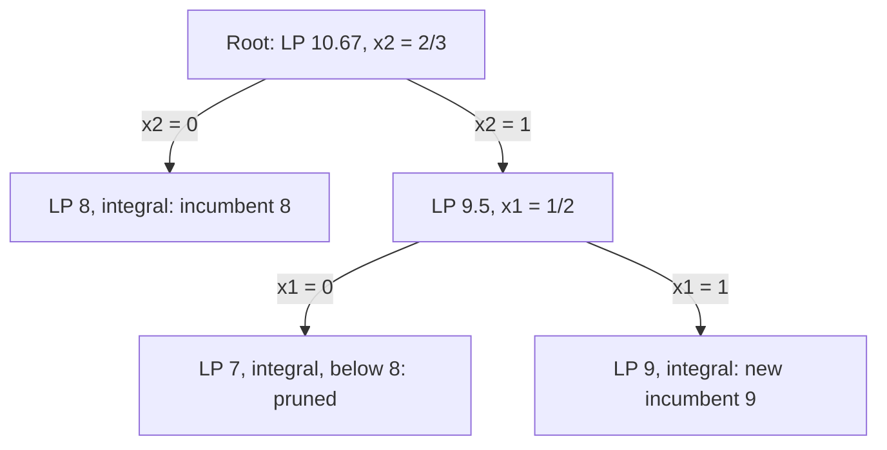
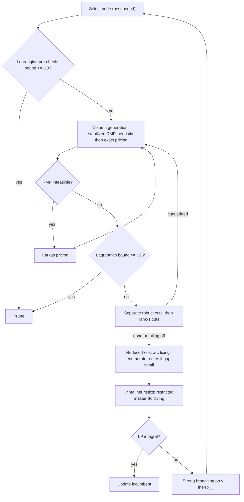

Exact methods for routing with profits · October 2026

# Branch-Price-and-Cut Field Guide

From branch-and-bound to modern branch-cut-and-price (BPC): bounds, relaxations, pricing, cuts, branching, acceleration and parameters, with a research agenda for a BPC for the capacitated profitable tour problem with time windows and time constraints (CPTPTW-TC).

Written for WSmart Route+Notation: minimization unless statedProblem: CPTPTW-TC

Contents

1. [0Map of the territory](#map)
2. [1History, 1954–2026](#history)
3. [2Branch-and-bound](#bb)
4. [3Relaxations and bounds](#relax)
5. [4Branch-and-cut](#bc)
6. [5Branch-and-price](#bp)
7. [6Pricing in depth](#pricing)
8. [7Cut families](#cuts)
9. [8Assembling BPC](#bpc)
10. [9Acceleration toolkit](#accel)
11. [10Parameters](#params)
12. [11Across problems](#apps)
13. [12BPC for CPTPTW-TC](#cptp)
14. [13Research agenda](#research)
15. [14Experimental protocol](#protocol)
16. [15Reading list](#refs)

## §0Map of the territory

Branch-price-and-cut (BPC), also called branch-cut-and-price (BCP), is LP-based branch-and-bound in which the LP at every node is solved by *column generation* (pricing) and strengthened by *cutting planes* (separation). It inherits three lines of work:

- **Branch-and-bound** (Land & Doig, 1960) supplies the enumeration tree, pruning by bounds and the incumbent.
- **Branch-and-cut** (Padberg & Rinaldi, 1987–1991) supplies dynamic separation of valid inequalities to tighten the relaxation at each node.
- **Branch-and-price** (Desrochers, Desrosiers & Solomon, 1992; Barnhart et al., 1998) supplies Dantzig–Wolfe reformulations with exponentially many columns, generated on demand by a pricing subproblem.

Lagrangian relaxation, state-space relaxation (q-routes, ng-routes) and dual stabilization sit underneath all three. They decide how strong and how cheap each bound is.

The one-line idea

Every node of the tree computes a bound \\(z\_{\\text{LB}}\\). Pricing makes the LP *bigger* (more columns), which can only lower the LP value in a minimization. Cutting makes the LP *smaller* (more rows), which can only raise it. A node is closed when its bound proves it cannot beat the incumbent, \\(z\_{\\text{LB}} \\ge z\_{\\text{UB}}\\). Everything else in this guide is about getting a strong \\(z\_{\\text{LB}}\\) quickly.

The rest of the guide follows the inheritance order: history (§1), the three parent algorithms (§2, §4, §5), the relaxations they rely on (§3), then pricing and cuts in detail (§6–§7), how they fit together (§8), acceleration techniques and parameters (§9–§10), other problems (§11), and finally a design and research agenda for the CPTPTW-TC (§12–§14).

## §1History, 1954–2026

The milestones below are the ones that changed what a BPC looks like in practice. The TSP and the VRP drove most of them.

- 1954

  **Dantzig, Fulkerson & Johnson** solve a 49-city TSP with LP plus hand-added subtour-elimination cuts: the first cutting-plane proof of optimality.
- 1958

  **Ford & Fulkerson** propose generating path variables on demand for multicommodity flow, the first column generation. **Gomory** publishes fractional cuts for pure integer programs.
- 1960

  **Land & Doig** introduce LP-based branch-and-bound. **Dantzig & Wolfe** publish their decomposition principle.
- 1961–63

  **Gilmore & Gomory** apply column generation to cutting stock, with a knapsack as pricing problem. **Little, Murty, Sweeney & Karel** coin "branch and bound" for the TSP (1963). **Dakin** (1965) gives the variable-dichotomy branching used today.
- 1970–71

  **Held & Karp** bound the TSP with Lagrangian 1-trees and subgradient optimization.
- 1974–81

  **Geoffrion** (1974) characterizes the Lagrangian dual bound. **Fisher** (1981) popularizes Lagrangian relaxation. **Christofides, Mingozzi & Toth** (1981) introduce q-routes and state-space relaxation for the VRP.
- 1983–91

  **Crowder, Johnson & Padberg** (1983) show lifted cover inequalities make large 0-1 programs solvable. **Padberg & Rinaldi** solve a 532-city TSP (1987) and name the method branch-and-cut (1991).
- 1992

  **Desrochers, Desrosiers & Solomon** solve the VRPTW by column generation with a shortest path problem with resource constraints (SPPRC) as pricing problem, inside branch-and-bound.
- 1996–98

  **Vanderbeck & Wolsey** (1996) and **Barnhart, Johnson, Nemhauser, Savelsbergh & Vance** (1998) formalize branch-and-price and branching rules compatible with pricing.
- 1999

  **Kohl, Desrosiers, Madsen, Solomon & Soumis** add 2-path cuts to VRPTW column generation, an early branch-price-and-cut.
- 2004

  **Feillet, Dejax, Gendreau & Gueguen** give an exact labeling algorithm for the elementary SPPRC (ESPPRC). **Baldacci, Hadjiconstantinou & Mingozzi** publish the two-commodity flow formulation.
- 2006

  **Fukasawa et al.** combine q-route pricing with capacity cuts in a robust BCP for the CVRP. They define robust cuts, whose duals project onto arc costs and leave the pricing problem unchanged. **Righini & Salani** introduce bidirectional labeling.
- 2007–08

  **Boussier, Feillet & Gendreau** (2007): first exact B&P for the team orienteering problem (TOP), a routing-with-profits problem. **Jepsen, Petersen, Spoorendonk & Pisinger** (2008): subset-row cuts, the first widely used non-robust cuts. **Righini & Salani** (2008): decremental state-space relaxation (DSSR). **Baldacci, Christofides & Mingozzi** (2008): route enumeration once the gap is small.
- 2011

  **Baldacci, Mingozzi & Roberti** introduce ng-routes, which became the standard partially elementary pricing.
- 2013–14

  **Archetti, Bianchessi & Speranza** (2013): B&P for the CPTP and capacitated TOP. **Jepsen, Petersen, Spoorendonk & Pisinger** (2014): branch-and-cut for the CPTP with rounded multistar inequalities, solving 800-node instances where dynamic programming stalled near 200.
- 2017

  **Pecin, Pessoa, Poggi & Uchoa** introduce limited-memory rank-1 cuts, which made a CVRP BCP solve every classic instance up to 199 customers. **Pecin, Contardo, Desaulniers & Uchoa** bring the same machinery to the VRPTW.
- 2018–21

  Automatic dual-smoothing stabilization (Pessoa et al., 2018). Diving primal heuristics (Sadykov et al., 2019). **VRPSolver**, a generic BCP for VRP variants (Pessoa, Sadykov, Uchoa & Vanderbeck, 2020). Bucket-graph labeling (Sadykov, Uchoa & Pessoa, 2021). Survey of exact BPC for routing (Costa, Contardo & Desaulniers, 2019).
- 2021–23

  Machine-learning column selection (Morabit, Desaulniers & Lodi, 2021) and arc selection for pricing networks (2023, up to 40% less time on VRPTW).
- 2024–26

  Textbooks: *Optimizing with Column Generation*, Part I (Uchoa, Pessoa & Moreno, 2024) and *Branch-and-Price* (Desrosiers, Lübbecke, Desaulniers & Gauthier; GERAD report 2024, open-access Springer book 2026). BPC with ng-paths, subset-row cuts and a Lagrangian bound for a time-dependent TOPTW (Peng et al., EJOR 2025). Bidirectional labeling for a VRPTW with flexible departures and route-duration limits (Lichau, 2025 talk). An open, reproducible CPTP branch-and-cut in which capacity-class cuts give almost all the benefit, while combs, rounded generalized large multistars and reduced-cost fixing show no measurable gain (Spoorendonk, arXiv 2607.04497, 2026). A bucket-graph meta-solver refactoring of VRPSolver's pricer (2026 preprint).

## §2Branch-and-bound: what it does and how

Consider \\(z^\* = \\min\\{c^\\top x : x \\in X\\}\\) with \\(X = \\{x \\in \\mathbb{Z}^n\_+ : Ax \\ge b\\}\\). Branch-and-bound (B&B) partitions \\(X\\) recursively into subproblems \\(X_k\\) and keeps two numbers:

- **Incumbent (primal bound)**: \\(z\_{\\text{UB}}\\) is the cost of the best feasible solution found so far.
- **Node bound (dual bound)**: \\(z\_{\\text{LB}}(X_k) \\le \\min\\{c^\\top x : x \\in X_k\\}\\) comes from a relaxation, usually the LP.

A node is **pruned** (fathomed) when its relaxation is infeasible, when \\(z\_{\\text{LB}}(X_k) \\ge z\_{\\text{UB}}\\) (pruning by bound), or when the relaxation's optimum is feasible for \\(X_k\\) (pruning by optimality, which may also update the incumbent). The global lower bound is the minimum node bound over open nodes, and the optimality gap is \\((z\_{\\text{UB}} - z\_{\\text{LB}})/|z\_{\\text{UB}}|\\).

```
procedure BranchAndBound(root)
  open ← {root};  z_UB ← +∞  (or a heuristic value)
  while open ≠ ∅ and gap > ε:
    k ← select(open)                   // best-bound, DFS, best-estimate, hybrid
    (z_k, x_k) ← solve relaxation of X_k
    if infeasible or z_k ≥ z_UB: continue   // prune
    if x_k ∈ X_k: z_UB ← z_k; incumbent ← x_k; continue
    run primal heuristics on x_k       // may lower z_UB
    choose a disjunction X_k = X_k' ∪ X_k''   // e.g. x_j ≤ ⌊x̂_j⌋ or x_j ≥ ⌈x̂_j⌉
    open ← open ∪ {X_k', X_k''}
```

### A worked example

Maximize \\(5x_1 + 4x_2 + 3x_3\\) subject to \\(2x_1 + 3x_2 + x_3 \\le 5\\), \\(x \\in \\{0,1\\}^3\\). For a maximization, the relaxation gives an *upper* bound and pruning compares it against the incumbent from below. The LP takes items by value/weight ratio: \\(x_3 = 1\\) (ratio 3), \\(x_1 = 1\\) (2.5), then \\(x_2 = 2/3\\), so \\(z\_{\\text{LP}} = 10.67\\).



After node D, no open node has a bound above 9, so \\(x = (1,1,0)\\) with value 9 is optimal. Three design choices control the size of every B&B tree, and they reappear in BPC with more at stake because each node's LP is expensive.

#### 1. Bounding: how strong is the relaxation?

A stronger relaxation prunes more nodes. This is why BPC accepts expensive column generation at each node: the Dantzig–Wolfe bound can be much stronger than a compact LP (§3).

#### 2. Branching: which disjunction?

- **Most fractional** is simple and, on general MIPs, about as good as random.
- **Pseudocost branching** estimates the bound gain per unit of change from earlier branchings on the same variable.
- **Strong branching** tentatively solves both children for a few candidates and picks the best by a score such as \\(\\max(\\Delta^-,\\epsilon)\\cdot\\max(\\Delta^+,\\epsilon)\\) (the product rule). **Reliability branching** (Achterberg, Koch & Martin, 2005) uses strong branching until pseudocosts are reliable.
- In BPC, strong branching is usually done in phases: a cheap estimate on many candidates, then a few CG iterations on the best ones, then full CG on two or three (Røpke, 2012; Pecin et al., 2017). It typically cuts tree size by an order of magnitude on hard instances.

#### 3. Node selection: which open node next?

- **Best-bound** minimizes the number of nodes needed to prove optimality.
- **Depth-first** finds incumbents quickly, uses little memory and allows warm starts, but can wander in poor subtrees.
- **Hybrids** dive depth-first and periodically jump to the best bound. BPC codes almost always use best-bound, because each node is costly and the goal is proof.

## §3Relaxations and bounds

### 3.1 LP relaxation of compact formulations

Drop integrality. For routing, compact formulations such as Miller–Tucker–Zemlin, single-commodity flow (SCF) and two-commodity flow (TCF) have polynomially many variables but weak LP bounds, because a fractional solution can split a route across many arcs. Your own MCPTP appendix shows that directed TCF projects exactly onto SCF with the same LP bound. To get a strictly stronger bound you need either more cuts (branch-and-cut) or a different variable space (column generation).

### 3.2 Lagrangian relaxation

Split the constraints into "complicating" rows \\(Ax \\ge b\\) and "easy" structure \\(x \\in X'\\). For multipliers \\(u \\ge 0\\):

\\\[ L(u) = \\min\_{x \\in X'} \\; c^\\top x + u^\\top (b - Ax) \\;\\le\\; z^\*, \\qquad z\_{\\text{LD}} = \\max\_{u \\ge 0} L(u). \\\]

Geoffrion's theorem (1974)

\\(z\_{\\text{LD}} = \\min\\{c^\\top x : Ax \\ge b,\\; x \\in \\operatorname{conv}(X')\\}\\). The Lagrangian dual is never weaker than the LP relaxation, and it is strictly stronger only if \\(\\operatorname{conv}(X')\\) is strictly smaller than the LP relaxation of \\(X'\\). If \\(X'\\) has the integrality property, Lagrangian relaxation gains nothing over the LP.

\\(L\\) is concave and piecewise linear, so it is maximized by subgradient methods. At \\(u^t\\), let \\(x^t\\) attain \\(L(u^t)\\); then \\(g^t = b - Ax^t\\) is a subgradient, and the Polyak (Held–Karp) step is

\\\[ u^{t+1} = \\max\\Bigl\\{0,\\; u^t + \\theta_t \\,\\frac{\\hat z - L(u^t)}{\\lVert g^t\\rVert^2}\\, g^t\\Bigr\\}, \\qquad 0 \\lt \\theta_t \\le 2, \\\]

where \\(\\hat z\\) is a target value, often \\(z\_{\\text{UB}}\\). Halve \\(\\theta\\) after a run of iterations without improvement. Bundle methods and the volume algorithm converge more reliably than plain subgradient methods.

BPC uses Lagrangian ideas in three places:

1. **The column generation bound (§5.3)** is a Lagrangian bound computed from the restricted master's duals.
2. **Pre-pruning**: a few subgradient iterations at a new node can prove \\(L(u) \\ge z\_{\\text{UB}}\\) before any LP is solved. Your BPC does this with 40 iterations and \\(\\theta = 1\\).
3. **Pricing and fixing**: Lagrangian-penalized resources give completion bounds in labeling, and they drive reduced-cost arc elimination.

### 3.3 Dantzig–Wolfe reformulation

Take the same split, with \\(X'\\) a finite set of points \\(\\{x^r\\}\_{r \\in \\Omega}\\) (routes). Write \\(x = \\sum_r x^r \\lambda_r\\) with \\(\\sum_r \\lambda_r = 1\\) (convexification) or \\(\\lambda \\in \\mathbb{Z}\_+\\) (discretization, needed when there are several identical subsystems such as vehicles). The resulting master problem has one column per route. Its LP bound equals \\(z\_{\\text{LD}}\\), so column generation and Lagrangian relaxation give the same bound. Column generation gets there with primal information and smoother convergence. For routing, \\(X'\\) is the set of feasible routes, which does *not* have the integrality property. That is why the set-partitioning LP bound is so much stronger than the compact LP.

### 3.4 State-space relaxations of the route set

Pricing over elementary routes (the ESPPRC) is strongly NP-hard. Instead, price over a superset \\(\\Omega' \\supseteq \\Omega\\) that contains some non-elementary paths. The relaxation stays valid for integer solutions: in a set-partitioning or set-packing master every customer row has right-hand side 1, so a column visiting a customer twice has coefficient 2 and can never appear in an integer solution. The cost is a weaker LP bound.

| Route set | Elementarity enforced | Pricing | Bound |
| --- | --- | --- | --- |
| q-routes (Christofides et al., 1981) | None; the load index only prevents infinite cycling | Pseudo-polynomial DP | Weakest |
| q-routes with k-cycle elimination (Irnich & Villeneuve, 2006) | No cycles of length up to k | Pseudo-polynomial, larger by roughly \\(k!\\) | Moderate |
| **ng-routes** (Baldacci, Mingozzi & Roberti, 2011) | No cycles that stay inside a neighbourhood | Labels carry an ng-memory set | Close to elementary for \\(\|N_i\| \\approx 8\\text{–}16\\) |
| DSSR (Righini & Salani, 2008) | Elementarity only on "critical" nodes, added until the optimal path is elementary | Iterated labeling | Elementary at convergence |
| Elementary routes | Full | ESPPRC | Strongest pure set-partitioning bound |

ng-route memory

Each node \\(i\\) has a neighbourhood \\(N_i \\ni i\\), typically its \\(\\Delta\\) nearest nodes. A partial path \\(P\\) ending at \\(j\\) carries memory \\(\\Pi(P)\\). Extending to \\(k\\) is allowed only if \\(k \\notin \\Pi(P)\\), and then

\\\[ \\Pi(P \\oplus k) = \\bigl(\\Pi(P) \\cap N_k\\bigr) \\cup \\{k\\}. \\\]

A cycle can close only if it passes through a node whose neighbourhood "forgets" the repeated customer. With \\(N_i = V\\) the routes are elementary; with \\(N_i = \\{i\\}\\) they are q-routes with 1-cycle elimination. **Dynamic ng** (Roberti & Mingozzi, 2014) grows \\(N_i\\) only where the LP solution actually uses cycles.

### 3.5 The bound hierarchy for routing

\\\[ z\_{\\text{LP}}^{\\text{compact}} \\;\\le\\; z^{\\text{q-route}} \\;\\le\\; z^{\\text{ng-route}} \\;\\le\\; z^{\\text{elem}} \\;\\le\\; z^{\\text{elem}+\\text{robust cuts}} \\;\\le\\; z^{\\text{elem}+\\text{R1C}} \\;\\le\\; z^\* \\\]

For minimization. Cuts can be added at any level, so in practice ng-routes with rank-1 cuts often beat elementary routes without cuts at a fraction of the pricing cost.

## §4Branch-and-cut

Branch-and-cut (B&C) adds valid inequalities \\(\\pi^\\top x \\le \\pi_0\\) at B&B nodes to cut off the current fractional LP optimum \\(\\hat x\\). The core subroutine is **separation**: given \\(\\hat x\\), find an inequality from a family \\(\\mathcal{F}\\) that \\(\\hat x\\) violates, or prove there is none. By the equivalence of separation and optimization (Grötschel, Lovász & Schrijver, 1981), a polynomial-time separator over \\(\\mathcal{F}\\) makes optimizing over \\(\\mathcal{F}\\) polynomial too.

#### The cut loop at one node

```
repeat
  solve LP → x̂
  for each family F (cheapest first):
    find violated inequalities in F       // exact or heuristic separation
  add the most violated / most orthogonal ones, at most K per round
until no violated cut, or bound gain over the last r rounds < τ (tailing off)
branch
```

Key engineering choices:

- **Global versus local cuts.** Global cuts are valid everywhere and stored in a pool; local cuts are valid only in a subtree.
- **Cut selection** by efficacy (violation divided by norm), parallelism to cuts already added, and density.
- **Aging** removes cuts that have been slack for several rounds.
- **Exact versus heuristic separation.** Exact is often polynomial (min-cut for subtour elimination) or NP-hard (rounded capacity cuts, combs), so heuristics such as CVRPSEP (Lysgaard, Letchford & Eglese, 2004) dominate.

The classical routing example is the subtour elimination constraint \\(x(\\delta(S)) \\ge 2\\), separated exactly by min-cut on the support graph. For profit problems the generalized version \\(x(\\delta(S)) \\ge 2y_i\\) for \\(i \\in S\\), \\(0 \\notin S\\), is separated by \\(|B|\\) max-flow computations (or Gomory–Hu trees on undirected graphs). Section 7 lists the families relevant to the CPTP.

Practice

Spoorendonk's 2026 component study of CPTP branch-and-cut on HiGHS is a useful cautionary example. Capacity-class cuts lifted solved instances from 52 to 64 of 76 and shrank trees more than tenfold. Comb cuts, rounded generalized large multistars, reduced-cost fixing and bound propagation showed no measurable gain. Before adding a cut family to a BPC, run the same kind of one-at-a-time ablation.

## §5Branch-and-price and column generation

### 5.1 The master problem for routing with profits

Let \\(\\Omega\\) be the set of feasible routes. Route \\(r\\) has cost \\(c_r\\) (travel plus any vehicle charge), collects prize \\(\\varphi_r = \\sum_i a\_{ir} p_i\\), and visits customer \\(i\\) \\(a\_{ir} \\in \\{0,1\\}\\) times. With a mandatory set \\(M\\) and a fleet bound \\(K\\):

\\\[ \\begin{aligned} \\text{(MP)}\\quad \\min\\; & \\textstyle\\sum\_{r \\in \\Omega} (c_r - \\varphi_r)\\,\\lambda_r \\\\ \\text{s.t.}\\; & \\textstyle\\sum_r a\_{ir}\\lambda_r = 1, && i \\in M \\quad \[\\pi_i \\text{ free}\]\\\\ & \\textstyle\\sum_r a\_{ir}\\lambda_r \\le 1, && i \\in B \\setminus M \\quad \[\\pi_i \\le 0\]\\\\ & \\textstyle\\sum_r \\lambda_r \\le K, && \[\\mu \\le 0\]\\\\ & \\lambda_r \\in \\{0,1\\}. \\end{aligned} \\\]

The restricted master problem (RMP) uses a subset \\(\\Omega_t \\subset \\Omega\\). After solving its LP, the reduced cost of any route is

\\\[ \\bar c_r = c_r - \\sum_i a\_{ir}\\,(p_i + \\pi_i) - \\mu = \\sum\_{(i,j) \\in r} \\bigl(c\_{ij} - p_j - \\pi_j\\bigr) - \\mu, \\\]

with node prizes and duals attached to the arc entering each node. **Pricing** means finding \\(\\min\_{r \\in \\Omega} \\bar c_r\\). If the minimum is negative, add the column(s) and resolve; otherwise the RMP LP is optimal for the full master LP. For the CPTP, the pricing problem is itself a single-vehicle CPTP on modified prizes, which is the ESPPRC with node rewards. This "self-similarity" is why an exact CPTP branch-and-cut code such as `cptp` can serve as the pricer of a CPTP BPC.

### 5.2 Column generation loop

```
repeat
  solve RMP-LP(Ω_t) → primal λ̂, duals (π, μ)        // stabilized duals, §9
  run heuristic pricers; if none finds c̄ < −ε, run the exact pricer
  add up to m columns with c̄ < −ε
  compute the Lagrangian bound (§5.3); stop early if it is ≥ z_UB (prune)
until no column with c̄ < −ε   // LP optimal at this node
```

### 5.3 The Lagrangian (column generation) bound

The RMP value \\(z\_{\\text{RMP}}\\) is an upper bound on the master LP until convergence, so it cannot prune by itself. With a fleet bound, Lagrangian duality gives a valid lower bound at every iteration:

\\\[ z\_{\\text{MP-LP}} \\;\\ge\\; z\_{\\text{RMP}} + K \\cdot \\min\\{0,\\, \\bar c^{\\,\*}\\}, \\qquad \\bar c^{\\,\*} = \\min\_{r \\in \\Omega} \\bar c_r . \\\]

This needs the *exact* pricing minimum, or a valid lower bound on it. Its uses:

- Early pruning: stop when \\(\\lceil \\text{bound} \\rceil \\ge z\_{\\text{UB}}\\), rounded if costs are integer.
- Early branching: when the bound and \\(z\_{\\text{RMP}}\\) are close (tailing off).
- Reduced-cost fixing (§9).

Without a fleet bound, \\(K\\) can be replaced by any valid bound on the number of routes, for example \\(|B|\\) or a bin-packing bound. A weak \\(K\\) gives a weak bound. For your setting, a much tighter bound is available. Without time windows, and with costs satisfying the triangle inequality, two routes whose loads sum to at most \\(Q\\) can be concatenated at no extra cost. So some optimal plan has at most one route loaded below \\(Q/2\\), which gives \\(K \\le \\lfloor 2W/Q \\rfloor + 1\\) for total collectible load \\(W\\). With remote depots, concatenation saves about 90 km of stem, so the bound is also close to tight in practice.

### 5.4 Farkas pricing: when the RMP is infeasible

After branching (for example forcing \\(y_i = 1\\) or forbidding arcs), or with mandatory rows at the root, the current columns may not cover a mandatory node. The RMP is then infeasible and has no duals. Farkas' lemma provides the replacement. For an RMP \\(\\{\\lambda \\ge 0 : A_t \\lambda \\ (\\ge, =)\\ b\\}\\):

\\\[ \\{\\lambda \\ge 0 : A_t\\lambda \\ge b\\} = \\varnothing \\iff \\exists\\, y \\ge 0:\\; y^\\top A_t \\le 0,\\; y^\\top b \\gt 0 . \\\]

The ray \\(y\\) certifies infeasibility. A new column \\(a_r\\) invalidates the certificate only if \\(y^\\top a_r \\gt 0\\). **Farkas pricing** therefore solves \\(\\max\_{r \\in \\Omega} y^\\top a_r\\), the same ESPPRC with travel costs set to zero and node weights \\(y_i\\), and adds columns with positive value until the RMP becomes feasible. If none exists, the node is infeasible and is pruned. SCIP exposes this as a separate pricer callback.

The common alternative is **Phase I with artificial columns**: one per mandatory row, with a big-M cost. It is simple, but a big M distorts the duals and slows convergence, and too small an M can return a falsely "optimal" artificial solution. Farkas pricing avoids both problems. It matters for the CPTPTW-TC because time windows make infeasible RMPs common after arc branching.

### 5.5 Branching compatible with pricing

Branching on a master variable \\(\\lambda_r = 0\\) is useless: the pricer would regenerate the same route, or the second-best one, and the down branch barely changes. Branch instead on **original-space quantities** that the pricer can respect:

| Branching object | Definition | Effect on pricing | Robust? |
| --- | --- | --- | --- |
| Arc flow | \\(x\_{ij} = \\sum_r b^r\_{ij}\\lambda_r \\in (0,1)\\) | 0-branch: delete arc. 1-branch: delete all other arcs out of \\(i\\) and into \\(j\\) | Yes |
| Node visit (profits) | \\(y_i = \\sum_r a\_{ir}\\lambda_r \\in (0,1)\\) | 0-branch: delete node. 1-branch: make \\(i\\) mandatory (equality row; Farkas pricing may be needed) | Yes |
| Number of vehicles | \\(\\sum_r \\lambda_r \\in (k, k+1)\\) | Bound on the convexity row | Yes |
| Ryan–Foster pair | \\(\\sum\_{r \\ni i,j}\\lambda_r \\in (0,1)\\) | Together: \\(i\\) and \\(j\\) both or neither. Apart: not both. Changes labeling | Partly |
| Resource windows | Split the time window of \\(i\\) at the LP's fractional arrival time | Narrower time windows in each child | Yes |

For profit problems, branch on node visits first. Deciding which optional bins are served is the dominant combinatorial choice, and \\(y_i\\) branching gives balanced children.

## §6Pricing in depth: labeling and its alternatives

### 6.1 ESPPRC by labeling

A forward label \\(L = (v, \\bar c, q, t, \\Pi, \\boldsymbol{s})\\) records:

- \\(v\\): the last node;
- \\(\\bar c\\): the accumulated reduced cost;
- \\(q\\): the load;
- \\(t\\): the earliest start of service at \\(v\\);
- \\(\\Pi\\): the ng-memory (or the visited set);
- \\(\\boldsymbol{s}\\): states for non-robust cuts (§7).

Extending along arc \\((v,w)\\) applies the **resource extension functions**:

\\\[ q' = q + d_w \\le Q,\\qquad t' = \\max\\{e_w,\\; t + s_v + \\tau\_{vw}\\} \\le l_w,\\qquad \\bar c' = \\bar c + c\_{vw} - p_w - \\pi_w - \\textstyle\\sum\_{k:\\, \\text{state } k \\text{ wraps}} \\sigma_k . \\\]

\\(L_1\\) **dominates** \\(L_2\\) at the same node if every extension of \\(L_2\\) is also feasible for \\(L_1\\) at no higher cost. A sufficient condition is

\\\[ q_1 \\le q_2,\\quad t_1 \\le t_2,\\quad \\Pi_1 \\subseteq \\Pi_2,\\quad \\bar c_1 - \\textstyle\\sum\_{k:\\, s\_{1k} \\gt s\_{2k}} \\sigma_k \\le \\bar c_2 , \\\]

where \\(\\sigma_k \\le 0\\) are subset-row cut duals (Jepsen et al., 2008). Dominated labels are deleted. The algorithm is exact, but its cost grows with the number of non-dominated labels. That number explodes when routes are long relative to the binding resources, for example large \\(Q\\) with small demands and loose time windows.

Why your BPC prices with branch-and-cut

In your municipal instances, \\(Q = 3{,}500\\) kg against bins of 47.5 kg, so one route can hold about 70 full bins and capacity rarely binds. Labeling then has almost no resource to prune with, which is the regime in which Jepsen et al. (2014) found CPTP branch-and-cut far ahead of dynamic programming (800 against about 200 nodes). Adding tight time windows reverses this: time becomes a strong label-pruning resource, while branch-and-cut has to model time with big-M or time-indexed constraints whose LP is weak. A CPTPTW-TC BPC should therefore have both pricers (idea R1).

### 6.2 Making labeling fast

- **Bidirectional labeling** (Righini & Salani, 2006): extend forward and backward labels to the midpoint of a critical resource (usually time), then join them. This roughly takes the square root of the label count.
- **Bucket graph** (Sadykov, Uchoa & Pessoa, 2021): discretize the main resource into buckets per node, compare labels only within and across nearby buckets, and eliminate whole bucket arcs by reduced-cost bounds. It is the pricer behind VRPSolver.
- **Completion bounds**: a lower bound on the reduced cost needed to finish a path from \\((v, q, t)\\), for example from a relaxed backward pass with q-routes. Discard a label if \\(\\bar c + \\text{bound} \\ge 0\\), or \\(\\ge\\) the current threshold.
- **Heuristic pricing first**: restrict to the k cheapest outgoing arcs, apply relaxed dominance or caps on labels per node, or run tabu-search column generators (Desaulniers, Lessard & Hadjar, 2008). Call the exact pricer only to prove that no negative column exists. Your 100,000-pop labeling cap is this kind of heuristic phase.
- **Return many columns** per call (your BPC returns 50), preferring diverse ones.

### 6.3 Alternatives to labeling

- **MIP or branch-and-cut pricing** over a CPTP/PCTSP formulation with GSECs and capacity cuts. It is strong for long routes and weak with tight time windows. It returns optimal and near-optimal columns from its solution pool.
- **Constraint programming** pricing for rich side constraints such as breaks and synchronization.
- **Learned or neural pricing heuristics** that propose candidate columns, as in your Attention Model, with exact pricing kept as a certificate (idea R9).

## §7Cut families and inequalities

In BPC, a cut is either **robust** or **non-robust** (Poggi de Aragão & Uchoa; Fukasawa et al., 2006).

- A **robust** cut is written in the original arc variables, \\(\\sum\_{(i,j)} \\alpha\_{ij} x\_{ij} \\ge \\beta\\), so its coefficient on route \\(r\\) is \\(\\sum\_{(i,j) \\in r}\\alpha\_{ij}\\). Its dual \\(\\nu \\ge 0\\) just modifies arc costs, \\(c\_{ij} \\leftarrow c\_{ij} - \\nu\\,\\alpha\_{ij}\\), and the pricing algorithm is unchanged.
- A **non-robust** cut has route coefficients that are not linear in arcs. It needs an extra label state and weakens dominance, but it can be far stronger.

### 7.1 Robust families relevant to the CPTP

| Family | Inequality (\\(S \\subseteq B\\), \\(0 \\notin S\\)) | Separation | Notes |
| --- | --- | --- | --- |
| Generalized subtour elimination (GSEC) | \\(x(\\delta(S)) \\ge 2\\,y_i,\\ i \\in S\\). Directed: \\(x(\\delta^-(S)) \\ge y_i\\) | Exact by max-flow | Main connectivity cuts for the PTP and OP, used in a branch-and-cut pricer |
| Rounded capacity (RCC) | CVRP: \\(x(\\delta(S)) \\ge 2\\lceil d(S)/Q\\rceil\\) | Heuristic (CVRPSEP), exact is NP-hard | With optional visits, \\(d(S)\\) is not fixed and the rounding needs care. Use visit-conditioned forms such as the fractional \\(x(\\delta(S)) \\ge \\tfrac{2}{Q}\\sum\_{i\\in S} d_i y_i\\), or the rounded multistars of Jepsen et al. (2014) |
| Multistar (Araque, Hall & Magnanti, 1990; Gouveia, 1995) | \\(x(\\delta(S)) \\ge \\tfrac{2}{Q}\\bigl\[\\,d(S) + \\sum\_{i\\in S}\\sum\_{j \\notin S\\cup\\{0\\}} d_j x\_{ij}\\bigr\]\\) | Heuristic | Counts the demand of satellite nodes adjacent to \\(S\\). Generalized large multistars (GLM) are due to Letchford, Eglese & Lysgaard (2002) |
| Rounded multistar (Jepsen et al., 2014) | Rounded form of the multistar for the CPTP, with \\(y\\)-conditioned demand | Heuristic | Introduced for the CPTP, but showed no measurable gain in Spoorendonk (2026) |
| Strengthened comb, framed capacity | Combinatorial TSP/CVRP families | Heuristic | Important for the CVRP; the 2026 CPTP study found combs ineffective |
| k-path cuts (Kohl et al., 1999) | \\(x(\\delta^-(S)) \\ge k(S)\\), where \\(k(S)\\) is the minimum number of routes needed to serve \\(S\\) under time windows and capacity | Heuristic, with a TSPTW feasibility check for \\(k = 2\\) | The time-window analogue of RCC. Valid with optional nodes only when \\(S \\subseteq\\) mandatory set, or conditioned on \\(y\\) |
| Infeasible-path / tournament | \\(\\sum\_{(i,j)\\in P} x\_{ij} \\le \|P\| - 1\\) for a time-infeasible path \\(P\\) | Check paths in the LP support | Mainly for a branch-and-cut pricer with time windows |
| Fleet cover, edge clique | Bound route counts and conflicting arcs | Simple | Cheap and occasionally useful |

### 7.2 Knapsack cover and lifted cover inequalities (LCI)

For a knapsack row \\(\\sum_j a_j z_j \\le b\\) with binaries \\(z\\), a **cover** \\(C\\) has \\(\\sum\_{j\\in C} a_j \\gt b\\), so

\\\[ \\textstyle\\sum\_{j \\in C} z_j \\le |C| - 1 \\qquad\\text{(cover inequality)}, \\\]

and **lifting** adds the remaining variables with the largest valid coefficients:

\\\[ \\textstyle\\sum\_{j\\in C} z_j + \\sum\_{j \\notin C} \\alpha_j z_j \\le |C| - 1 . \\\]

The coefficients come from sequential lifting (one small knapsack per variable) or from sequence-independent lifting with superadditive functions (Gu, Nemhauser & Savelsbergh, 1998–2000). Separation of minimal covers is itself a knapsack problem and is solved greedily in practice.

In routing they appear on the route-level capacity knapsack \\(\\sum_i d_i y_i \\le Q\\) inside a branch-and-cut pricer, and on the **shift-duration knapsack** of the CPTPTW-TC. For example, if mandatory and optional service times must fit into \\(K\\) shifts of length \\(T\\), a cover gives a cut on visit variables that set partitioning does not imply directly.

### 7.3 Non-robust: subset-row and rank-1 cuts

Chvátal–Gomory rank-1 cuts on the customer rows of the master, with multipliers \\(u_i \\in \[0,1)\\) over a set \\(S\\), are

\\\[ \\textstyle\\sum\_{r} \\Bigl\\lfloor \\sum\_{i \\in S} u_i\\, a\_{ir} \\Bigr\\rfloor \\lambda_r \\;\\le\\; \\Bigl\\lfloor \\sum\_{i\\in S} u_i \\Bigr\\rfloor . \\\]

The **subset-row cut** (SRC) is the case \\(|S| = 3\\), \\(u_i = \\tfrac12\\): \\(\\sum_r \\lfloor \\tfrac12 |S \\cap r| \\rfloor \\lambda_r \\le 1\\), so at most one route may visit two or more of the three customers. Pecin et al. (2017) catalogue the optimal multiplier vectors for \\(|S| \\le 5\\).

In pricing, each active rank-1 cut adds a state \\(s_k \\in \[0,1)\\) to the label. When \\(s_k + u_i \\ge 1\\) the state wraps and the cut's dual \\(\\sigma_k\\) is charged. The dominance test then needs the correction shown in §6.1, so many cuts slow labeling sharply.

**Limited-memory rank-1 cuts** (Pecin et al., 2017) attach a memory \\(\\mathcal{M}\_k\\) (node or arc memory) to each cut. A route's state is reset to zero whenever it leaves \\(\\mathcal{M}\_k\\). The coefficient can only shrink, so the cut stays valid, and the memory is chosen just large enough to keep the cut violated by the current LP. This was the step that made rank-1 cuts affordable at scale.

Set packing note

With optional customers (\\(\\le 1\\) rows), rank-1 cuts remain valid, since Chvátal–Gomory rounding works on any \\(\\le\\) rows. Mixed mandatory and optional sets are fine. The violation pattern differs from the CVRP, though. Fractional LPs in profit problems often split *whether* a node is served (\\(y_i = 0.5\\)) rather than *which route* serves it, and SRCs are weaker against the former. Node-visit branching and GSEC-type cuts address that case.

### 7.4 Cut management in BPC

- Separate robust cuts first, then non-robust ones only when the gap is still large.
- Cap non-robust cuts per round (for example 50–100 SRCs) and in total, since pricing time grows with each one.
- Remove cuts that stay slack for 3–5 rounds.
- Stop the cut loop on tailing off (bound gain below 0.1–0.5% of the gap over 2–3 rounds) and branch.
- Your BPC's limit of 10 cuts per iteration is conservative for SRCs; a sweep is cheap to run.

## §8Assembling branch-price-and-cut

At each node, BPC alternates column generation and separation until both stall, then branches. The interplay is the hard part. New cuts change the duals, which makes new columns attractive, and new columns create new fractional patterns to cut.



```
procedure SolveNode(k)
  loop
    ColumnGeneration(k)                      // §5.2, Farkas pricing if infeasible
    if LagrangianBound(k) ≥ z_UB: return PRUNED
    C ← Separate(x̂(λ̂))                     // robust first; R1C if gap still large
    if C = ∅ or TailingOff(): break
    add C; remove aged cuts
  ArcElimination(k, z_UB)                    // path reduced costs
  if gap(k) small: EnumerateRoutes(k); solve set-partitioning MIP; return
  RestrictedMasterHeuristic(k)               // MIP on current columns, time-limited
  if λ̂ integral: update incumbent; return
  Branch(k)                                  // strong branching, phased
```

Correctness checklist

- A node can be pruned by bound only with a *valid* lower bound: the exact pricing minimum, or a proven bound on it. A heuristic pricer that finds no negative column proves nothing.
- Branching decisions and cuts must be enforced in pricing as well as in the master. Otherwise the pricer regenerates forbidden columns.
- Pricing tolerances (\\(\\varepsilon \\approx 10^{-6}\\) relative to costs) must match the LP solver's dual tolerance, or column generation can cycle.
- Integrality of \\(\\lambda\\) is not enough when ng-routes are used: check that the selected routes are elementary.

## §9Acceleration toolkit

| Technique | What it does | Key reference |
| --- | --- | --- |
| Dual smoothing (Wentges) | Price at \\(\\tilde\\pi = \\alpha\\,\\pi\_{\\text{center}} + (1-\\alpha)\\,\\pi\_{\\text{RMP}}\\). On mispricing, reduce \\(\\alpha\\). Cures dual oscillation and tailing off | Wentges (1997); automatic \\(\\alpha\\): Pessoa et al. (2018) |
| Box-step / penalty stabilization | Penalize dual moves outside a trust box | du Merle et al. (1999); Ben Amor, Desrosiers & Frangioni (2009) |
| Dual-optimal inequalities | Restrict duals with valid bounds, for example \\(\\pi_i \\ge -p_i\\) for optional nodes, since dropping a node never costs more than its prize under the triangle inequality | Ben Amor, Desrosiers & Valério de Carvalho (2006) |
| Reduced-cost arc elimination | Remove arc \\((i,j)\\) if \\(z\_{\\text{LB}} + \\min\_{r \\ni (i,j)} \\bar c_r \\ge z\_{\\text{UB}}\\), using forward and backward labels | Irnich, Desaulniers, Desrosiers & Hadjar (2010) |
| Route enumeration | When the gap is small, enumerate all routes with \\(\\bar c_r \\lt z\_{\\text{UB}} - z\_{\\text{LB}}\\) and solve the set-partitioning MIP | Baldacci, Christofides & Mingozzi (2008); Contardo & Martinelli (2014) |
| Column pool and warm start | Keep generated columns globally and re-price pool columns before calling the pricer | Standard |
| Diving heuristics | Fix a column to 1, resolve with CG, repeat, with limited-discrepancy backtracking | Sadykov, Vanderbeck, Pessoa, Tahiri & Uchoa (2019) |
| Restricted master heuristic | Solve the RMP as a MIP over the current columns, with a time limit | Joncour et al. (2010); Archetti et al. (2013) |
| Learned column and arc selection | A classifier keeps promising columns, or prunes arcs from the pricing graph | Morabit, Desaulniers & Lodi (2021, 2023) |
| Parallelism | Price multiple subproblems or bucket ranges concurrently, or evaluate strong-branching candidates in parallel | VRPSolver (Pessoa et al., 2020) |

Dual bound for optional nodes

For a set-packing row of optional node \\(i\\), any optimal dual satisfies \\(\\pi_i \\ge -p_i\\) when travel costs obey the triangle inequality: removing \\(i\\) from a route saves at least zero travel and loses \\(p_i\\). Adding this as a dual-optimal inequality is a one-line change that often stops early iterations from overpricing. Your municipal matrices violate the triangle inequality in 2.8% of triples, so either use a metric closure or relax the bound slightly.

## §10Parameters: typical values and your BPC

The "WSmart Route+ BPC" column is taken from Table 8 and Appendix D of your simulator paper. The suggestions are starting points for a sweep, not established optima.

| Parameter | Common range | WSmart Route+ BPC | Comment |
| --- | --- | --- | --- |
| Node selection | Best-bound | Depth-first | DFS suits a 60 s anytime budget, but weakens the reported gap. Try a best-bound hybrid with periodic dives |
| Strong branching | 3 phases; 30–100 → 5–10 → 1–3 candidates | Off | Usually the biggest tree reduction. Use a light single phase with about 5 candidates and a few CG iterations under tight budgets |
| Branching objects | Vehicles, then nodes, then arcs | Divergence, node visits | Node visits first suits profit problems |
| CG iterations per node | Unlimited at the root, early branching on tailing off | 150 | A hard cap breaks bound validity unless the Lagrangian bound is used for pruning |
| Columns per pricing call | 20–200 | 50 | Reasonable |
| ng neighbourhood \\(\\Delta\\) | 8–16, or dynamic | 12 (alternative pricer) | Use dynamic ng for long routes |
| Labeling effort cap | Heuristic phase only | 100,000 queue pops | Make sure the exact phase is uncapped when a proof is needed |
| Cuts per round | Robust: all violated; SRC: 50–100 | 10 | Likely too few for SRCs. Sweep 10/30/100 |
| Cut violation tolerance | \\(10^{-3}\\)–\\(5\\cdot10^{-2}\\) | Not reported | Report it |
| Node limit | None (time limit) | 2,000 | Fine as a safeguard |
| Gap tolerance | 0 to \\(10^{-4}\\) for exact; 0.5–1% for operational use | 0.5%, 1% early stop | Report the final certified gap per day |
| Lagrangian pre-pruning | 10–50 subgradient iterations | 40, \\(\\theta = 1\\) | Halve \\(\\theta\\) after 5–10 non-improving steps |
| Stabilization \\(\\alpha\\) | Automatic, or 0.5–0.9 | Not reported | Add automatic smoothing; it is a large, cheap gain |
| Reduced-cost tolerance | \\(10^{-6}\\)–\\(10^{-9}\\) | \\(10^{-6}\\) | Match the LP solver's dual feasibility tolerance |
| Enumeration threshold | Enumerate if routes with \\(\\bar c \\lt\\) gap number at most \\(10^5\\)–\\(10^6\\) | Not used | Hard with very long routes; useful with time windows |

## §11How BPC applies across problems

The template is always the same: a master problem over combinatorial objects, a pricing problem over one object, and cuts on the master or the original space.

| Problem | Column | Pricing problem | Typical cuts | Landmarks |
| --- | --- | --- | --- | --- |
| Cutting stock, bin packing | Cutting pattern | Bounded knapsack | CG rank-1, dual-optimal inequalities | Gilmore & Gomory (1961); Vanderbeck (1999); Belov & Scheithauer (2006) |
| Generalized assignment | Feasible job set per machine | 0-1 knapsack | Cover cuts | Savelsbergh (1997) |
| Graph colouring | Independent set | Maximum-weight stable set | Clique-based | Mehrotra & Trick (1996) |
| Multicommodity flow | Path per commodity | Shortest path | Lifted cover on arc capacities | Ford & Fulkerson (1958); Barnhart, Hane & Vance (2000) |
| Crew pairing, rostering, vehicle scheduling | Pairing, roster, duty | SPPRC on a time-space network | Clique, rank-1 | Desrosiers, Dumas, Solomon & Soumis (1995) |
| CVRP | Route | ng-route SPPRC (load) | RCC, strengthened comb, limited-memory R1C | Fukasawa et al. (2006); Pecin et al. (2017); Pessoa et al. (2020) |
| VRPTW | Route | ESPPRC (time, load) | k-path, SRC, limited-memory R1C | Desrochers et al. (1992); Kohl et al. (1999); Jepsen et al. (2008); Pecin, Contardo et al. (2017) |
| TOP, OP, PCTSP, CPTP | Route with prizes | ESPPRC with node rewards (a single-vehicle CPTP) | GSEC, capacity, SRC | Boussier et al. (2007); Poggi, Viana & Uchoa (2010); Archetti et al. (2013); Jepsen et al. (2014) |
| TOPTW and variants | Route | ESPPRC with time windows and rewards | SRC, Lagrangian bound | Peng et al. (2025); capacitated TOPTW with ng-routes |
| Inventory routing | Route with delivery quantities | SPPRC with quantity decisions | Capacity, inventory-based | Desaulniers, Rakke & Coelho (2016) |
| Electric VRPTW | Route with recharging | SPPRC with a battery resource | SRC | Desaulniers, Errico, Irnich & Schneider (2016) |
| Multi-trip VRPTW | Trip or full workday | Trip ESPPRC, or workday labeling with reloads | SRC, trip-linking | Hernandez et al. (2016); Paradiso, Roberti, Laganà & Dullaert (2020) |
| Arc routing (CARP) | Route over required edges | SPPRC on edges | Odd cut, capacity | Bode & Irnich (2012) |

## §12A BPC for the CPTP with time windows and time constraints

### 12.1 Problem statement

Take a directed graph \\(G = (V, A)\\) with \\(V = \\{0\\} \\cup B \\cup \\{n{+}1\\}\\), travel costs \\(c\_{ij}\\) and times \\(\\tau\_{ij}\\) (asymmetric), prizes \\(p_i = R\\,w_i\\), demands \\(d_i\\), service times \\(s_i\\), time windows \\(\[e_i, l_i\]\\), vehicle capacity \\(Q\\), shift length \\(T\\) (the *time constraint*), at most \\(K\\) vehicles or a vehicle charge \\(\\Omega\\), and a mandatory set \\(M \\subseteq B\\) supplied by packing. A route is **feasible** if it is an elementary path \\(0 \\to n{+}1\\) that satisfies all of the following:

- **Load**: \\(\\sum\_{i \\in r} d_i \\le Q\\).
- **Time windows**: service starts in \\(\[e_i, l_i\]\\), with waiting allowed.
- **Shift**: return time minus departure time \\(\\le T\\).

The objective is to minimize travel cost (plus vehicle charges) minus collected prizes, while serving all of \\(M\\). This is the master of §5.1, with an optional extra row for the shift budget.

Two modelling decisions change the pricing problem substantially:

1. **Fixed or flexible departure.** With a fixed departure at \\(e_0\\), the shift limit is a plain time window at \\(n{+}1\\). With flexible departure, route duration depends on when the vehicle leaves, and labels need extra resources: the latest feasible departure and the accumulated "slack". The VRPTW with flexible departures and duration limits is solved by bidirectional labeling in Lichau (2025).
2. **Single-trip or multi-trip shifts.** Waste vehicles unload at the depot or a disposal facility and continue within the shift. Columns can then be *workdays* (labels with reload operations that reset the load but not the time) or *trips* linked by a vehicle-scheduling master (Paradiso et al., 2020). With depots about 50 km away, a second trip costs another 100 km, so single-trip is the right first model, and multi-trip is a research extension (R11).

### 12.2 Reference design

| Component | Recommended choice | Rationale |
| --- | --- | --- |
| Master | Set packing with mandatory equalities; fleet row or vehicle charge; dual-optimal inequalities \\(\\pi_i \\ge -p_i\\) | Strong bound; optional nodes handled natively |
| Pricing (exact) | Hybrid: bidirectional bucket labeling on time with dynamic ng-memory when time windows are tight; CPTP branch-and-cut (GSEC, capacity, infeasible-path cuts) when routes are long and time windows loose | Each method wins in a different regime (R1) |
| Pricing (heuristic) | Re-price the column pool; restricted-arc labeling; LNS on best columns; seeds from your ALNS/HGS routes | Most iterations never need exact pricing |
| Infeasible RMP | Farkas pricing | Time-window branching makes infeasible RMPs common |
| Robust cuts | Visit-conditioned capacity cuts, GSEC (if branch-and-cut pricing), k-path on mandatory subsets | Capacity-class cuts did most of the work in the 2026 study; time windows make k-path relevant |
| Non-robust cuts | Limited-memory SRCs (\\(\|S\| = 3\\)), added after robust cuts stall | Strongest known for set-partitioning routing masters |
| Branching | Vehicles, then node visits \\(y_i\\), then arcs \\(x\_{ij}\\); phased strong branching | Profit problems are decided mostly by which nodes are served |
| Node selection | Best-bound with periodic diving | Proves optimality while still finding incumbents |
| Bounds and fixing | Lagrangian bound every iteration; path reduced-cost arc and node elimination; enumeration when the gap is small | Prune early and shrink the pricing graph |
| Primal | Warm start from the metaheuristic; restricted master MIP every k nodes; diving | Time-limited daily use needs good incumbents |
| Stabilization | Automatic Wentges smoothing | Large, cheap gain |

### 12.3 Label for the CPTPTW-TC pricing problem

With fixed departure, a label is \\(L = (v, \\bar c, q, t, \\Pi, \\boldsymbol{s})\\) with the extensions of §6.1 plus \\(t' + s_w + \\tau\_{w,n+1} \\le e_0 + T\\), the feasibility of returning in time. Dominance is the standard test. Prizes do *not* break dominance, because they are already inside \\(\\bar c\\): a label that has collected more prize has a lower \\(\\bar c\\), all else equal. With flexible departure, add a second time-related resource so the label knows how late the vehicle could have left: the latest feasible departure \\(\\ell\\) together with the elapsed duration \\(\\delta\\). Dominance then needs \\(\\ell_1 \\ge \\ell_2\\) and \\(\\delta_1 \\le \\delta_2\\) in addition to the remaining resources. Irnich (2008, *OR Spectrum*) gives the general theory of such resource extension functions, and Lichau (2025) applies bidirectional labeling to exactly this case.

## §13Research agenda: new components

Each idea names the mechanism, why it should help, how to test it, and the main risk. R1–R6 target the bound and pricing; R7–R10 bring in learning and your simulator; R11–R14 extend the model.

#### R1Regime-switching hybrid pricing

Mechanism

Keep a labeling pricer and a branch-and-cut CPTP pricer. Choose per iteration (or per node) from cheap features: time-window tightness, \\(Q/\\bar d\\), label counts in the last call, LP fractionality. Use either as the exact certificate.

Why

Labeling wins when time windows are tight; branch-and-cut wins for long, capacity-loose routes (Jepsen et al., 2014). The CPTPTW-TC moves between these regimes as packing changes \\(M\\) day to day.

Test

Sweep time-window width on your networks; compare pure and hybrid pricing on time-to-root-bound and nodes solved.

Risk

Switching overhead; branching and cuts must be encoded in both pricers.

#### R2Prize-aware completion bounds

Mechanism

For a label at \\((v, q, t)\\), bound the best remaining reduced profit by a fractional knapsack over unvisited nodes, with value \\(p_j + \\pi_j\\) and two weights (load and time). Its Lagrangian combination gives a single bound. Prune when \\(\\bar c\\) minus that bound is \\(\\ge 0\\).

Why

In profit problems most labels die because no profitable completion exists, not because of dominance. Completion bounds address that directly.

Test

Count labels per call with the bound on and off; check that exactness is unchanged.

Risk

Weak bounds when travel cost dominates; adds a precomputation per pricing call.

#### R3Visit-conditioned rounded capacity and k-path cuts

Mechanism

Derive cuts of the form \\(x(\\delta^-(S)) \\ge k(S')\\) for \\(S' = S \\cap \\{i : \\hat y_i = 1\\}\\) at nodes where branching has fixed visits, or lift \\(y\\)-conditioned forms. These are local cuts valid in subtrees.

Why

Classical RCC and k-path cuts assume every node in \\(S\\) is served. After \\(y\\)-branching that becomes true locally, and the cuts recover CVRP-strength bounds.

Test

Root and tree bound gain against the robust baseline.

Risk

Local cut management and pool bookkeeping.

#### R4Shift-knapsack lifted covers in the master

Mechanism

Aggregate service plus minimum travel time per node into a fleet-level knapsack \\(\\sum_i (s_i + \\underline\\tau_i) y_i \\le K T\\), and separate lifted covers on \\(y = A\\lambda\\). These are robust in \\(y\\).

Why

Set partitioning does not see the fleet's total time budget, and covers capture which optional bins can be served together at all.

Test

Tight-shift instances; bound gain per cut.

Risk

Weak if \\(\\underline\\tau_i\\) is loose. Use the minimum in-plus-out travel time, halved.

#### R5Asymmetry-aware ng-neighbourhoods and directed cuts

Mechanism

Build \\(N_i\\) from round-trip distance \\(c\_{ij} + c\_{ji}\\), or from LP-observed cycles (dynamic ng). Add directed families such as \\(D_k\\) inequalities and directed infeasible-path cuts.

Why

Your road matrices are asymmetric for 87% of pairs; symmetric-distance neighbourhoods misjudge which cycles are cheap.

Test

Root bound and pricing time against symmetric \\(N_i\\).

Risk

Small gains if asymmetry is mild in the cost-relevant arcs.

#### R6Depot-stem aggregation

Mechanism

With depots 47–54 km from every bin, precompute stem costs and treat each route as "stem plus intra-cluster tour". Use the stem cost for a tight route-count bound in the Lagrangian bound (§5.3) and for fleet-cover cuts.

Why

It turns the weak \\(K = |B|\\) Lagrangian bound into a strong one at no cost.

Test

Number of nodes pruned by the Lagrangian bound before CG convergence.

Risk

Specific to remote-depot geometry, though that is your case.

#### R7Cross-day column and dual warm starts

Mechanism

Your simulator solves 30–90 related daily problems on the same network. Prices change only through \\(w_i\\) and \\(M\\). Keep a persistent column pool, re-price it first each day, and start stabilization at yesterday's duals adjusted for prize changes.

Why

Route structure changes slowly from day to day, so most good columns already exist.

Test

CG iterations and time per day, with and without the pool, under the 60 s budget.

Risk

Pool growth; age out columns that stay unpriced for several days.

#### R8Look-ahead prizes from a value function

Mechanism

Replace \\(p_i = R w_i\\) with \\(p_i = R w_i + \\Delta V_i\\), where \\(\\Delta V_i\\) estimates the future value of serving \\(i\\) today: avoided overflow, and the effect on tomorrow's routes. Fit it from simulator rollouts (approximate dynamic programming), then solve the daily BPC exactly on these prizes.

Why

This addresses the myopia result in your Proposition on indifference to overflow. The BPC structure stays intact; only the prizes change.

Test

30- and 90-day net contribution and overflow against the myopic BPC, on common deposits.

Risk

The value function may need state features beyond single-bin fill.

#### R9Learned pricing heuristics with exact certification

Mechanism

Train a model, such as your Attention Model with reduced costs as node features, to propose negative-reduced-cost routes. Use it as the first heuristic pricer and keep exact pricing as the certificate. Related: ML column selection (Morabit et al., 2021) and arc selection for pricing graphs (Morabit et al., 2023).

Why

It turns the AM's weakness as a stand-alone solver into a role it can fill, and exactness is preserved.

Test

Fraction of iterations solved without exact pricing; time to root bound.

Risk

Distribution shift as duals change within CG; retrain with dual-perturbation augmentation.

#### R10Learned branching and cut selection for BPC

Mechanism

Imitate strong branching on \\(y_i\\) and \\(x\_{ij}\\) with a graph neural network, after Gasse et al. (2019), using features from the master LP, reduced costs and the pricing graph. Learn which SRC triples to add.

Why

Strong branching is the most effective and most expensive BPC component, and your daily instances come from a stable distribution.

Test

Tree size and time against reliability branching.

Risk

Training data collection is expensive; the benefit may not transfer between networks.

#### R11Multi-trip workday pricing with disposal reloads

Mechanism

Columns are workdays: labels carry the shift clock and a load that resets at the depot or a disposal facility. Add trip-count resources and ng-memory that persists across reloads.

Why

This matches real waste operations and your simulator's "time constraint" action.

Test

Against trip-based masters with scheduling rows (Paradiso et al., 2020).

Risk

Label explosion; needs strong completion bounds (R2).

#### R12Overflow-service rows in the master

Mechanism

Model the \\(\\delta\\)-service level of your MCPTP (at most \\(\\lfloor\\delta N\\rfloor\\) at-risk bins left unserved) as a master row \\(\\sum\_{i\\in\\mathcal{O}} (1 - y_i) \\le \\lfloor\\delta N\\rfloor\\), which is robust in \\(y\\). Its dual becomes a uniform prize bonus on at-risk bins.

Why

It carries the formulation's service constraint into the daily solver exactly, instead of through packing rules.

Test

Overflow against net contribution trade-off curves as \\(\\delta\\) varies.

Risk

Fractional bonus duals can slow convergence.

#### R13Budget-aware anytime BPC

Mechanism

Make every component time-aware under the 60 s daily budget: early branching thresholds, a strong-branching budget and diving frequency scale with the time left. Always return the certified gap.

Why

Your benchmark compares algorithms at equal wall-clock time; the BPC's fallback plan is the weakest part today.

Test

Days ending without an incumbent; certified gap distribution per day.

Risk

Wall-clock control is non-deterministic, which interacts with the replication issue in your paper. Log the iteration counts.

#### R14Time-dependent and stochastic travel times

Mechanism

Use piecewise-linear arrival-time functions in labels (time-dependent SPPRC), or chance-constrained shift limits.

Why

Real road times vary over the day, and a shift overrun has a cost.

Test

Feasibility rate of planned routes under sampled travel times.

Risk

Dominance becomes function comparison; label counts grow.

## §14Experimental protocol for the new BPC

#### Benchmarks

- **OPTW and TOPTW instances**: Solomon- and Cordeau-based sets (Righini & Salani, 2009; Montemanni & Gambardella, 2009; Vansteenwegen et al., 2009).
- **CPTP instances**: the benchmark used by Jepsen et al. (2014) and re-run by Spoorendonk (2026), so your results can be compared with an open code.
- **Your own instances**: daily snapshots from the simulator, with shift lengths and time windows added, across the three networks.

#### Metrics

- Root gap and root time;
- nodes;
- number solved within the time limit;
- final certified gap;
- shifted geometric mean times, with performance profiles (Dolan & Moré, 2002).

#### Design

1. A full-featured reference configuration.
2. One-component-off ablations, following Spoorendonk's design.
3. Parameter sweeps for the four parameters with the largest expected effect: cuts per round, \\(\\Delta\\), strong-branching candidates and the stabilization mode.
4. The simulator study on common deposits, with replications.
5. Fixed seeds and iteration-based logs alongside wall-clock time.

Avoid the confound in your current paper

Run every BPC variant with the same improver (or none), the same code revision and the same machine load, and report which days hit the time limit without an incumbent. Otherwise BPC rankings inherit the problems flagged in the simulator review.

## §15Reading list

#### Books and surveys: start here

- Desrosiers, J., Lübbecke, M., Desaulniers, G., Gauthier, J.B. *Branch-and-Price*. GERAD G-2024-36 (2024); Springer, open access (2026). [GERAD pdf](https://gerad.ca/papers/G-2024-36.pdf)
- Uchoa, E., Pessoa, A., Moreno, L. *Optimizing with Column Generation: Advanced Branch-Cut-and-Price Algorithms (Part I)*. Cadernos do LOGIS-UFF (2024). [Optimization Online](https://optimization-online.org/2024/08/optimizing-with-column-generation-advanced-branch-cut-and-price-algorithms-part-i/)
- Costa, L., Contardo, C., Desaulniers, G. Exact branch-price-and-cut algorithms for vehicle routing. *Transportation Science* 53(4), 946–985 (2019).
- Desaulniers, G., Desrosiers, J., Solomon, M.M. (eds.) *Column Generation*. Springer (2005).
- Toth, P., Vigo, D. (eds.) *Vehicle Routing: Problems, Methods, and Applications*, 2nd ed. SIAM (2014).

#### Foundations

- Land, A.H., Doig, A.G. An automatic method of solving discrete programming problems. *Econometrica* 28 (1960).
- Dantzig, G.B., Wolfe, P. Decomposition principle for linear programs. *Operations Research* 8 (1960).
- Gilmore, P.C., Gomory, R.E. A linear programming approach to the cutting-stock problem. *Operations Research* 9 (1961).
- Held, M., Karp, R.M. The traveling-salesman problem and minimum spanning trees, I and II (1970, 1971).
- Geoffrion, A.M. Lagrangean relaxation for integer programming. *Math. Programming Study* 2 (1974).
- Padberg, M., Rinaldi, G. A branch-and-cut algorithm for the resolution of large-scale symmetric traveling salesman problems. *SIAM Review* 33 (1991).
- Barnhart, C., et al. Branch-and-price: Column generation for solving huge integer programs. *Operations Research* 46(3) (1998).

#### Pricing and relaxations

- Christofides, N., Mingozzi, A., Toth, P. State-space relaxation procedures for the computation of bounds to routing problems. *Networks* 11 (1981).
- Feillet, D., et al. An exact algorithm for the elementary shortest path problem with resource constraints. *Networks* 44 (2004).
- Righini, G., Salani, M. Symmetry helps: bounded bi-directional dynamic programming for the ESPPRC. *Discrete Optimization* 3 (2006); New dynamic programming algorithms for the resource constrained elementary shortest path problem. *Networks* 51 (2008).
- Baldacci, R., Mingozzi, A., Roberti, R. New route relaxation and pricing strategies for the vehicle routing problem. *Operations Research* 59(5) (2011).
- Sadykov, R., Uchoa, E., Pessoa, A. A bucket graph–based labeling algorithm with application to vehicle routing. *Transportation Science* 55(1), 4–28 (2021).
- Irnich, S., Desaulniers, G., Desrosiers, J., Hadjar, A. Path-reduced costs for eliminating arcs in routing and scheduling. *INFORMS J. Computing* 22 (2010).

#### Cuts

- Crowder, H., Johnson, E.L., Padberg, M. Solving large-scale zero-one linear programming problems. *Operations Research* 31 (1983).
- Gu, Z., Nemhauser, G., Savelsbergh, M. Lifted cover inequalities for 0-1 integer programs: computation. *INFORMS J. Computing* 10(4) (1998).
- Letchford, A.N., Eglese, R.W., Lysgaard, J. Multistars, partial multistars and the capacitated vehicle routing problem. *Math. Programming* 94 (2002).
- Kohl, N., et al. 2-path cuts for the vehicle routing problem with time windows. *Transportation Science* 33 (1999).
- Jepsen, M., Petersen, B., Spoorendonk, S., Pisinger, D. Subset-row inequalities applied to the vehicle-routing problem with time windows. *Operations Research* 56(2) (2008).
- Pecin, D., Pessoa, A., Poggi, M., Uchoa, E. Improved branch-cut-and-price for capacitated vehicle routing. *Math. Programming Computation* 9 (2017).

#### Routing with profits

- Boussier, S., Feillet, D., Gendreau, M. An exact algorithm for team orienteering problems. *4OR* 5 (2007). [HAL](https://hal.archives-ouvertes.fr/hal-01315417)
- Archetti, C., Bianchessi, N., Speranza, M.G. Optimal solutions for routing problems with profits. *Discrete Applied Mathematics* 161 (2013). [VU record](https://research.vu.nl/en/publications/optimal-solutions-for-routing-problems-with-profits/)
- Jepsen, M.K., Petersen, B., Spoorendonk, S., Pisinger, D. A branch-and-cut algorithm for the capacitated profitable tour problem. *Discrete Optimization* 14, 78–96 (2014). [DTU Orbit](https://orbit.dtu.dk/en/publications/a-branch-and-cut-algorithm-for-the-capacitated-profitable-tour-pr/)
- Spoorendonk, S. An open, reproducible branch-and-cut for the capacitated profitable tour problem: a component study. arXiv:2607.04497 (2026). [arXiv](https://arxiv.org/abs/2607.04497)
- Peng, G., et al. Branch-and-cut-and-price for agile earth observation satellite scheduling (time-dependent TOPTW variant). *EJOR* 326(3), 427–438 (2025). [IDEAS](https://ideas.repec.org/a/eee/ejores/v326y2025i3p427-438.html)
- Exact algorithm for the capacitated team orienteering problem with time windows (ng-route pricing). [CORE record](https://core.ac.uk/works/100904816)
- Branch-and-price for the team orienteering problem with time windows and bivariate time-varying profit. *INFORMS J. Computing* (2025). [INFORMS](https://pubsonline.informs.org/doi/10.1287/ijoc.2025.1516)
- Lera-Romero, G., Miranda-Bront, J.J. A branch and cut algorithm for the time-dependent profitable tour problem with resource constraints. *EJOR* 289(3) (2021). [Optimization Online](https://optimization-online.org/2019/02/7077/)

#### Generic solvers and learning

- Pessoa, A., Sadykov, R., Uchoa, E., Vanderbeck, F. A generic exact solver for vehicle routing and related problems. *Math. Programming* 183 (2020).
- Bucket Graph Meta-Solver (2026 preprint). [HAL](https://hal-emse.ccsd.cnrs.fr/PLAFRIM/hal-05486295v2)
- Morabit, M., Desaulniers, G., Lodi, A. Machine-learning-based column selection for column generation. *Transportation Science* 55 (2021); Machine-learning–based arc selection for constrained shortest path problems in column generation. *INFORMS J. Optimization* 5(2) (2023). [INFORMS](https://pubsonline.informs.org/doi/10.1287/ijoo.2022.0082)
- Gasse, M., et al. Exact combinatorial optimization with graph convolutional neural networks. NeurIPS (2019).
- Learning for routing: a guided review of recent developments and future directions. arXiv:2507.00218 (2025). [arXiv](https://arxiv.org/abs/2507.00218)
- Lichau, S. Branch-cut-and-price for a VRPTW with flexible departures and route-duration limits (seminar, Bordeaux, 2025). [Abstract](https://www.math.u-bordeaux.fr/en/agenda/7522)

Recent entries (2021–2026) were checked against publisher or preprint pages on 27 October 2026. Classic references are cited from standard bibliographic knowledge; check page numbers before using them in a manuscript.